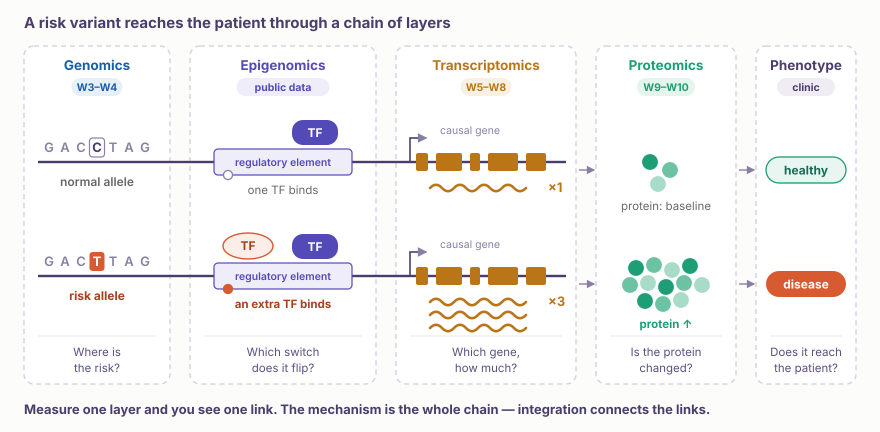
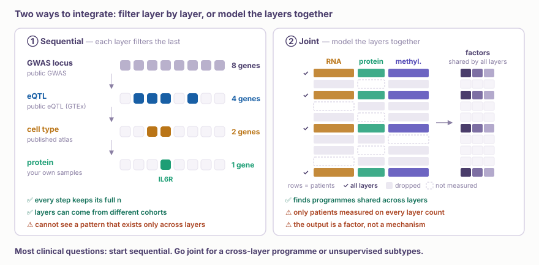
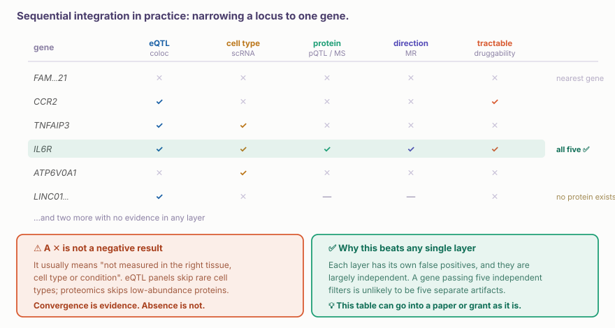
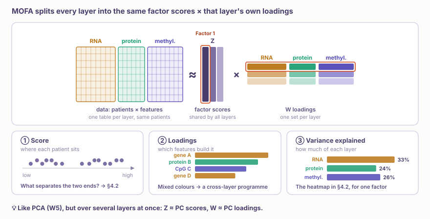
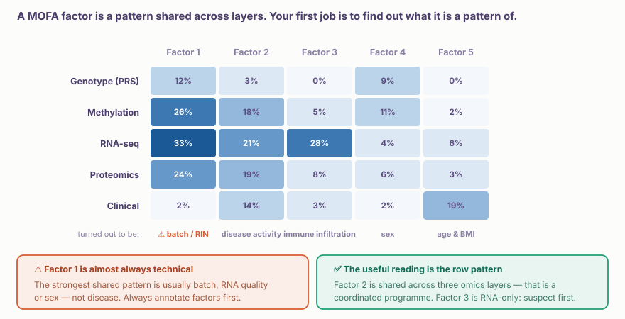
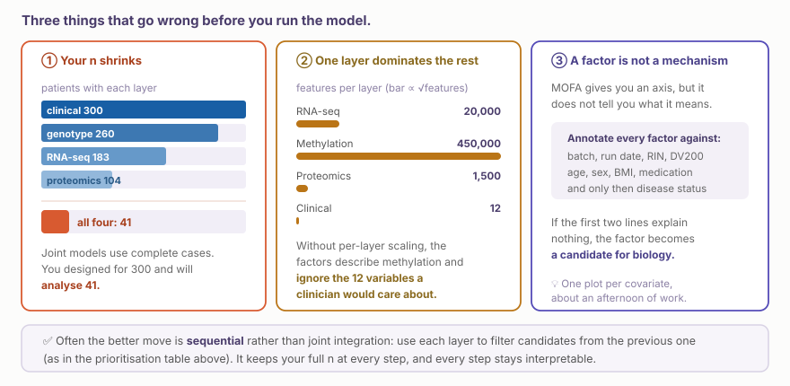

::: {.callout-note collapse="true"}
## 🎯 Learning objectives

By the end of this chapter you should be able to:

-   Explain why a single omics layer shows only part of the path from a risk variant to disease
-   Distinguish **sequential** from **joint** integration, and say which your question needs
-   Use convergent evidence across layers to narrow a locus to a single candidate gene
-   ⚠️ Say why an absent signal in one layer is not a negative result
-   Read a MOFA variance-explained plot, and ⚠️ recognise a technical factor
-   ⚠️ Anticipate the three failures that happen before any model is fitted: n collapse, scale imbalance, uninterpretable factors
-   Say what integration genuinely buys, and what it cannot manufacture
:::

> 🤔 **Motivating question**
>
> You have genotypes, RNA-seq, proteomics and clinical data on the same cohort. Should you put them all into one model?

------------------------------------------------------------------------

# 1. Why Multi-omics? 🧬 {#w11-s1}

{fig-align="center"}

As W3 showed, **about 90% of GWAS hits are non-coding** (🔗 [W3 §3.2](../part2/w3_gwas.qmd#w3-s3-2)). Most of them leave the protein sequence alone and change how a gene is **regulated**. In the figure, the risk allele leads to disease like this:

1.  **Genomics**: the risk variant sits inside a regulatory element
2.  **Epigenomics**: an extra TF binds there, so the gene is switched on more strongly. This course does not cover epigenomics; public chromatin data can show it
3.  **Transcriptomics**: the nearby causal gene makes more mRNA
4.  **Proteomics**: more protein is made
5.  **Phenotype**: disease appears

Measure one layer and you see only one of these steps.

-   **GWAS** shows **where** in the genome the risk is, but not which gene or how
-   **RNA** shows **which gene** changes and by how much, but not whether the change is a cause or a consequence of disease
-   **Protein** shows whether **the molecule that does the work** has changed, but not why
-   ⚠️ A change in one layer does not always carry over to the next: mRNA can go up while the protein stays flat (🔗 [W9 §1](../part5/w9_proteomics_tech.qmd#w9-s1))

So explaining a mechanism means **connecting** the results from several layers. W3–W10 looked at the layers one at a time; this week is about connecting them.

💡 These steps happen in order. The most natural integration therefore follows the same order and filters candidates step by step: **sequential integration** (§2.1). The columns of the table in §3 follow roughly the same order.

------------------------------------------------------------------------

# 2. Two Ways to Integrate 🧭 {#w11-s2}

{fig-align="center"}

## 1) Sequential: each layer filters the last {#w11-s2-1}

You already did this without calling it integration. W3 narrowed a locus; W5 named a cell type; W9 asked whether the protein exists. Each layer removes candidates.

-   ✅ Keeps your **full n** at every step, because each analysis uses only the samples that have that layer
-   ✅ Every step can be interpreted on its own and is easy to justify in the Methods
-   ✅ Layers can come from **different cohorts**: public eQTL data, a published atlas, your own samples
-   ⚠️ Cannot find a pattern that shows up only when the layers are looked at *together*

## 2) Joint: model the layers together {#w11-s2-2}

**MOFA+**, **mixOmics/DIABLO**, **iCluster** and similar methods find latent factors that explain variance across several layers at once.

-   ✅ Can find programmes that move together across layers, which no single layer shows
-   ✅ Unsupervised, so it can find structure you did not ask about (patient subtypes)
-   ⚠️ Needs the **same samples** measured on every layer
-   ⚠️ Output is a factor, not a mechanism

💡 **Answer to the motivating question:** usually **no, not first**. Sequential prioritisation answers most clinical questions, keeps your n, and produces a figure a reviewer can follow. Use joint modelling when you have a reason to suspect a programme that spans layers, or when you want unsupervised patient subtypes.

------------------------------------------------------------------------

# 3. Sequential Integration in Practice 🎯 {#w11-s3}

{fig-align="center"}

## 1) Why convergence is strong evidence {#w11-s3-1}

Each layer has its own false positives, and they are largely **independent**: an eQTL colocalisation artifact has nothing to do with a proteomics artifact. So a gene that passes five independent filters is unlikely to have passed all five by chance.

## 2) ⚠️ No signal is not a negative result {#w11-s3-2}

::: {.callout-important collapse="true"}
## A ✓ and a ✕ do not carry the same weight

A ✕ in one column almost always means **"not measured in the right context"**, not "measured and absent".

-   ⚠️ eQTL panels come from bulk tissue, so effects confined to a rare cell type are invisible
-   ⚠️ Plasma proteomics misses low-abundance proteins entirely (🔗 [W9 §5](../part5/w9_proteomics_tech.qmd#w9-s5))
-   ⚠️ Some genes have no protein product to measure
-   ⚠️ MR needs a strong instrument; a gene without one cannot be tested, which is not the same as being tested and failing

✅ Report convergence as positive evidence, and report each gap as a **coverage limitation** in one sentence of the results.

⚠️ This also creates a bias: prioritisation pipelines tend to pick **genes that are already well measured and well studied**. The same bias returns in [W12](w12_network_drug.qmd) as network hubs.
:::

------------------------------------------------------------------------

# 4. Joint Models: Reading the Output 📐 {#w11-s4}

## 1) What a factor is {#w11-s4-1}

{fig-align="center"}

A factor is a latent axis along which samples vary. Its **loadings** say which features, in which layers, build that axis. The variance explained plot shows how much of each layer each factor accounts for.

💡 It is close to running PCA (🔗 [W5 §3.4](../part3/w5_scrna_qc.qmd#w5-s3-4)) on several layers at once. The factor score corresponds to the PC score, and the loadings to the PC loadings. The difference is that every layer shares the same scores, while each layer has its own loadings.

## 2) ⚠️ Annotate factors before interpreting them {#w11-s4-2}

{fig-align="center"}

::: {.callout-warning collapse="true"}
## Factor 1 is almost always technical

The strongest shared source of variation in a real cohort is rarely disease. It is batch, RNA integrity, sex, or age.

✅ The annotation routine, in order:

1.  **Technical**: batch, run date, RIN/DV200, operator, storage time
2.  **Demographic**: age, sex, BMI, ancestry
3.  **Clinical confounders**: medication, comorbidity, disease duration
4.  **Only then**: disease status or outcome

⚠️ If a factor correlates with batch at r = 0.8 and with disease at r = 0.3, it is a batch factor that happens to be slightly confounded with disease. Reporting it as a "disease signature" is a real and common error.

💡 A factor that loads across **several** layers is more likely to be biological than one confined to a single layer, but only after steps 1–3 come back empty.
:::

------------------------------------------------------------------------

# 5. ⚠️ Three Failures Before You Run the Model 🕳️ {#w11-s5}

{fig-align="center"}

**① Your n shrinks.** Joint models use only complete cases, the patients measured on every layer. A cohort of 300 with four layers may have 41 patients measured on all four, and 41 is then your real sample size.

-   ✅ Check the intersection **before** planning the analysis
-   ✅ Some methods handle missing views; using one is a decision to state, not a default

**② Scale imbalance.** Methylation contributes 450,000 features and your clinical variables contribute 12. Without per-layer scaling, the factors end up describing methylation.

**③ The factor is not a mechanism.** See §4.2.

::: {.callout-tip collapse="true"}
## What integration cannot do

-   ❌ It cannot create power. Four noisy layers on 41 patients are weaker than one good layer on 300
-   ❌ It cannot fix confounding. If batch overlaps with disease, every layer carries that confounding, and the joint model only gathers it into one factor
-   ❌ It cannot make an underpowered study publishable. Reviewers quickly notice when integration is used to make up for a small n

✅ What integration does give you is two things: **coordination across layers** that no other method shows, and **unsupervised subtypes** you did not know to look for.
:::

------------------------------------------------------------------------

# 6. Hands-On 💻 {#w11-s6}

## 1) Build a prioritisation table {#w11-s6-1}

Take one locus for a disease you treat, and fill in the table from §3 by hand, in the browser:

-   **eQTL / locus-to-gene**: [Open Targets Platform](https://platform.opentargets.org) (formerly Open Targets Genetics) or [GTEx](https://gtexportal.org)
-   **Cell type**: [CELLxGENE](https://cellxgene.cziscience.com)
-   **Protein**: [Human Protein Atlas](https://www.proteinatlas.org)
-   **Direction**: [IEU OpenGWAS](https://opengwas.io) for MR results
-   **Tractability**: [Open Targets](https://platform.opentargets.org) target profile

✅ One row per candidate gene, one column per layer. It takes about an afternoon, and the table can go into a paper as a figure.

## 2) Check the intersection first {#w11-s6-2}

::: {.panel-tabset group="lang"}

### R

```{r}
library(tidyverse); library(UpSetR)

# toy cohort (illustration only): 200 patients, each layer measured in some of them
set.seed(1)
meta <- tibble(patient = sprintf("P%03d", 1:200),
               geno_id = ifelse(runif(200) < 0.90, patient, NA),
               rna_id  = ifelse(runif(200) < 0.60, patient, NA),
               prot_id = ifelse(runif(200) < 0.45, patient, NA))

have <- meta |> transmute(
  clinical   = 1L,
  genotype   = as.integer(!is.na(geno_id)),
  rna        = as.integer(!is.na(rna_id)),
  proteomics = as.integer(!is.na(prot_id)))

upset(as.data.frame(have), order.by = "freq")
cat("complete cases:", sum(rowSums(have) == ncol(have)), "\n")   # ⚠️ this is your n
```

### Python

```{python}
import numpy as np, pandas as pd, matplotlib.pyplot as plt
from upsetplot import UpSet, from_indicators

# toy cohort (illustration only): 200 patients, each layer measured in some of them
rng = np.random.default_rng(1)
patient = [f"P{i:03d}" for i in range(1, 201)]
meta = pd.DataFrame({"patient": patient,
                     "geno_id": np.where(rng.random(200) < 0.90, patient, None),
                     "rna_id":  np.where(rng.random(200) < 0.60, patient, None),
                     "prot_id": np.where(rng.random(200) < 0.45, patient, None)})

have = pd.DataFrame({"clinical":   True,
                     "genotype":   meta.geno_id.notna(),
                     "rna":        meta.rna_id.notna(),
                     "proteomics": meta.prot_id.notna()})

_ = UpSet(from_indicators(have), subset_size="count", sort_by="cardinality").plot()
plt.show()
print("complete cases:", have.all(axis=1).sum())   # ⚠️ this is your n
```

:::

## 3) MOFA, and how to annotate its factors {#w11-s6-3}

::: {.panel-tabset group="lang"}

### R

```{r}
library(MOFA2)

# toy layers (illustration only): 60 samples × 3 omics, features × samples;
# a batch effect runs through RNA and protein, a weaker case effect through all three
set.seed(2)
n <- 60
meta <- tibble(sample = sprintf("S%02d", 1:n), batch = rep(c("B1", "B2"), each = n / 2),
               RIN = round(runif(n, 5, 9), 1), age = round(rnorm(n, 60, 10)),
               sex = sample(c("F", "M"), n, replace = TRUE), bmi = round(rnorm(n, 25, 4), 1),
               condition = sample(c("control", "case"), n, replace = TRUE))
layer <- function(p, prefix, batch_shift, case_shift) {
  m <- matrix(rnorm(p * n), p, n, dimnames = list(paste0(prefix, 1:p), meta$sample))
  b <- 1:(p / 5); k <- p / 5 + 1:(p / 10)
  m[b, ] <- m[b, ] + rep(batch_shift * (meta$batch == "B2"), each = length(b))
  m[k, ] <- m[k, ] + rep(case_shift * (meta$condition == "case"), each = length(k))
  m
}
rna_mat <- layer(500, "gene_", 2, 1); prot_mat <- layer(200, "prot_", 1.5, 1); meth_mat <- layer(300, "cpg_", 0, 0.8)

mofa <- create_mofa(list(RNA = rna_mat, Protein = prot_mat, Methyl = meth_mat)) |>
  prepare_mofa() |> run_mofa()

plot_variance_explained(mofa)          # the figure above

# ⚠️ the step that must come next
Z <- get_factors(mofa)[[1]]
covars <- meta |> select(batch, RIN, age, sex, bmi, condition)

cors <- sapply(covars, \(v) apply(Z, 2, \(f) {
  if (is.numeric(v)) abs(cor(f, v, use = "pairwise")) else summary(aov(f ~ factor(v)))[[1]][1, "F value"]
}))
round(cors, 2)     # look here before you look at biology
```

### Python

```{python}
from scipy.stats import f_oneway
from mofapy2.run.entry_point import entry_point

# toy layers (illustration only): 60 samples × 3 omics, samples × features;
# a batch effect runs through RNA and protein, a weaker case effect through all three
rng = np.random.default_rng(2)
n = 60
meta = pd.DataFrame({"sample": [f"S{i:02d}" for i in range(1, n + 1)], "batch": np.repeat(["B1", "B2"], n // 2),
                     "RIN": rng.uniform(5, 9, n).round(1), "age": rng.normal(60, 10, n).round(),
                     "sex": rng.choice(["F", "M"], n), "bmi": rng.normal(25, 4, n).round(1),
                     "condition": rng.choice(["control", "case"], n)})
def layer(p, batch_shift, case_shift):
    m = rng.normal(size=(n, p))
    m[:, : p // 5] += batch_shift * (meta.batch == "B2").to_numpy()[:, None]
    m[:, p // 5 : p // 5 + p // 10] += case_shift * (meta.condition == "case").to_numpy()[:, None]
    return m
views = {"RNA": layer(500, 2, 1), "Protein": layer(200, 1.5, 1), "Methyl": layer(300, 0, 0.8)}

ent = entry_point()
ent.set_data_matrix([[v] for v in views.values()], views_names=list(views))
ent.set_model_options(factors=15)                  # MOFA2's default in R
ent.set_train_options(seed=1, quiet=True)
ent.build(); ent.run()

r2 = pd.DataFrame(ent.model.calculate_variance_explained()[0] * 100, index=list(views))
r2.columns = [f"Factor{k + 1}" for k in r2.columns]
fig, ax = plt.subplots(figsize=(8, 2.5))
im = ax.imshow(r2, cmap="Purples", aspect="auto")
ax.set_xticks(range(r2.shape[1]), r2.columns, rotation=90); ax.set_yticks(range(len(views)), r2.index)
_ = fig.colorbar(im, label="variance explained (%)")
plt.show()

# ⚠️ the step that must come next
Z = pd.DataFrame(ent.model.nodes["Z"].getExpectation(), columns=r2.columns)
covars = meta[["batch", "RIN", "age", "sex", "bmi", "condition"]]

cors = pd.DataFrame({name: [abs(np.corrcoef(Z[f], v)[0, 1]) if pd.api.types.is_numeric_dtype(v)
                            else f_oneway(*(Z[f][v == g] for g in v.unique())).statistic
                            for f in Z] for name, v in covars.items()}, index=Z.columns)
cors.round(2)     # look here before you look at biology
```

:::

## 4) ✅ Change one thing {#w11-s6-4}

::: {.panel-tabset group="lang"}

### R

```{r}
# Re-run MOFA with the batch effect removed from each layer first.
# Does Factor 1 disappear? Does anything else change rank?
```

### Python

```{python}
# Re-run MOFA with the batch effect removed from each layer first.
# Does Factor 1 disappear? Does anything else change rank?
```

:::

💡 If removing batch reshuffles your factors, that tells you how much of the original result was batch. That number is worth knowing before it appears in review.

## 5) Before next week {#w11-s6-5}

**[W12: networks and drug targets](w12_network_drug.qmd).** Bring the prioritisation table from §6.1. We will ask whether the surviving gene is druggable.

------------------------------------------------------------------------

# 📝 Summary

-   Most GWAS hits are non-coding, so risk is passed on **in order**: regulation → RNA → protein → phenotype. One layer shows only one of these steps
-   **Sequential** integration filters candidates layer by layer; **joint** integration models layers together
-   ✅ Sequential keeps your full n, works across cohorts, and answers most clinical questions
-   ✅ Convergent evidence across layers is strong because each layer's false positives are **independent**
-   ⚠️ **An absent signal is a coverage gap, not a negative result.** It also biases prioritisation toward well-studied genes
-   ⚠️ **Factor 1 is almost always technical.** Annotate against batch, RIN, age and sex *before* disease
-   ⚠️ Joint models use complete cases, so **your n is the intersection**, not the cohort
-   ⚠️ Without per-layer scaling, the layer with most features dominates every factor
-   ❌ Integration cannot create power, fix confounding, or rescue an underpowered study

------------------------------------------------------------------------

# 🔑 Key terms

| Term | One-line meaning |
|-------------------------|-----------------------------------------|
| Regulatory element | A stretch of DNA (promoter, enhancer) that controls a gene's expression; where TFs bind |
| Sequential integration | Each layer filters candidates from the previous one |
| Joint integration | Modelling several layers simultaneously |
| Latent factor | An axis of variation shared across layers |
| Loadings | Which features drive a factor, per layer |
| Variance explained | How much of each layer a factor accounts for |
| MOFA+ | Unsupervised multi-omics factor analysis |
| DIABLO / mixOmics | Supervised multi-omics discriminant analysis |
| Complete case | A sample measured on every layer |
| Per-layer scaling | Preventing the largest layer from dominating |
| Convergent evidence | Independent layers pointing at the same gene |
| Coverage gap | A layer that could not have detected the signal |

------------------------------------------------------------------------

# ➕ References

### Methods

Argelaguet R, et al. [*MOFA+: a statistical framework for comprehensive integration of multi-modal single-cell data.*](https://doi.org/10.1186/s13059-020-02015-1) Genome Biol. 2020.\
Argelaguet R, et al. [*Multi-Omics Factor Analysis — a framework for unsupervised integration of multi-omics data sets.*](https://doi.org/10.15252/msb.20178124) Mol Syst Biol. 2018.\
Singh A, et al. [*DIABLO: an integrative approach for identifying key molecular drivers from multi-omics assays.*](https://doi.org/10.1093/bioinformatics/bty1054) Bioinformatics. 2019.

### Perspective and pitfalls

Argelaguet R, Cuomo ASE, Stegle O, Marioni JC. [*Computational principles and challenges in single-cell data integration.*](https://doi.org/10.1038/s41587-021-00895-7) Nat Biotechnol. 2021.\
Vasaikar SV, et al. [*LinkedOmics: analyzing multi-omics data within and across 32 cancer types.*](https://doi.org/10.1093/nar/gkx1090) Nucleic Acids Res. 2018.\
Subramanian I, et al. [*Multi-omics data integration, interpretation, and its application.*](https://doi.org/10.1177/1177932219899051) Bioinform Biol Insights. 2020.

### Gene prioritisation

Mountjoy E, et al. [*An open approach to systematically prioritize causal variants and genes at all published human GWAS trait-associated loci.*](https://doi.org/10.1038/s41588-021-00945-5) Nat Genet. 2021. (Open Targets Genetics locus-to-gene)\
Ochoa D, et al. [*The next-generation Open Targets Platform.*](https://doi.org/10.1093/nar/gkac1046) Nucleic Acids Res. 2023.
