::: {.callout-note collapse="true"}
## 🎯 Learning objectives

By the end of this chapter you should be able to:

-   Explain nodes, edges and degree, and tell the types of graph apart (directed, weighted, signed, bipartite)
-   Say whether a biological network was measured or built by a rule, and ⚠️ how that construction biases the results
-   Explain what degree, paths, centrality and modules each measure
-   ⚠️ Recognise the study-bias artifact behind most "hub gene" findings
-   Compare the three routes to drug repurposing, and say what each is worth as evidence
-   ⚠️ Read the direction of effect from an MR result, and explain why it decides inhibitor versus activator
-   Work through six questions that separate a top-ranked gene from an actual target
-   Use PheWAS and loss-of-function carriers as a free safety readout
:::

> 🤔 **Motivating question**
>
> A network analysis of your disease reports TP53, EGFR and AKT1 as the key regulators. How surprised should you be?

------------------------------------------------------------------------

# 1. Network Basics 🕸️ {#w12-s1}

## 1) Network and graph: nodes and edges {#w12-s1-1}

-   **Network**: relationships that exist in the world. Proteins that bind each other, an enzyme that phosphorylates its substrate, cells that touch
-   **Graph**: the mathematical record of those relationships. It has only two parts, **nodes** (points) and **edges** (lines)
    -   Node: the things. Genes, proteins, cells, patients, drugs
    -   Edge: a relationship between two of them. Binding, regulation, correlation, similarity
    -   **Degree**: the number of edges at a node

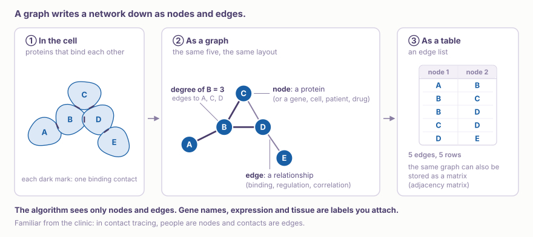{fig-align="center"}

💡 A graph does not know what its nodes are. Gene names, expression values and tissue are labels you attach to it.

-   ✅ That is why an algorithm written for friendship networks runs unchanged on a protein network
-   ⚠️ It is also why an algorithm will find hubs and modules without complaint in a network built from noise

## 2) Types of graph {#w12-s1-2}

Graphs differ by what their edges carry.

| Type | What the edge carries | Biological example |
|------------------|---------------------------|---------------------------|
| Undirected | Only that two nodes are linked. A–B is the same as B–A | PPI: two proteins bind |
| Directed | A direction. A → B is not B → A | Transcription factor → target gene, kinase → substrate |
| Weighted | A number (strength, confidence) | STRING score, correlation |
| Signed | + or − | Activation vs inhibition in signalling |
| Bipartite | Links between two kinds of node | Drug–target, gene–pathway, patient–diagnosis |

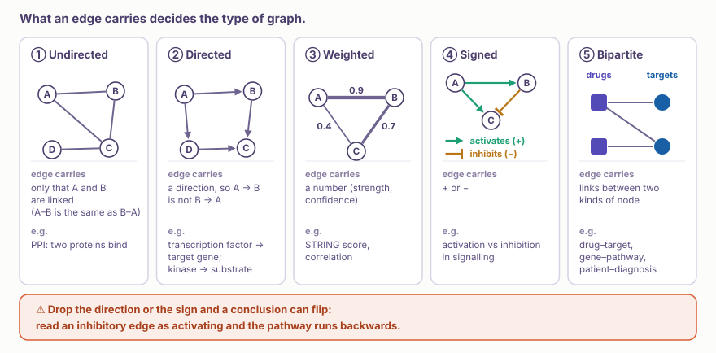{fig-align="center"}

-   ⚠️ Drop the direction or the sign and a conclusion can flip. Read an inhibitory edge as activating and you interpret the pathway backwards
-   💡 Drug repurposing in §2 joins a bipartite graph (drug–target) onto a PPI graph

## 3) Biological graphs {#w12-s1-3}

Biological networks differ by where their edges come from.

-   **Measured edges**: an experiment saw the relationship
    -   Protein–protein interactions (PPI): yeast two-hybrid, affinity purification–mass spectrometry. Undirected
    -   Signalling and metabolic pathways: directed and signed (Reactome, KEGG, OmniPath)
    -   ⚠️ STRING scores also mix in text-mining of the literature and prediction. "High confidence" does not mean "observed in an experiment"
-   **Edges built by a rule**: computed from data with a rule you chose
    -   Co-expression network: an edge when two genes' correlation passes a threshold (WGCNA)
    -   Single-cell kNN graph: each cell linked to its k nearest cells (🔗 [W5 §4.1](../part3/w5_scrna_qc.qmd#w5-s4-1))
    -   Spatial neighbour graph: spots or cells that sit close together in the tissue (🔗 [W7 §4.4](../part4/w7_spatial_basics.qmd#w7-s4-4))
-   **Knowledge graph**: genes, drugs, diseases and phenotypes as nodes; "treats", "causes" and "binds" as edges. It is assembled from the literature and databases, so it inherits the study bias of §1.6

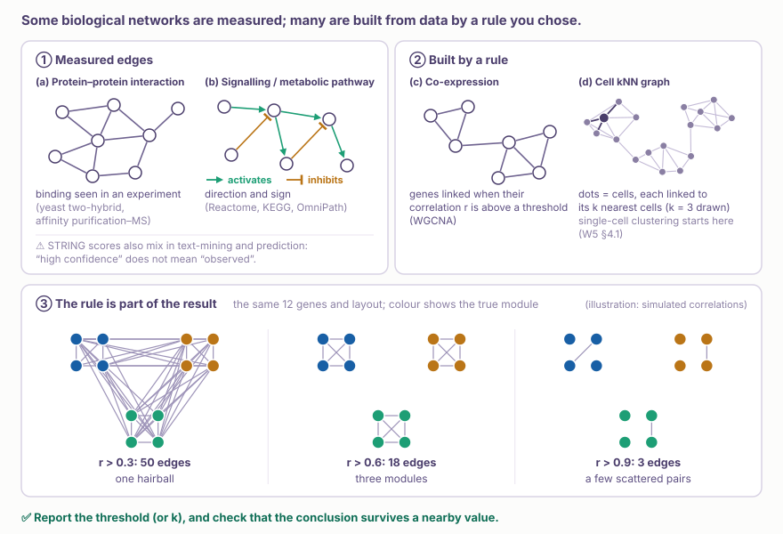{fig-align="center"}

⚠️ A network built by a rule changes shape completely with its threshold (the correlation cut-off, k). Yet everything downstream runs with the same tools as for a measured network, and no step tells you that an edge came from a number you picked.

✅ Report the threshold, and check that the conclusion holds at a nearby value.

## 4) Quantifying a network: degree, connectivity, centrality {#w12-s1-4}

-   **Degree**: the number of edges at a node. The simplest measure, and the most used
    -   In biological networks degree is very uneven. Most nodes have a few edges; a few nodes have very many
    -   ⚠️ So a single average degree hides that difference
-   **Connectivity**
    -   **Path**: a route from one node to another along edges. **Distance** is the number of edges on the shortest path
    -   **Connected component**: a set of nodes that can all reach each other. Distances and centralities are usually computed only inside the largest one (the giant component)
-   **Centrality**: a number for how important a node is. There are several definitions
    -   **Degree centrality**: how many neighbours. A high value makes a **hub**
    -   **Betweenness**: how often the shortest paths between other nodes pass through this one. A high value makes a **bottleneck**, such as the only link between two groups
    -   **Closeness**: how short the average distance to every other node is

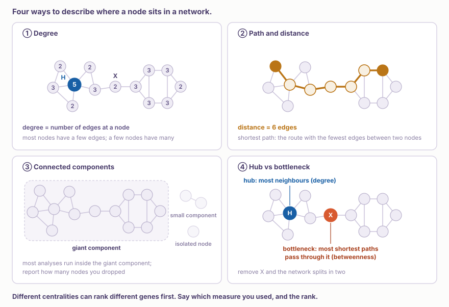{fig-align="center"}

-   ⚠️ Each centrality can put a different gene first. Hubs and bottlenecks are often different genes
-   ✅ Do not write just "hub gene" in a paper: say which centrality, and which rank

## 5) Community, module, hub {#w12-s1-5}

-   **Community (module)**: a set of nodes densely linked to each other and sparsely linked to the rest
    -   In biology: a protein complex, a pathway, a group of genes that move together
    -   Found with Louvain or Leiden, the method used to cluster cells in 🔗 [W5 §4.2](../part3/w5_scrna_qc.qmd#w5-s4-2). There the nodes were cells
-   **Module hub**: the most connected node inside a module. WGCNA's "hub gene" is this
-   **Connector**: a node with links into several modules, a position similar to the bottleneck in 4)

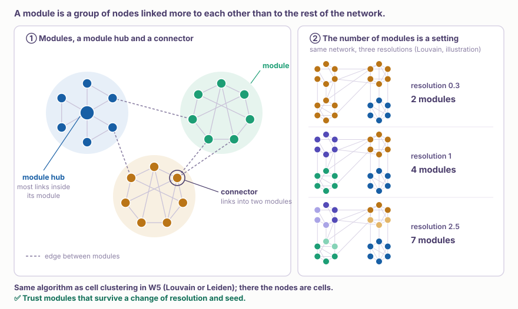{fig-align="center"}

-   ⚠️ The **resolution** setting decides how many modules you get, and there is no statistically correct value. So trust only modules that survive a change of resolution and seed
-   💡 A module is a more stable result than a single gene: measurement noise is spread over many genes, and the result reads as "which process changed"

## 6) ⚠️ The bias, and what networks are still good for {#w12-s1-6}

A protein–protein interaction network (PPI network) is an accumulation of **published experiments**. STRING, BioGRID and IntAct are curated literature, plus predictions trained on that literature.

Experiments concentrate on genes people already study. So node degree tracks **publication count**.

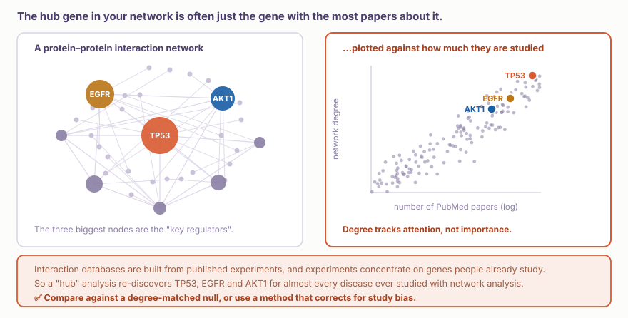{fig-align="center"}

::: {.callout-important collapse="true"}
## The answer to the motivating question is: not at all surprised

TP53, EGFR and AKT1 come out as hubs for nearly every disease that has ever been studied with network analysis. They have tens of thousands of papers each, so they have edges to everything.

⚠️ Concretely, this means:

-   "Hub" analyses rediscover the same genes regardless of your data
-   **Network proximity** scores favour well-studied drugs and well-studied targets
-   Genes with no publications have **degree ≈ 0** and can never be prioritised, however important

✅ What to do:

-   Compare against a **degree-matched null**: permute while preserving each node's degree, so "well-connected" stops being an automatic win
-   Prefer networks built from a **single systematic experiment** (a proteomics interactome, a CRISPR screen) over literature aggregates, where you can
-   ✅ Report degree alongside any hub claim, and let the reader see it
:::

What networks are still good for:

-   ✅ **Modules**: a set of genes that interact more than expected, which gives a process-level rather than gene-level result
-   ✅ **Connecting your hits**: do your 40 GWAS loci converge on a pathway?
-   ✅ **Suggesting a mechanism** for a gene of unknown function, from its neighbours
-   ⚠️ Always as a hypothesis. The edges are other people's experiments, not yours

------------------------------------------------------------------------

# 2. From Gene to Drug 💊 {#w12-s2}

There are three routes from your gene to an existing drug, and they give very different levels of evidence.

| Route | The question it asks | Evidence |
|------------------|-----------------------------------|------------------|
| 1) Genetic support | Does human genetics point to this target as a cause of the disease? | ✅ The strongest |
| 2) Signature reversal | Is there a drug that pushes the disease's expression changes the other way? | ⚠️ A candidate list |
| 3) Network proximity | Is the drug's target close to the disease genes? | ⚠️ A candidate list, and it needs bias correction |

## 1) Genetic support {#w12-s2-1}

Targets with human genetic support are roughly **twice as likely** to succeed through clinical development. The mechanism is simple: a variant that alters the target is assigned at conception, so it is a natural, lifelong, randomised experiment in humans. This is the Mendelian randomization argument from 🔗 [W3 §3.2](../part2/w3_gwas.qmd#w3-s3-2).

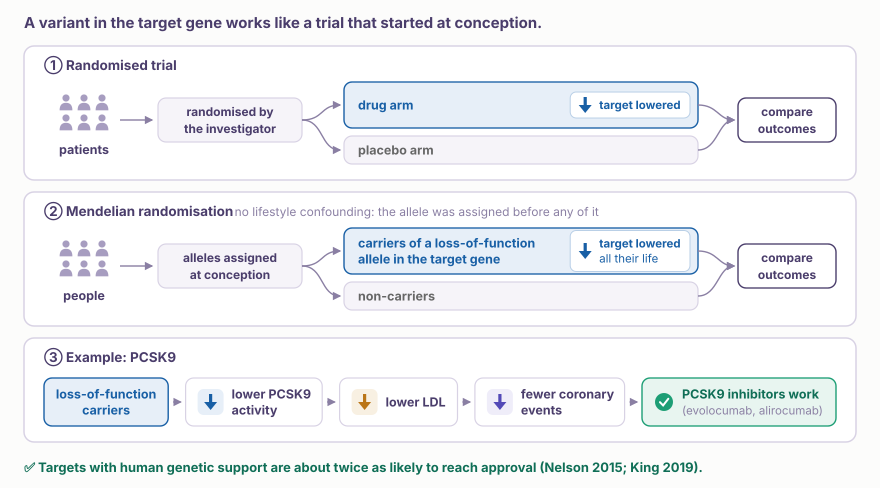{fig-align="center"}

-   **PCSK9**: loss-of-function carriers have low LDL and low cardiovascular risk, so inhibitors (evolocumab, alirocumab) work
-   **IL6R**: a variant mimicking IL-6 blockade associates with lower CHD risk, which supports tocilizumab's cardiovascular signal

::: {.callout-warning collapse="false"}
## Direction of effect: the mistake with the worst consequences in this course

If the risk allele **increases** target activity, you want an inhibitor. If it **decreases** it, the target may be protective, and inhibiting it would make patients worse. What you need then is a drug that raises its activity (an agonist or activator), or replacement.

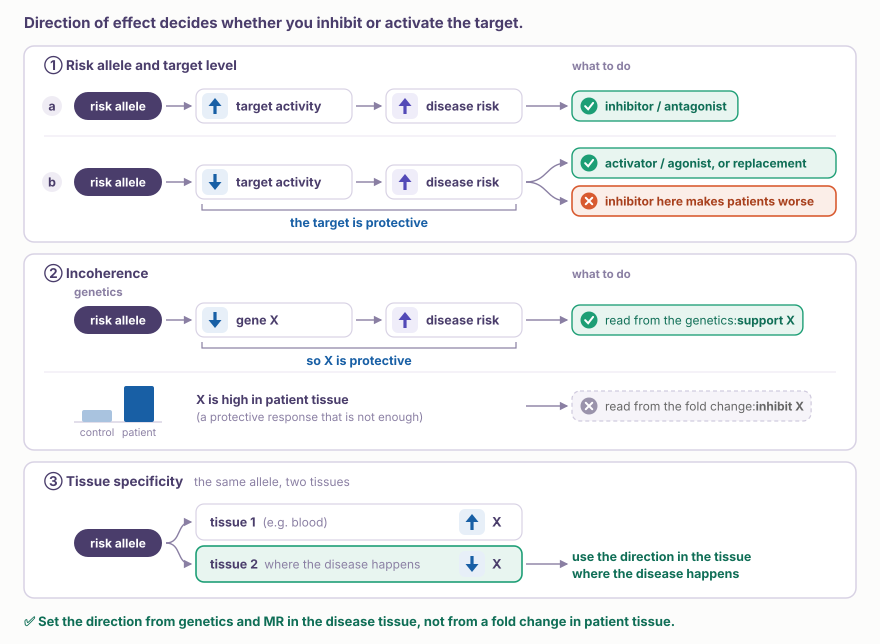{fig-align="center"}

Two complications:

-   ⚠️ **Incoherence.** A risk allele can down-regulate a gene that appears up-regulated in patients. Often that is an impaired protective response, and the therapeutic direction is the opposite of what the expression data suggests
-   ⚠️ **Tissue-specificity.** Direction can differ between tissues. The relevant tissue is the one where the disease process happens (🔗 [W5](../part3/w5_scrna_qc.qmd), 🔗 [W7](../part4/w7_spatial_basics.qmd))

✅ Establish direction from **genetics plus MR**, not from a fold change in patient tissue.
:::

::: {.callout-tip collapse="true"}
## Reading an MR result for direction

An MR result is usually reported as the odds ratio for the disease per unit (or per SD) change in the exposure. To get a direction from it, read it in three steps.

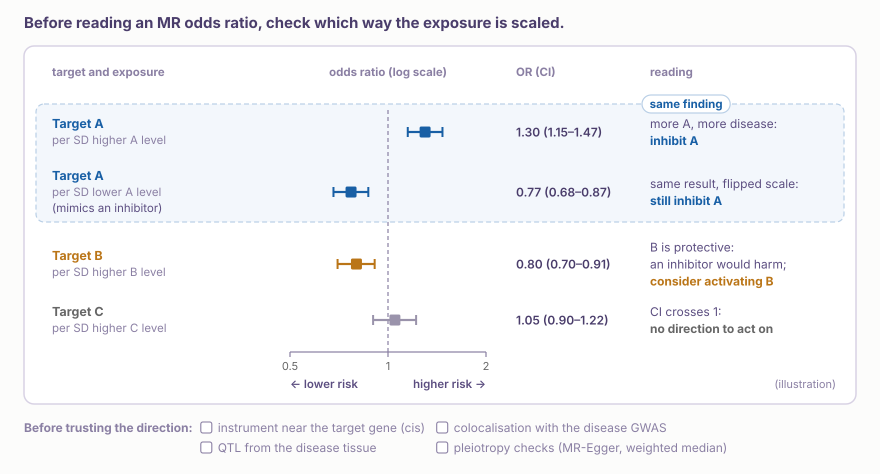{fig-align="center"}

1.  **First check which way the exposure is defined**
    -   Is it a "genetically predicted **higher** target level", or "variants that mimic **inhibiting** the target" (common in drug-target MR)?
    -   ⚠️ The two have opposite signs. The same finding can be reported as OR 1.30 or as OR 0.77
2.  **Translate the OR into a drug direction** (for an exposure defined as a higher level)
    -   OR above 1: more target, more disease. A candidate for an inhibitor
    -   OR below 1: the target is protective. An inhibitor could harm; an activator is the candidate
    -   Confidence interval includes 1: no basis for a direction
3.  **Check before you trust it**
    -   Is the instrument a variant near the target gene (cis)? A distant (trans) variant can act on the disease through another route
    -   Do the target's eQTL or pQTL and the disease GWAS share the same causal variant (colocalisation, 🔗 [W3 §3.2](../part2/w3_gwas.qmd#w3-s3-2))?
    -   Was the QTL measured in the tissue where the disease happens (tissue-specificity)?
    -   Pleiotropy checks (MR-Egger, weighted median)
:::

## 2) Signature reversal {#w12-s2-2}

Look for a drug whose expression changes run opposite to the disease signature.

-   **Disease signature**: the genes that go up and down in patients compared with controls
-   **Drug signature**: the expression changes measured after treating a cell line with the drug. CMap and LINCS (L1000) hold profiles for thousands of drugs
-   Comparing the two gives a score (the connectivity score)
    -   Negative: the drug lowers the genes that are up in disease and raises those that are down. A candidate
    -   Positive: the drug moves genes the same way as the disease. It could make the disease worse

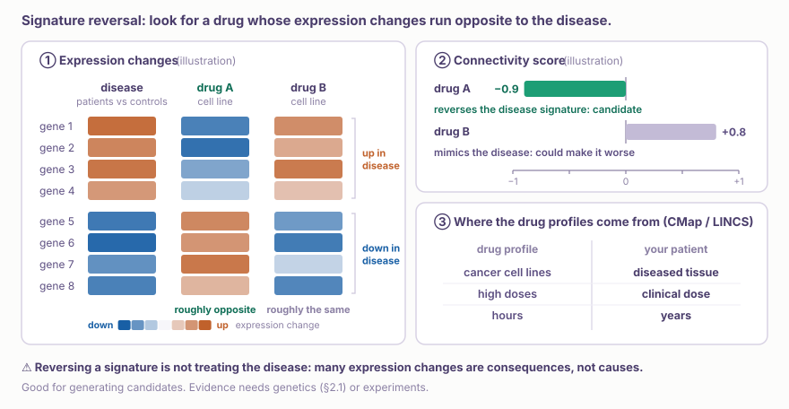{fig-align="center"}

⚠️ Limits:

-   The reference profiles come from **cell lines**, usually at **high doses for a few hours**. That is not your patient's tissue, dose or treatment duration
-   Reversing expression is not the same as treating the disease. Many expression changes are consequences of the disease, not causes (🔗 [W11 §1](w11_multiomics.qmd#w11-s1))

✅ Useful for generating candidates. To count as evidence, a candidate needs the genetic support of 1) or experiments.

## 3) Network proximity {#w12-s2-3}

Measure how close a drug's targets sit to the disease genes in the network.

-   Distance is the shortest-path length from §1.4. A common version takes, for each target, the distance to the nearest disease gene, and averages (Guney et al., 2016)
-   The closer the targets, the more likely the drug is taken to affect the disease process

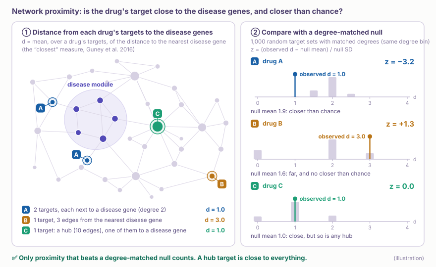{fig-align="center"}

-   ⚠️ The study bias from §1.6 comes straight in. A drug that targets a hub is close to every disease
-   ✅ So compare the observed distance with a **degree-matched null**. Measure the distance again thousands of times with random genes of the same degree as the real targets, and see how far the observed value sits from that distribution (a z-score). In §4.3 you do the same with degree-preserving rewiring

💡 One question none of the three routes can answer: is this drug tolerable in this population, at a dose that reaches this tissue, for as long as this disease would need? That judgement is the clinician's.

------------------------------------------------------------------------

# 3. Six Questions Before Calling It a Target ✅ {#w12-s3}

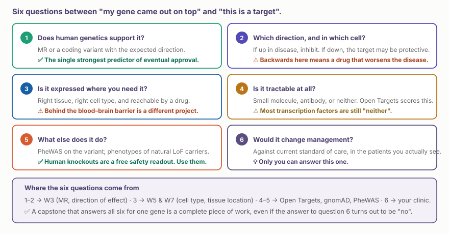{fig-align="center"}

::: {.callout-tip collapse="true"}
## Question 5 in more detail: humans have already run your safety study

People carrying natural loss-of-function variants in your target are a preview of what inhibiting it does over a lifetime.

-   ✅ **gnomAD**: how many LoF carriers exist? Is the gene depleted of them (a **LOEUF** near 0 means intolerant, and probably a poor target)?
-   ✅ **PheWAS** on the variant: what else changes? Those are your predictable side effects
-   ✅ Human knockouts, where they exist, are the strongest signal available short of a trial

⚠️ A gene that is highly intolerant to loss of function is a warning sign. Inhibiting it is likely to have consequences beyond the disease.
:::

------------------------------------------------------------------------

# 4. Hands-On 💻 {#w12-s4}

Bring the prioritisation table from 🔗 [W11 §6.1](w11_multiomics.qmd#w11-s6-1).

## 1) No code: profile your surviving gene {#w12-s4-1}

[**Open Targets**](https://platform.opentargets.org) → your gene → its target profile.

-   ① **Tractability**: small molecule? antibody? Which clinical phase, for any indication?
-   ② **Safety**: any flagged organ toxicity?
-   ③ **Known drugs**: is something already approved against it, for anything?
-   ④ [**gnomAD**](https://gnomad.broadinstitute.org) → **LOEUF**. Is the gene tolerant of loss of function?
-   ⑤ [**Open Targets**](https://platform.opentargets.org) → the lead variant's page → the other traits it is associated with (a PheWAS). What else does it affect?

✅ Write the answers as five sentences. That is §3's checklist, done.

## 2) Build a small network, then check yourself {#w12-s4-2}

::: {.panel-tabset group="lang"}

### R

```{r}
library(STRINGdb); library(igraph); library(tidyverse)

# toy gene list (illustration only): the default list in scripts/download_public_data.R
my_genes <- c("TP53", "EGFR", "AKT1", "TNF", "IL6", "MYC", "VEGFA", "STAT3", "MTOR", "CTNNB1",
              "IL6R", "PCSK9", "TCF7L2", "PPARG", "SCN5A", "IL23R", "RANKL", "HMGCR", "ESR1", "DRD2",
              "TMEM175", "FAM210B", "CCDC91", "ZNF385D", "RNF130", "TTC39B", "ANKRD55", "SPPL3",
              "CCDC92", "MAP3K11", "TMEM258", "RASIP1")

sdb <- STRINGdb$new(version = "12", species = 9606, score_threshold = 700)
mapped <- sdb$map(data.frame(gene = my_genes), "gene", removeUnmappedRows = TRUE)
g <- sdb$get_subnetwork(mapped$STRING_id) |> igraph::simplify()
V(g)$name <- mapped$gene[match(V(g)$name, mapped$STRING_id)]   # STRING ids → gene symbols

deg <- sort(degree(g), decreasing = TRUE)
head(deg, 10)
```

### Python

```{python}
import io, requests, numpy as np, pandas as pd, igraph as ig

# toy gene list (illustration only): the default list in scripts/download_public_data.R
my_genes = ["TP53", "EGFR", "AKT1", "TNF", "IL6", "MYC", "VEGFA", "STAT3", "MTOR", "CTNNB1",
            "IL6R", "PCSK9", "TCF7L2", "PPARG", "SCN5A", "IL23R", "RANKL", "HMGCR", "ESR1", "DRD2",
            "TMEM175", "FAM210B", "CCDC91", "ZNF385D", "RNF130", "TTC39B", "ANKRD55", "SPPL3",
            "CCDC92", "MAP3K11", "TMEM258", "RASIP1"]

# STRING v12, high-confidence edges (score ≥ 700), from the STRING API
r = requests.post("https://string-db.org/api/tsv/network",
                  data={"identifiers": "\r".join(my_genes), "species": 9606, "required_score": 700})
edges = pd.read_csv(io.StringIO(r.text), sep="\t")
g = ig.Graph.TupleList(edges[["preferredName_A", "preferredName_B"]].itertuples(index=False)).simplify()

deg = pd.Series(g.degree(), index=g.vs["name"]).sort_values(ascending=False)
deg.head(10)
```

:::

⚠️ **Now the step that is usually missing:**

::: {.panel-tabset group="lang"}

### R

```{r}
# Is your "hub" just a well-studied gene?
# Fetch PubMed counts for the same genes and correlate with degree.
# real PubMed counts — scripts/download_public_data.R fetches these
pubs <- readRDS(here::here("rawdata", "pubmed_counts.rds"))   # gene → n papers
cor(log10(pubs[names(deg)] + 1), deg, use = "complete", method = "spearman")
```

### Python

```{python}
import time
from scipy.stats import spearmanr

# Is your "hub" just a well-studied gene?
# Fetch PubMed counts for the same genes and correlate with degree.
# real PubMed counts — NCBI E-utilities, as scripts/download_public_data.R does
def pubmed_count(gene):
    r = requests.get("https://eutils.ncbi.nlm.nih.gov/entrez/eutils/esearch.fcgi",
                     params={"db": "pubmed", "term": f"{gene}[Title/Abstract]", "retmode": "json"})
    time.sleep(0.35)                                   # 3 requests/s without an API key
    return int(r.json()["esearchresult"]["count"])

pubs = pd.Series({gene: pubmed_count(gene) for gene in deg.index})   # gene → n papers
round(float(spearmanr(np.log10(pubs + 1), deg).statistic), 3)
```

:::

💡 In most literature-derived networks this correlation is strong. Report it, and your hub claim becomes credible rather than an obvious result.

## 3) A degree-matched null {#w12-s4-3}

::: {.panel-tabset group="lang"}

### R

```{r}
# toy gene sets (illustration only); the rewiring null needs one connected network
g <- largest_component(g)
disease_genes <- c("TCF7L2", "PPARG", "PCSK9", "HMGCR")
drug_targets  <- c("MTOR", "EGFR", "ESR1")

observed <- mean(distances(g, v = disease_genes, to = drug_targets))

null <- replicate(1000, {
  rw <- sample_degseq(degree(g), method = "vl")   # same degrees, rewired edges
  V(rw)$name <- V(g)$name
  mean(distances(rw, v = disease_genes, to = drug_targets))
})

cat("observed:", round(observed, 2), " null mean:", round(mean(null), 2), "\n")
```

### Python

```{python}
# toy gene sets (illustration only); the rewiring null needs one connected network
g = g.connected_components().giant()
disease_genes = ["TCF7L2", "PPARG", "PCSK9", "HMGCR"]
drug_targets  = ["MTOR", "EGFR", "ESR1"]

observed = np.mean(g.distances(source=disease_genes, target=drug_targets))

null = []
for _ in range(1000):
    rw = ig.Graph.Degree_Sequence(g.degree(), method="vl")   # same degrees, rewired edges
    rw.vs["name"] = g.vs["name"]
    null.append(np.mean(rw.distances(source=disease_genes, target=drug_targets)))

print("observed:", round(observed, 2), " null mean:", round(np.mean(null), 2))
```

:::

✅ If the observed proximity is not clearly better than the degree-matched null, you have measured popularity.

**Try it** — [Network null models: degree-preserving rewiring ↗](https://kkonoo.github.io/edu_sims/sims/network-null/?lang=en){target="_blank"}

::: {.column-page}
```{=html}
<iframe src="https://kkonoo.github.io/edu_sims/sims/network-null/?embed=1&lang=en" title="Network null models: degree-preserving rewiring" loading="lazy"
        style="width: 100%; height: 1300px; border: 0;"></iframe>
```
:::

## 4) Before next week {#w12-s4-4}

**[W13 — interpretation and visualisation](../part7/w13_visualization.qmd).** Bring **one figure** from your own work or from a paper you are reading. We will take it apart.

------------------------------------------------------------------------

# 📝 Summary

-   A graph is only nodes and edges. Edges can carry a direction, a weight or a sign, and ⚠️ dropping the direction or the sign can flip a conclusion
-   Some biological edges are measured (PPI, pathways); many are built by a rule (co-expression, kNN). ⚠️ In a built network the threshold shapes the network
-   Degree, distance and centrality measure different things. ⚠️ A hub (degree) and a bottleneck (betweenness) can be different genes
-   Modules come from Louvain or Leiden. ⚠️ Their number depends on resolution, so check that they survive other values and seeds
-   Biological networks are aggregated published experiments, so ⚠️ **node degree tracks publication count**
-   ⚠️ Hub analyses rediscover TP53, EGFR and AKT1 for almost every disease. ✅ Use a degree-matched null
-   ⚠️ Genes with no literature have degree ≈ 0 and can never be prioritised, however important
-   ✅ Networks are good for **modules**, for connecting scattered hits, and for suggesting mechanism, all as hypotheses
-   ✅ **Genetic support roughly doubles the chance a target reaches approval**. It is the strongest evidence class available
-   ⚠️ **Direction of effect decides agonist vs antagonist**, and getting it backwards harms patients. Set it with MR, after checking which way the exposure is defined
-   ⚠️ Signature reversal uses cell lines at high doses. Candidates, not evidence
-   ⚠️ Network proximity favours hub targets. It means something only against a degree-matched null
-   ✅ Six questions: genetics · direction · expression · tractability · safety · **would it change management**
-   ✅ LoF carriers and PheWAS are a free, human, lifelong safety readout. Use them before proposing a target

------------------------------------------------------------------------

# 🔑 Key terms

| Term | One-line meaning |
|-------------------------|-----------------------------------------|
| Node | A point in a graph: a gene, protein, cell, patient or drug |
| Edge | A line between two nodes, standing for a relationship |
| Directed graph | A graph whose edges have a direction, so A → B is not B → A |
| Bipartite graph | A graph with two kinds of node, linked only across kinds (e.g. drug–target) |
| PPI network | Graph of protein–protein interactions, mostly from literature |
| Degree | Number of edges at a node |
| Shortest path | The route with the fewest edges between two nodes; its length is their distance |
| Connected component | A set of nodes that can all reach each other |
| Hub | High-degree node, often a well-studied gene |
| Betweenness | How often shortest paths between other nodes pass through a node; high values mark a bottleneck |
| Study bias | Degree reflecting research attention rather than biology |
| Degree-matched null | Rewiring that preserves degrees, to test a network claim |
| Module | A densely interconnected set of genes |
| Network proximity | Graph distance between drug targets and disease genes |
| Signature reversal | Finding a drug that anti-correlates with the disease signature |
| CMap / LINCS | Databases of drug-induced expression profiles |
| Connectivity score | Score comparing a drug signature with a disease signature; negative when the drug reverses the disease |
| Tractability | Whether a target can be drugged at all |
| LOEUF | gnomAD metric of intolerance to loss of function |
| Human knockout | A natural homozygous LoF carrier, giving a lifetime safety preview |

------------------------------------------------------------------------

# ➕ References

### Network basics and biases

Barabási AL, Oltvai ZN. [*Network biology: understanding the cell's functional organization.*](https://doi.org/10.1038/nrg1272) Nat Rev Genet. 2004. **← an introduction to biological networks**\
Yu H, Kim PM, Sprecher E, Trifonov V, Gerstein M. [*The importance of bottlenecks in protein networks: correlation with gene essentiality and expression dynamics.*](https://doi.org/10.1371/journal.pcbi.0030059) PLoS Comput Biol. 2007. **← hubs and bottlenecks are different**\
Schaefer MH, Serrano L, Andrade-Navarro MA. [*Correcting for the study bias associated with protein–protein interaction measurements reveals differences between protein degree distributions from different cancer types.*](https://doi.org/10.3389/fgene.2015.00260) Front Genet. 2015. **← the study-bias problem, measured**\
Gillis J, Ballouz S, Pavlidis P. [*Bias tradeoffs in the creation and analysis of protein–protein interaction networks.*](https://doi.org/10.1016/j.jprot.2014.01.020) J Proteomics. 2014.\
Barabási AL, Gulbahce N, Loscalzo J. [*Network medicine: a network-based approach to human disease.*](https://doi.org/10.1038/nrg2918) Nat Rev Genet. 2011.

### Drug targets and genetic support

Nelson MR, et al. [*The support of human genetic evidence for approved drug indications.*](https://doi.org/10.1038/ng.3314) Nat Genet. 2015. **← the paper behind "roughly doubles"**\
King EA, Davis JW, Degner JF. [*Are drug targets with genetic support twice as likely to be approved?*](https://doi.org/10.1371/journal.pgen.1008489) PLoS Genet. 2019.\
Reay WR, Cairns MJ. [*Advancing the use of genome-wide association studies for drug repurposing.*](https://doi.org/10.1038/s41576-021-00387-z) Nat Rev Genet. 2021.\
Minikel EV, et al. [*Evaluating drug targets through human loss-of-function genetic variation.*](https://doi.org/10.1038/s41586-020-2267-z) Nature. 2020. **← human knockouts as a safety readout**\
Davies NM, Holmes MV, Davey Smith G. [*Reading Mendelian randomisation studies: a guide, glossary, and checklist for clinicians.*](https://doi.org/10.1136/bmj.k601) BMJ. 2018. **← how to read an MR result**

### Repurposing methods

Subramanian A, et al. [*A next generation connectivity map: L1000 platform and the first 1,000,000 profiles.*](https://doi.org/10.1016/j.cell.2017.10.049) Cell. 2017.\
Guney E, Menche J, Vidal M, Barabási AL. [*Network-based in silico drug efficacy screening.*](https://doi.org/10.1038/ncomms10331) Nat Commun. 2016.

### Resources

[Open Targets](https://platform.opentargets.org) · [STRING](https://string-db.org) · [gnomAD](https://gnomad.broadinstitute.org) · [CLUE / LINCS](https://clue.io) · [DGIdb](https://dgidb.org)
