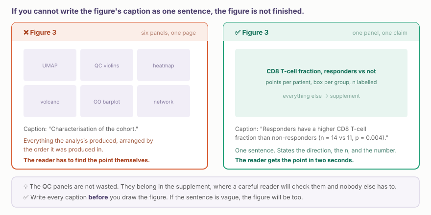
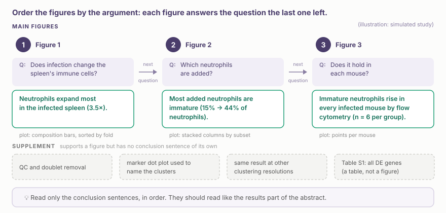
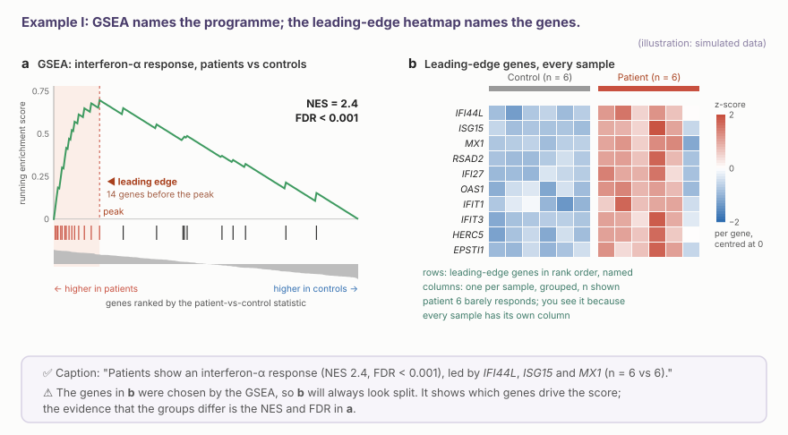
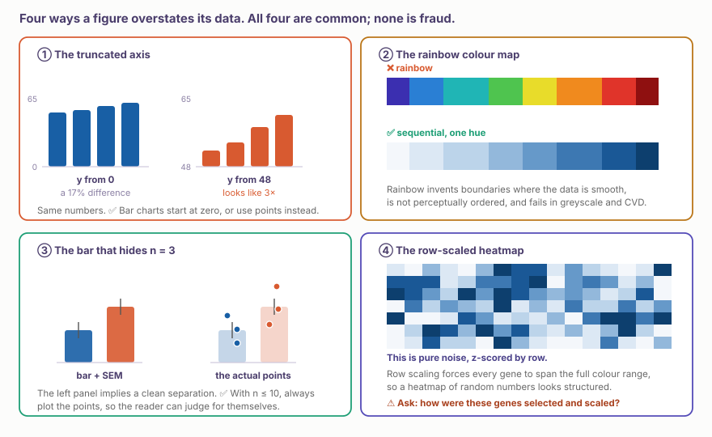
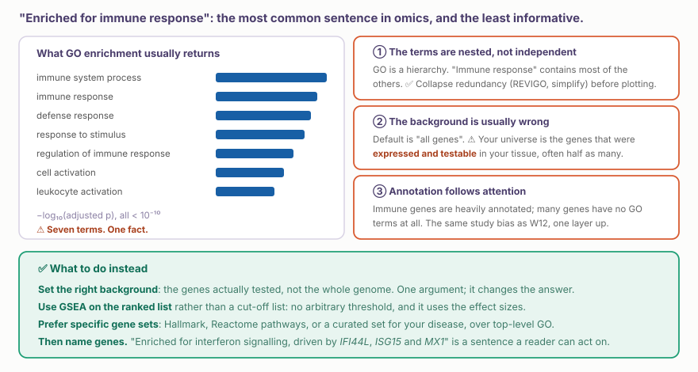
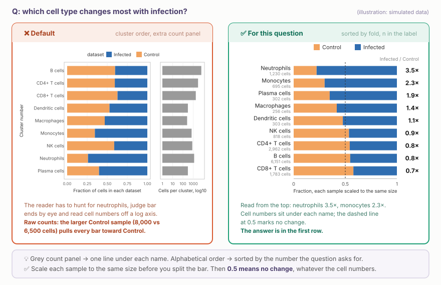
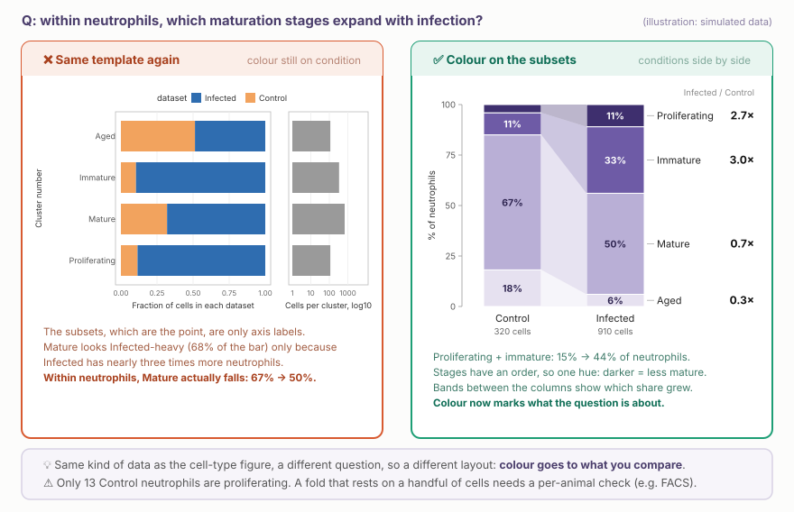

::: {.callout-note collapse="true"}
## 🎯 Learning objectives

By the end of this chapter you should be able to:

-   Write one conclusion sentence per figure, and use it to split main figures from the supplement
-   Order figures by the argument
-   Choose a plot type from the comparison the reader has to see
-   Decide what belongs in a figure (trends) and what in a table (values to look up)
-   ⚠️ Spot the routine ways a figure overstates its data, and the analysis steps that change a figure before it is drawn (gene selection, the enrichment background)
-   Draw the same kind of data differently when the question changes
:::

> 🤔 **Motivating question**
>
> Your RNA-seq analysis is done and you have 40 plots. Your supervisor says "five main figures". What do you keep, in what order, and in what form?

------------------------------------------------------------------------

# 1. Figure Principles 📐 {#w13-s1}

Four principles. The two examples that follow (§2, §3) apply them.

## 1) Write one conclusion sentence per figure {#w13-s1-1}

{fig-align="center"}

-   A **conclusion sentence** states, in one sentence, the claim a figure shows. It states the result, not the method or the plot type
-   ✅ The subject is what you studied (cells, genes, patient groups); the verb is the result. Write it **before** you draw, with a blank for the number
-   ✅ A caption should state the **direction**, the **n**, and the **number**
-   ⚠️ No causal verbs (*drives*, *mediates*) for observational data. Claim only what the data shows

| ❌ Method or plot type | ✅ Conclusion sentence |
|------------------------------|------------------------------------------------|
| UMAP of PBMCs from 25 patients. | Responders have a higher CD8 T-cell fraction than non-responders (n = 14 vs 11). |
| GSEA of patients vs controls. | Patients show an interferon-α response, led by *IFI44L*, *ISG15* and *MX1*. |
| Cell type composition by condition. | Neutrophils expand most in the infected spleen (3.5×). |

**Main or supplement.** Only a figure with a conclusion sentence is a candidate for the main text.

-   ✅ **Main**: figures that show a claim directly
-   ✅ **Supplement**: QC, parameter comparisons, the marker plots used for annotation, robustness checks that do not change the claim, full gene lists (as tables)
-   ⚠️ A six-panel "characterisation" figure asks the reader to do your interpreting for you. QC panels are not wasted; they belong in the supplement

## 2) Order the figures by the argument {#w13-s1-2}

{fig-align="center"}

-   ✅ Place each figure so that it answers the question the previous one left
-   ⚠️ Not the order you ran the analysis (QC → clustering → DE → enrichment), and not grouped by technique. Order by the **question each figure answers**
-   ✅ Read only the conclusion sentences, in order: they should read like the results part of the abstract
-   ✅ The same holds for panels inside a figure. Left to right, top to bottom is the order of the argument

## 3) Choose the plot from the comparison to show {#w13-s1-3}

Don't pick from habit. First decide **what the reader has to compare with what**, then pick the plot.

{fig-align="center"}

-   ✅ With small n (≤ 10), plot each sample as a point instead of a bar. n is patients or animals, not cells
-   ✅ Order categories by meaning or by value, not alphabetically
-   ✅ Give the same group or cell type the same colour in every figure. Avoid red–green pairs
-   ⚠️ **Never a dual y-axis.** Two scales on one plot let the author choose the apparent relationship. Use two panels instead, or index both to a common baseline
-   ⚠️ UMAP is a map for orientation. Don't read meaning into distances between clusters

::: {.callout-tip collapse="true"}
## Three habits that fix most omics figures

-   ✅ **Show the patients.** Points per patient, coloured by nothing else, are more convincing than any summary statistic
-   ✅ **Direct labelling.** With two to four series, labels on the plot beat a legend the reader has to keep glancing back at
-   ✅ **Tone down the background.** Grid lines and axes in light grey; the data is the only thing that should be dark. Use the accent colour for the one thing the claim needs
:::

## 4) Show trends in figures and values to look up in tables {#w13-s1-4}

-   A figure shows a difference, trend or pattern at a glance. A table is for exact values, or for many items side by side
-   ⚠️ Don't show the same data in a figure and a table
-   ✅ A table must read without the main text: title, units, n and abbreviations go in the table

| What to show | Form |
|------------------------------|------------------------------------------------|
| Differences between groups, change over time, patterns across clusters | Figure |
| Patient characteristics (Table 1), per-sample QC metrics, antibodies and primers | Table |
| All DE genes, all enrichment results | Supplementary table (file) |
| One headline number (e.g. a 42% response rate) | A sentence in the text. Not every result needs a chart |

::: {.callout-important collapse="true"}
## Back to the motivating question

To cut 40 plots down to five main figures:

-   ① Write a **conclusion sentence** for each. Plots without one (QC, parameter comparisons, full lists) go to the supplement
-   ② **Read the remaining sentences in order** and arrange them so they read like the results of the abstract. One question, one figure
-   ③ For each figure, decide the **comparison** the reader must see, then pick the plot
-   ④ Anything that needs exact values goes in a **table**
:::

------------------------------------------------------------------------

# 2. Example I: GSEA and a Heatmap of the Key Genes 🧾 {#w13-s2}

A standard figure in RNA-seq papers: DE between patients and controls → GSEA to find the pathway → a heatmap of the genes that drive it (the **leading edge**).

{fig-align="center"}

-   ✅ The **leading edge** is the set of genes that push the running enrichment score up to its peak. It lets you name genes instead of a pathway
-   ✅ One column per sample in the heatmap, grouped, with n shown. A patient who barely responds stays visible
-   ✅ Conclusion sentence: *"Patients show an interferon-α response (NES 2.4, FDR < 0.001), led by IFI44L, ISG15 and MX1 (n = 6 vs 6)."*

Making this one figure involves both **figure traps** and **analysis traps**.

## 1) Figure traps {#w13-s2-1}

{fig-align="center"}

Where they turn up in this example:

-   ⚠️ **Truncated axis.** An enrichment bar chart (−log~10~ FDR) or a bar chart of key-gene expression that does not start at zero inflates the difference, because a bar's length *is* the value. If zero is uninformative, use points or a dot plot instead
-   ⚠️ **Rainbow colour map** on the heatmap. Not perceptually ordered, invents boundaries where data is smooth, and fails in greyscale and for colour-vision deficiency. ✅ Use a single-hue sequential ramp for magnitude, and a two-hue diverging ramp with a neutral midpoint for signed values such as z-scores
-   ⚠️ **Bars that hide n.** A qPCR check of the key genes (n = 3) drawn as bar plus SEM implies a precision you do not have. ✅ With n ≤ 10, plot the individual points
-   ⚠️ **Row-scaled heatmap.** Row scaling forces every gene to span the full colour range, so noise looks structured. A diverging scale with an off-centre midpoint exaggerates one direction. ✅ Say "z-score per gene" in the legend and centre the scale at zero

## 2) Analysis traps {#w13-s2-2}

Steps before the drawing that change the figure.

### ① How the genes were chosen creates the blocks

-   ⚠️ If genes are selected *because* they differ between the groups, a heatmap of them is guaranteed to show blocks: the selection created the pattern. This is **circular selection**, and it is extremely common
-   ⚠️ A leading-edge heatmap is no different. The GSEA chose those genes, so they will look split. The heatmap shows which genes drive the score; it is not evidence that the groups differ. That evidence is the NES and FDR from the GSEA
-   ✅ To show the difference itself as a heatmap, select genes on one split of the data and display them on the other. Or show an unselected set alongside

### ② The background determines the result

{fig-align="center"}

Enrichment asks whether your gene list contains more of a category than expected **by chance from some universe**. Change the universe, change the answer.

-   ❌ Default "all human genes". But genes not expressed in your tissue could never have been in your list
-   ✅ The universe is **the genes you actually tested**: expressed above threshold, passing filters
-   ⚠️ In tissue-specific data this typically halves the universe, and it can remove an entire "significant" category
-   ✅ GO terms are nested, so one finding is reported many times. Collapse them with `simplify()` or REVIGO before plotting

::: {.panel-tabset group="lang"}

### R

```{r}
# toy input (illustration only): airway smooth-muscle cells ± dexamethasone, through DESeq2
library(DESeq2); library(airway)
data(airway)
airway$dex <- relevel(airway$dex, "untrt")
sym <- AnnotationDbi::mapIds(org.Hs.eg.db::org.Hs.eg.db, rownames(airway), "SYMBOL", "ENSEMBL")
airway <- airway[!is.na(sym) & !duplicated(sym), ]
rownames(airway) <- sym[rownames(airway)]
dds <- DESeqDataSet(airway, design = ~ cell + dex) |> DESeq()
res <- as.data.frame(results(dds)); res$gene <- rownames(res)
sig_genes <- res$gene[which(res$padj < 0.05 & abs(res$log2FoldChange) > 1)]

library(clusterProfiler); library(org.Hs.eg.db)

universe <- rownames(dds)[rowSums(counts(dds)) > 10]   # ✅ what was testable

ego <- enrichGO(gene = sig_genes, universe = universe,     # ⚠️ not the default
                OrgDb = org.Hs.eg.db, keyType = "SYMBOL",
                ont = "BP", pAdjustMethod = "BH")

ego <- simplify(ego, cutoff = 0.7)     # collapse redundant nested terms
head(as.data.frame(ego)[, c("Description", "GeneRatio", "p.adjust")])
```

### Python

```{python}
import numpy as np, pandas as pd, gseapy as gp

# toy input (illustration only): the same airway experiment (± dexamethasone),
# as the authors' published differential-expression table (GEO GSE52778, Cuffdiff)
res = pd.read_csv("https://ftp.ncbi.nlm.nih.gov/geo/series/GSE52nnn/GSE52778/suppl/"
                  "GSE52778_Dex_vs_Untreated_gene_exp.diff.gz", sep="\t")
res = res[res.status == "OK"]                                 # ✅ what was testable
sig_genes = res.gene[(res.q_value < 0.05) & (res["log2(fold_change)"].abs() > 1)].unique().tolist()
universe  = res.gene.unique().tolist()

ego = gp.enrichr(gene_list=sig_genes, background=universe,   # ⚠️ not the default
                 gene_sets="GO_Biological_Process_2023", outdir=None)
# (no GO-similarity simplify() in Python — read past near-duplicate terms yourself)
print(ego.results.sort_values("Adjusted P-value")[["Term", "Odds Ratio", "Adjusted P-value"]].head(6).to_string(index=False))
```

:::

### ③ GSEA on the ranked list, not a cut-off list

✅ Often better than an over-representation test: it uses the whole ranking rather than a thresholded list, so there is no arbitrary cut-off, and modest coordinated shifts are detectable. The leading edge in panel a above comes from here.

::: {.panel-tabset group="lang"}

### R

```{r}
library(tidyverse)                    # dplyr verbs; loaded after AnnotationDbi so select() is dplyr's

ranks <- res |> filter(!is.na(stat)) |> arrange(desc(stat)) |>
  select(gene, stat) |> deframe()

gseaGO <- gseGO(ranks, OrgDb = org.Hs.eg.db, keyType = "SYMBOL", ont = "BP")
head(as.data.frame(gseaGO)[, c("Description", "NES", "p.adjust")])
```

### Python

```{python}
# Cuffdiff's test_stat is positive when a gene is higher with dexamethasone, like DESeq2's stat
ranks = res.groupby("gene").test_stat.mean().sort_values(ascending=False)

gseaGO = gp.prerank(rnk=ranks, gene_sets="GO_Biological_Process_2023",
                    threads=8, seed=1, outdir=None)
gseaGO.res2d[["Term", "NES", "FDR q-val"]].head(6)
```

:::

### ④ Name genes, not terms

"Enriched for immune response" is compatible with almost any inflammatory tissue. **"Interferon signalling, driven by *IFI44L*, *ISG15* and *MX1*"** is a sentence a reader can act on, and check. The leading edge gives you those gene names.

------------------------------------------------------------------------

# 3. Example II: Cell Type Composition 🧩 {#w13-s3}

These are Figures 1–2 of the order cards in §1. Almost every scRNA-seq paper has a figure comparing cell composition between conditions. Even for the same kind of data, a different question needs a different figure. The two figures below rebuild a revision from a real analysis with simulated data (infected vs control mouse spleen).

## 1) Which cell type changes most? {#w13-s3-1}

{fig-align="center"}

The question is "which cell type changes most between conditions?", so the figure should show that answer first.

-   ✅ **Sort by the number the question asks about.** Alphabetical or cluster order is just the order of the analysis. Sorted by fold, the top row is the answer
-   ✅ **Drop the grey count panel; put the cell number under each name.** Cell numbers are reference information and do not need a panel of their own
-   ✅ **Write the fold as a number.** Don't make the reader compare bar ends by eye
-   ⚠️ **Scale both samples to the same size before splitting the bar.** On raw counts, every bar leans toward the sample with more cells, and 0.5 no longer means "no change"

## 2) What grows within neutrophils? {#w13-s3-2}

Neutrophils changed most, so the next question is which neutrophils. The data has the same form as in 1) (composition by condition), but now the subsets are the subject.

{fig-align="center"}

-   ✅ **Colour goes to what you compare.** Here that is the subsets, so they get the colour and the conditions sit side by side on the x-axis
-   ✅ **Ordered subsets get one sequential hue.** Maturation stages have an order, so darker means less mature, and the immature subsets you want to stress stand out on their own
-   ✅ **Compute shares within the parent population.** On the left, 68% of mature neutrophils come from the infected sample, which looks like an increase. It only reflects nearly three times more neutrophils overall: within neutrophils, the mature share fell from 67% to 50%
-   ⚠️ **Check the cell numbers behind each fold.** Only 13 control neutrophils are proliferating. A fold resting on a handful of cells needs a per-animal check such as FACS (Figure 3 of the order cards). With one library per condition, a fold describes; it does not test

::: {.callout-tip collapse="true"}
## Same composition, different figure

| | 1) All cell types | 2) Neutrophil subsets |
|--------------|-----------------------------|-----------------------------|
| Question | Which cell type changes most? | Which maturation stages grow within neutrophils? |
| Colour | Condition | Subset (one hue, in maturation order) |
| Axis | Cell types, sorted by fold | The two conditions side by side |
| Numbers | Cell number under each name, fold on the right | % inside the bars, fold on the right |

✅ The question decides the figure, not the shape of the data. Put what the reader must compare closest together and give it the strongest colour.
:::

------------------------------------------------------------------------

# 4. Hands-On 💻 {#w13-s4}

## 1) Write your figure order cards {#w13-s4-1}

Three to five cards, for your W14 project or an analysis you are doing now.

-   ① On each card: the question it answers, one conclusion sentence (in English), the comparison to show and the plot type, and whether it is main or supplement
-   ② Read only the conclusion sentences, in order. Do they read like the results of an abstract?
-   ③ Swap cards with a partner and say where the argument stalls when read in order

## 2) Take apart the figure you brought {#w13-s4-2}

Work in pairs. For your neighbour's figure:

-   ① Write its conclusion as one sentence. Can you?
-   ② Does the plot fit the comparison the reader has to see? Is there a better form in the §1 gallery?
-   ③ Does the axis start at zero, and should it?
-   ④ Can you see the n? Can you see individual patients?
-   ⑤ If there is a heatmap: how were the genes chosen, and was it row-scaled?
-   ⑥ If there is a colour scale: sequential, diverging, or rainbow, and does it match the job?
-   ⑦ Which panel could move to the supplement without weakening the point?

## 3) Rebuild one plot {#w13-s4-3}

::: {.panel-tabset group="lang"}

### R

```{r}
library(tidyverse)

# toy data (illustration only): CD8 T-cell fraction in 8 controls and 9 responders
set.seed(1)
d <- tibble(group = rep(c("control", "responder"), c(8, 9)),
            value = c(rnorm(8, 0.15, 0.05), rnorm(9, 0.25, 0.07)))

# ❌ before
ggplot(d, aes(group, value, fill = group)) +
  stat_summary(fun = mean, geom = "col") +
  stat_summary(fun.data = mean_se, geom = "errorbar", width = .2)

# ✅ after — the patients are visible, and n is on the axis
d |>
  mutate(group = fct_relevel(group, "control")) |>
  ggplot(aes(group, value)) +
  geom_boxplot(width = .45, outlier.shape = NA, colour = "#8A7FA3") +
  geom_jitter(width = .12, size = 2.6, alpha = .85, colour = "#185FA5") +
  scale_x_discrete(labels = \(x) paste0(x, "\n(n = ", table(d$group)[x], ")")) +
  labs(y = "CD8 T-cell fraction", x = NULL,
       title = "Responders have a higher CD8 T-cell fraction") +
  theme_minimal(base_size = 13) +
  theme(panel.grid.major.x = element_blank())
```

### Python

```{python}
import matplotlib.pyplot as plt, seaborn as sns

# toy data (illustration only): CD8 T-cell fraction in 8 controls and 9 responders
rng = np.random.default_rng(1)
d = pd.DataFrame({"group": ["control"] * 8 + ["responder"] * 9,
                  "value": np.r_[rng.normal(0.15, 0.05, 8), rng.normal(0.25, 0.07, 9)]})

# ❌ before
sns.barplot(d, x="group", y="value", hue="group", errorbar="se", capsize=.2)
plt.show()

# ✅ after — the patients are visible, and n is on the axis
order = ["control", "responder"]
n = d.group.value_counts()
ax = sns.boxplot(d, x="group", y="value", order=order, width=.45, showfliers=False,
                 fill=False, color="#8A7FA3")
sns.stripplot(d, x="group", y="value", order=order, jitter=.12, size=7, alpha=.85,
              color="#185FA5", ax=ax)
ax.set_xticks(range(len(order)), [f"{g}\n(n = {n[g]})" for g in order])
ax.set(xlabel=None, ylabel="CD8 T-cell fraction", title="Responders have a higher CD8 T-cell fraction")
sns.despine()
plt.show()
```

:::

## 4) Redo an enrichment with the right universe {#w13-s4-4}

::: {.panel-tabset group="lang"}

### R

```{r}
# Run enrichGO twice: default universe, then the expressed-gene universe.
# How many terms survive? Does the top term change?
```

### Python

```{python}
# Run gp.enrichr twice: default background, then the expressed-gene universe.
# How many terms survive? Does the top term change?
```

:::

💡 This takes two minutes and changes results often enough to be worth doing every time.

## 5) Before next week {#w13-s4-5}

**[W14: your own project](w14_project_design.qmd).** Bring a one-sentence research question and a note of what data you could realistically get hold of. Bring your order cards from hands-on 1) too, if you have them.

------------------------------------------------------------------------

# 📝 Summary

-   ✅ **One conclusion sentence per figure.** Direction, n, number, in one sentence. A plot without one goes to the supplement
-   ✅ **Figure order is the order of the argument.** The conclusion sentences, read in order, should read like the results of the abstract
-   ✅ **Choose the plot from the comparison to show.** Never a dual y-axis
-   ✅ **Trends in figures, values to look up in tables.** Never the same data in both
-   ⚠️ Four figure traps: **truncated axes**, **rainbow colour maps**, **bars hiding n**, **row-scaled heatmaps**
-   ⚠️ Selecting genes because they differ, then showing them as a heatmap, **creates** the blocks (circular selection). A leading-edge heatmap names the genes; the evidence is the GSEA statistic
-   ⚠️ **The enrichment background determines the result.** Use the genes you actually tested, not the genome. Collapse redundant GO terms; prefer GSEA on the ranked list
-   ✅ **Name genes, not terms.** "Interferon signalling, driven by *ISG15*" beats "immune response"
-   ✅ Even for the same composition data, the question decides the figure: colour what you compare, sort by the number the question asks about

------------------------------------------------------------------------

# 🔑 Key terms

| Term | One-line meaning |
|-------------------------|-----------------------------------------|
| Conclusion sentence | One sentence stating the claim a figure shows; the result, not the method |
| Truncated axis | A bar axis not starting at zero; exaggerates differences |
| Sequential ramp | One hue, light to dark; for magnitude |
| Diverging ramp | Two hues with a neutral midpoint; for signed values |
| Row scaling (z-score) | Rescaling each row; makes noise look structured |
| Circular selection | Choosing features by the effect you then display |
| Over-representation test | Is this category more frequent than expected? |
| Universe / background | The set your list could have been drawn from |
| GSEA | Enrichment on a ranked list, without a cut-off |
| Leading edge | The genes that push a GSEA running score to its peak; the genes driving the set |
| Term redundancy | Nested GO terms reporting the same finding repeatedly |
| Direct labelling | Naming series on the plot instead of in a legend |

------------------------------------------------------------------------

# ➕ References

### Figures

Rougier NP, Droettboom M, Bourne PE. [*Ten simple rules for better figures.*](https://doi.org/10.1371/journal.pcbi.1003833) PLoS Comput Biol. 2014.\
Weissgerber TL, et al. [*Beyond bar and line graphs: time for a new data presentation paradigm.*](https://doi.org/10.1371/journal.pbio.1002128) PLoS Biol. 2015. **← the argument for showing the points**\
Crameri F, Shephard GE, Heron PJ. [*The misuse of colour in science communication.*](https://doi.org/10.1038/s41467-020-19160-7) Nat Commun. 2020. **← why rainbow maps fail**\
Wilke CO. [*Fundamentals of Data Visualization.*](https://clauswilke.com/dataviz/) (free online)\
Holtz Y, Healy C. [*From Data to Viz.*](https://www.data-to-viz.com/) **← a decision tree from data type and purpose to plot type**\
Ha E. [*AI Scientific Writing W5. Figure storyboard*](https://kkonoo.github.io/AI_Sci_Writing_KNUmed/ko/chapters/w05_figure_storyboard.html) (in Korean). **← conclusion sentences, figure order and table format in more detail**

### Enrichment

Timmons JA, Szkop KJ, Gallagher IJ. [*Multiple sources of bias confound functional enrichment analysis of global -omics data.*](https://doi.org/10.1186/s13059-015-0761-7) Genome Biol. 2015. **← including the background problem**\
Wijesooriya K, et al. [*Urgent need for consistent standards in functional enrichment analysis.*](https://doi.org/10.1371/journal.pcbi.1009935) PLoS Comput Biol. 2022.\
Subramanian A, et al. [*Gene set enrichment analysis.*](https://doi.org/10.1073/pnas.0506580102) PNAS. 2005. **← where the leading edge is defined**\
Wu T, et al. [*clusterProfiler 4.0: a universal enrichment tool.*](https://doi.org/10.1016/j.xinn.2021.100141) Innovation. 2021.

### Circularity

Kriegeskorte N, et al. [*Circular analysis in systems neuroscience: the dangers of double dipping.*](https://doi.org/10.1038/nn.2303) Nat Neurosci. 2009. **← written for neuroscience, applies verbatim to omics heatmaps**
