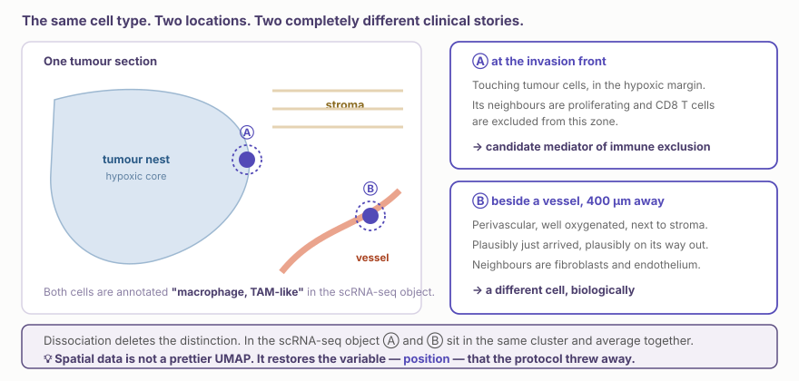
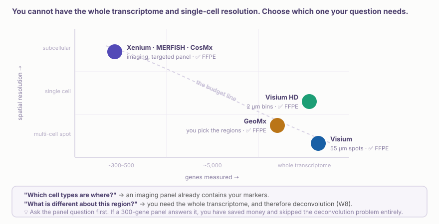
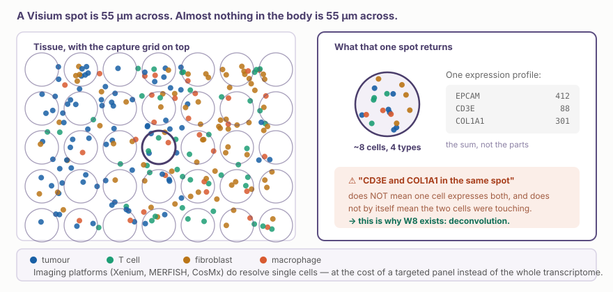
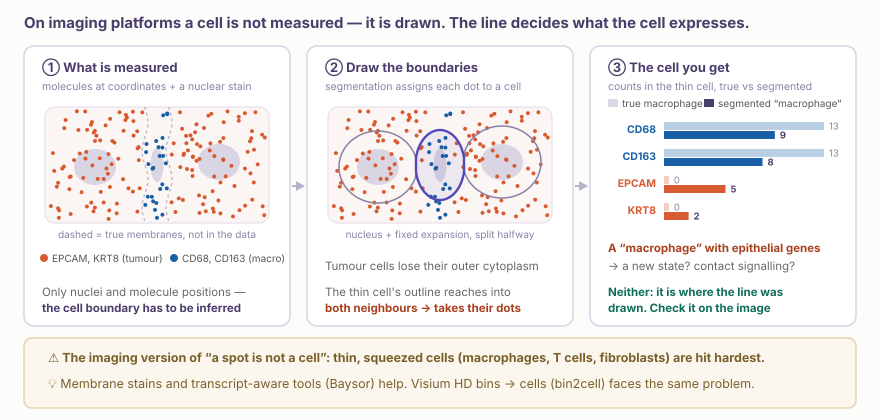
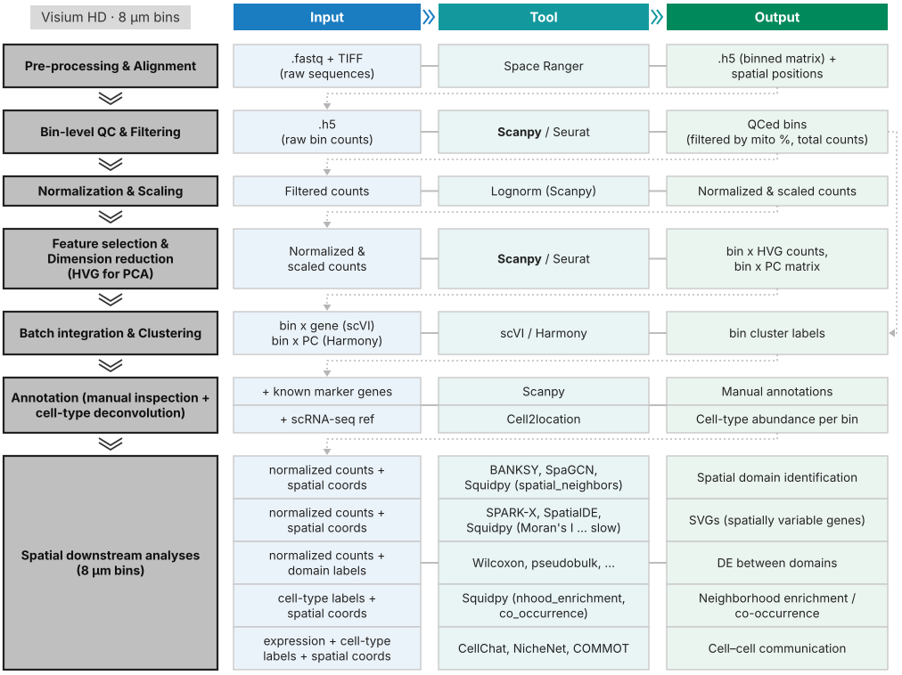
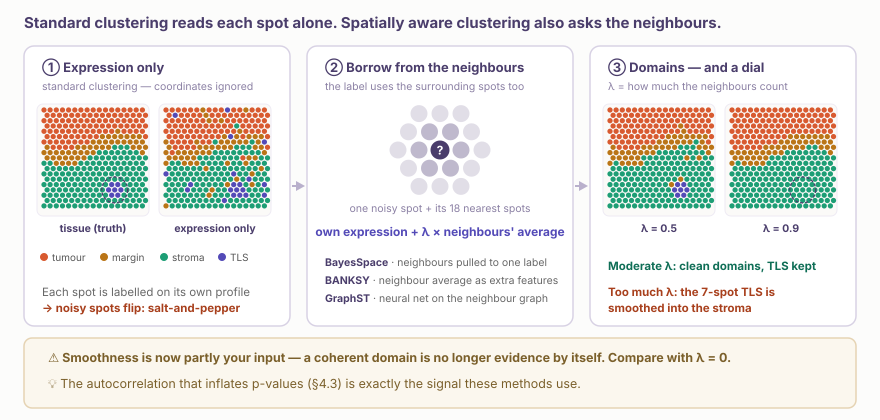
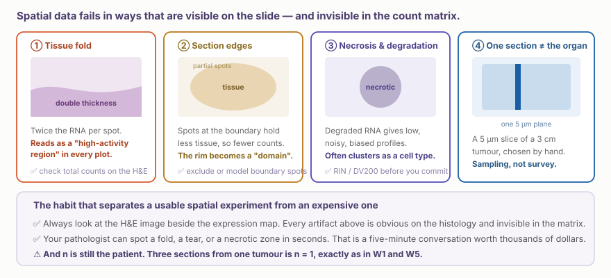

::: {.callout-note collapse="true"}
## 🎯 학습목표

이 장을 마치면 다음을 할 수 있어야 합니다.

-   조직 해리가 없애 버린 정보 가운데 공간 데이터가 무엇을 복원하는지 말할 수 있다
-   주요 플랫폼을 해상도와 측정 범위의 상충관계 위에 놓고, 질문에 맞는 플랫폼을 선택할 수 있다
-   ⚠️ **FFPE 호환성**이 이 장에서 실무적으로 가장 중요한 사실인 이유를 말할 수 있다
-   ⚠️ Visium spot이 세포가 아닌 이유와 그로부터 무엇이 따라오는지 설명할 수 있다
-   ⚠️ 단일세포 해상도 플랫폼에서 cell segmentation이 어떻게 없는 co-expression을 만들어 내는지 설명할 수 있다
-   ⚠️ 주름, 절편 가장자리, 괴사처럼 생물학적 신호로 가장하는 물리적 artifact를 알아볼 수 있다
-   이웃한 spot이 서로 독립적인 관측치가 아닌 이유를 말할 수 있다
-   Spatially aware clustering이 무엇을 더해 주고, 그 평활화가 무엇을 지울 수 있는지 말할 수 있다
-   공간 실험에서 자신의 n이 무엇인지 명시할 수 있다
:::

> 🤔 **동기 질문**
>
> 단일세포 데이터에서 비반응자에게 TAM 유사 대식세포가 풍부하다는 결과가 나왔습니다. 공동연구자가 묻습니다. *"그 세포들은 어디에 있었나요?"* 지금 가진 데이터로 답할 수 있습니까?

------------------------------------------------------------------------

# 1. Dissociation이 버린 것 🗺️ {#w7-s1}

## 1) 같은 cell type, 서로 다른 두 cell {#w7-s1-1}

{fig-align="center"}

W6까지는 전부 suspension 속 cell로 분석. 그런데 protocol의 첫 단계가 임상적 직관 대부분이 기대는 변수를 없애버림 = **cell이 어디에 있었나**

## 2) Spatial만 답할 수 있는 질문 {#w7-s1-2}

-   **Architecture** — 면역세포 침윤이 종양 안에 있나, 경계에 막혀 있나? (immune-excluded vs inflamed vs desert)
-   **Neighbourhood** — 그냥 같이 있는 게 아니라 실제로 붙어 있는 cell type은?
-   **Gradient** — 혈관, invasion front, germinal centre로부터의 거리에 따라 뭐가 달라지나?
-   **Regional heterogeneity** — 종양 한쪽은 저항, 다른 쪽은 민감?
-   **Histology와 연결** — 병리의사가 150년 동안 읽어 온 영상과 분자 정보를 잇기

💡 이 중 상당수는 병리의사가 이미 눈으로 평가하는 것들. Spatial transcriptomics = 상당 부분 **우리 과가 이미 내리는 판단에 분자 수치를 붙이는 일** → 그래서 이 장에서 가장 유용한 공동연구자 = 병리의사

------------------------------------------------------------------------

# 2. Platform 🔬 {#w7-s2}

## 1) Trade-off 하나, 나머지는 디테일 {#w7-s2-1}

{fig-align="center"}

-   **Sequencing 기반** (Visium, Visium HD, GeoMx, Slide-seq) — 격자나 선택한 영역에서 transcript를 포획. ✅ Whole transcriptome. ⚠️ Capture 영역 하나에 cell 여러 개가 들어갈 수 있음
-   **Imaging 기반** (Xenium, MERFISH, CosMx) — 제자리에서 molecule 하나하나를 영상화. ✅ Single-cell, 때로는 subcellular. ⚠️ 미리 고른 수백~수천 개 gene의 targeted panel만

## 2) ⚠️ 우리한테 제일 중요한 건 FFPE {#w7-s2-2}

지금 거의 모든 platform이 **FFPE**(formalin-fixed paraffin-embedded) 조직에서 작동

::: {.callout-important collapse="true"}
## 병원에서 할 수 있는 일이 바뀌는 이유

병리과엔 수년~수십 년 된 block이 보관돼 있고, block마다 결과가 붙어 있음: 누가 반응했고, 재발했고, 생존했는지

-   ✅ 실제 outcome이 연결된 **후향적 spatial 연구**가 지금 바로 가능. 전향적 cohort가 쌓일 때까지 5년 기다릴 필요 x
-   ✅ *Outcome 기준으로* 증례 선택 가능 (반응자 vs 비반응자) → 동의한 환자를 순서대로 하는 것보다 훨씬 강한 설계
-   ⚠️ 오래된 block은 RNA 품질이 제각각. 표준 지표 = **DV200** → 연구 확정 전에 꼭 확인
-   ⚠️ 보관 조직의 윤리·동의는 별도 절차. 대개 가장 오래 걸리는 단계 → 일찍 시작

💡 이 수업을 듣는 대부분에게 "그래서 내가 실제로 뭘 할 수 있나?"에 대한 구체적인 답
:::

## 3) Platform 고르기 {#w7-s2-3}

| 연구 질문 | Platform 종류 |
|-----------------------------------|-------------------------------------|
| "어떤 cell type이 어디에 있나?" — marker는 알려져 있음 | ✅ Imaging panel (Xenium, CosMx) |
| "이 영역은 transcriptome상 뭐가 다른가?" | ✅ Whole transcriptome (Visium, Visium HD) |
| "조직학적으로 정의한 두 영역을 비교" | ✅ GeoMx — 영역을 직접 지정 |
| "이 두 cell type이 맞닿아 있나?" | ✅ Imaging; ❌ 표준 Visium으로는 불가 |
| "환자 block 60개를 싸게 screening" | ⚠️ 비용이 결정적 — 설계 전에 core 시설과 상의 |

------------------------------------------------------------------------

# 3. ⚠️ Spot ≠ cell 🔍 {#w7-s3}

## 1) Spot 기반 platform: 조성 {#w7-s3-1}

{fig-align="center"}

표준 Visium spot = 지름 55 µm, 보통 여러 type의 cell **1–10개**. 측정값 = 이들의 **합**

::: {.callout-warning collapse="true"}
## Spot 하나로는 할 수 없는 주장 세 가지

-   ❌ **"이 두 gene이 co-expression된다"** — 같은 spot 안의 다른 cell에서 나왔을 수도. Single-cell co-expression의 함정(🔗 [W6 §3](../part3/w6_scrna_dynamics.qmd#w6-s3))이 옷만 바꿔 입고 돌아온 것
-   ❌ **"이 spot은 macrophage다"** — spot에는 cell type이 없음. 조성(composition)이 있을 뿐
-   ⚠️ **"이 cell type들이 상호작용한다"** — 같은 55 µm spot 안에 있다 = 접촉의 약한 근거. Dissociation data보단 낫지만 인접(adjacency)은 아님

→ ✅ 말할 수 있는 것: *이 영역에 macrophage signal이 풍부하다.* 실제로 유용하고 방어 가능한 주장 — 여기서 비율까지 가는 게 W8
:::

## 2) ⚠️ Single-cell platform: cell = 그어 놓은 선 {#w7-s3-2}

{fig-align="center"}

Xenium, CosMx, MERFISH, 그리고 Visium HD도 cell을 측정하는 건 아님. 측정값 = **좌표 위의 molecule**(또는 2 µm bin). Cell은 **segmentation**이 molecule 하나하나를 경계선에 배정한 다음에야 생김

-   **Nucleus만** (DAPI) — 깔끔하지만 cytoplasm을 버림 → count 낮음
-   **Nucleus + 고정 거리 확장** — 흔한 기본값. Count는 회복되지만 빽빽한 조직에선 경계선이 이웃 cell로 넘어가 **이웃의 transcript를 가져옴**
-   **더 나은 경계선** — membrane 염색, 또는 transcript 자체를 쓰는 tool(`Baysor`). 낫지만 여전히 정답은 아님
-   **Visium HD** — 2 µm bin을 cell 단위로 다시 묶음(`bin2cell`, 10x 자체 segmentation) → 입력만 다르고 같은 문제

::: {.callout-warning collapse="true"}
## Segmentation된 cell 하나로는 할 수 없는 주장 두 가지

-   ❌ **"종양 둥지 속 macrophage가 epithelial gene을 발현한다"** — 대표적인 spillover artefact. 종양 cell 사이에 끼인 얇은 cell이 이웃의 transcript를 주워 담음 = 새 옷 입은 doublet(🔗 [W5 §3.3](../part3/w5_scrna_qc.qmd#w5-s3-3))
-   ❌ **"두 cell type이 맞닿아 있으니 signalling한다"** — 경계선이 가장 많이 틀리는 곳 = 바로 접촉면. Ligand–receptor 쌍이 segmentation에서 만들어질 수 있음

→ ✅ Cell 수준 결과를 믿기 전에: 배타적이어야 할 marker(예: `PTPRC` vs `EPCAM`)가 엉뚱한 cell type에서 얼마나 나오나, 접촉면에서 더 심한가? 그다음 영상 위에 경계선을 겹쳐 보기 — 🔗 [§5](#w7-s5)의 H&E와 같은 원칙
:::

------------------------------------------------------------------------

# 4. Spatial data 분석 📐 {#w7-s4}

## 1) Pipeline {#w7-s4-1}

{fig-align="center"}

-   뼈대는 scRNA-seq(🔗 [W5 §3.1](../part3/w5_scrna_qc.qmd#w5-s3-1))과 같고 cell 자리에 bin. Cell calling, doublet 단계 x — bin은 격자 칸이지 포획된 cell이 아니라서
-   ✅ 표에는 없지만 꼭 넣어야 할 두 단계: **H&E 영상과 대조한 QC**, **domain을 histology와 연결** (🔗 [§5](#w7-s5))
-   ⚠️ Domain 간 DE를 "Wilcoxon"으로 → bin을 전부 독립으로 취급 → p-value 부풀려짐 (🔗 [§4.3](#w7-s4-3)). Sample × domain pseudobulk가 더 안전한 쪽
-   Deconvolution, neighbourhood enrichment, cell–cell communication → 🔗 [W8](w8_spatial_integration.qmd)

⚠️ 표준 clustering은 **좌표를 완전히 무시** — Seurat가 cell 묶듯 spot을 묶음. 그런데도 domain이 공간적으로 이어져 나오면 좋은 신호, 안 이어지면 그것도 정보. 좌표까지 쓰는 방법 → 🔗 [§4.4](#w7-s4-4)

## 2) Spatially variable gene {#w7-s4-2}

DE와는 다른 질문: *"이 gene이 그룹 간에 다른가?"*가 아니라 *"이 gene의 발현이 공간적으로 조직돼 있긴 한가?"*

-   Tool: `SpatialDE`, `nnSVG`, Moran's I, `SPARK`
-   ✅ 어떤 영역이 중요한지 아직 모를 때 탐색용으로 유용

## 3) ⚠️ 이웃 spot은 독립이 아님 {#w7-s4-3}

::: {.callout-important collapse="true"}
## Spatial autocorrelation — 모든 걸 부풀리는 이유

인접한 spot은 퍼진 transcript를 공유하고, 같은 국소 조직을 공유하고, 때로는 cell까지 물리적으로 공유 → 설계상 **양의 상관**

4,000개 spot을 4,000개 독립 관측치로 취급하는 검정 → 🔗 [W5 §5.2](../part3/w5_scrna_qc.qmd#w5-s5-2)의 per-cell test만큼 p-value가 부풀려짐. 이유도 같음

-   ⚠️ "이 domain에 DE gene 3,412개, 전부 *p* \< 10⁻¹⁵" = 결과가 아니라 증상
-   ✅ Spatial dependence를 반영하는 방법 있음 (`nnSVG`, SPARK-X, spatial term을 넣은 mixed model)
-   ✅ 환자 간 비교는 해법도 늘 같음: **환자 단위로 집계 → 환자끼리 비교**
:::

## 4) 좌표를 쓰는 domain, 그리고 niche {#w7-s4-4}

{fig-align="center"}

§4.3에서 p-value를 부풀리던 autocorrelation이 clustering에선 **signal**: 이웃 spot = 같은 조직을 한 번 더 잰 것

**① Spatially aware domain** — spot의 label을 자기 발현 **+** 이웃의 발현으로 결정

-   `BayesSpace` — 이웃 spot을 같은 label 쪽으로 끌어당기는 prior
-   `BANKSY` — 이웃 spot의 평균 발현을 feature로 덧붙이고 **λ**로 가중 → 평소처럼 clustering. λ = 0 → 일반 clustering. Seurat 안에서 돌아감 (🔗 [§6.5](#w7-s6-5))
-   `GraphST` — spatial neighbour graph 위의 graph neural network
-   ✅ 소금-후추처럼 흩어진 label → 이어진 domain. Noisy한 spot이 cluster 사이를 오가지 않음
-   ⚠️ **이제 매끄러움 일부는 내가 넣은 가정.** §4.1에선 이어진 domain = 좋은 신호였지만, 여기선 내가 요구한 것
-   ⚠️ **너무 매끄럽게 하면 작은 구조가 지워짐** — tertiary lymphoid structure(TLS), micrometastasis, 얇은 층. Domain 지도 보고 전에 λ = 0과 비교

**② Niche** — 자기 발현이 아니라 **주변에 뭐가 있는지**(국소 neighbourhood의 조성)로 묶기. 진짜 spatial biology는 여기 있고, 먼저 deconvolution이 필요 → 🔗 [W8](w8_spatial_integration.qmd)

------------------------------------------------------------------------

# 5. ⚠️ 조직의 현실 🧪 {#w7-s5}

{fig-align="center"}

::: {.callout-tip collapse="true"}
## 이런 문제 대부분을 잡아내는 리뷰어 질문

*"H&E 영상과 발현 지도를 같은 축척으로 나란히 보여 주세요."*

"새로운 spatial domain"이 절편 가장자리, 주름, 괴사 부위와 딱 겹친다면 → 영상에선 2초 만에 보이지만, 어떤 통계에도 안 드러남

💡 내 연구에도 같은 조언: 데이터 받은 다음이 아니라 block을 고르기 **전에** 병리의사와 같이 보기
:::

⚠️ **여전히 n = 환자.** 종양 하나에서 얻은 절편 세 장 = n = 1 — 🔗 [W1 §3.2](../part1/w1_intro.qmd#w1-s3-2), 🔗 [W5 §5](../part3/w5_scrna_qc.qmd#w5-s5)와 같은 원칙. Spatial 실험은 검체당 비용이 비싸서 환자는 적고 spot은 많은 설계로 기울기 쉬움 → 일반화하려는 연구엔 잘못된 방향

------------------------------------------------------------------------

# 6. 실습 💻 {#w7-s6}

## 1) 코드 없이: 실제 절편 보기 {#w7-s6-1}

[**10x Genomics dataset**](https://www.10xgenomics.com/datasets) → H&E 영상이 있는 Visium 또는 Xenium dataset 하나 고르기

-   ① H&E와 total count 지도 찾기. Count가 높은 영역 중 주름이나 두꺼운 부위와 겹치는 곳이 있나?
-   ② Clustering 그림 찾기. 절편 **가장자리**를 따라가는 cluster가 있나?
-   ③ 환자 몇 명, 환자당 절편 몇 장?
-   ④ 💡 그다음 논문의 주장을 읽고, ①–③을 거치고도 살아남는 주장이 뭔지 따져보기

```{python}
#| include: false
# silence spatialdata's INFO log (ANSI-coloured, printed by sq.gr.spatial_neighbors)
import logging, spatialdata
logging.getLogger("spatialdata._logging").setLevel(logging.WARNING)
```

## 2) 분석 pipeline {#w7-s6-2}

::: {.panel-tabset group="lang"}

### R

```{r}
library(Seurat); library(SeuratData); library(tidyverse); library(patchwork)

br <- LoadData("stxBrain", type = "anterior1")

# ⚠️ QC against the image, not just the numbers
SpatialFeaturePlot(br, features = "nCount_Spatial") +
  ggtitle("Look for folds and edges before anything else")

br <- SCTransform(br, assay = "Spatial", verbose = FALSE) |>
  RunPCA() |> FindNeighbors(dims = 1:30) |>
  FindClusters(resolution = 0.6) |> RunUMAP(dims = 1:30)

# the two views that must always appear together
DimPlot(br, reduction = "umap", label = TRUE) |
  SpatialDimPlot(br, label = TRUE, label.size = 3)

# ✅ save it — W8 picks this object up
saveRDS(br, here::here("analysis", "7_visium.rds"))
```

### Python

```{python}
import scanpy as sc, squidpy as sq
import numpy as np, matplotlib.pyplot as plt

ad = sc.datasets.visium_sge("V1_Mouse_Brain_Sagittal_Anterior")   # same section as stxBrain anterior1
ad.var_names_make_unique()
sc.pp.calculate_qc_metrics(ad, inplace=True)

# ⚠️ QC against the image, not just the numbers
sq.pl.spatial_scatter(ad, color="total_counts",
                      title="Look for folds and edges before anything else")
plt.show()

sc.pp.normalize_total(ad); sc.pp.log1p(ad)        # log-normalisation in place of SCTransform
sc.pp.highly_variable_genes(ad, n_top_genes=3000)
sc.pp.pca(ad, n_comps=30); sc.pp.neighbors(ad, n_pcs=30)
sc.tl.leiden(ad, resolution=0.6, key_added="clusters", flavor="igraph", n_iterations=2)
sc.tl.umap(ad)

# the two views that must always appear together
fig, axs = plt.subplots(1, 2, figsize=(11, 4.5))
sc.pl.umap(ad, color="clusters", legend_loc="on data", ax=axs[0], show=False)
sq.pl.spatial_scatter(ad, color="clusters", legend_loc="on data", ax=axs[1])

# ✅ save it
ad.write_h5ad("analysis/7_visium.h5ad")
```

:::

## 3) Spatially variable gene {#w7-s6-3}

::: {.panel-tabset group="lang"}

### R

```{r}
br <- FindSpatiallyVariableFeatures(
  br, assay = "SCT", features = VariableFeatures(br)[1:1000],
  selection.method = "moransi")

top <- SpatiallyVariableFeatures(br, method = "moransi")[1:6]
SpatialFeaturePlot(br, features = top, ncol = 3, alpha = c(0.1, 1))
```

### Python

```{python}
sq.gr.spatial_neighbors(ad)                       # Visium hex grid: 6 neighbours
hvg = ad.var.sort_values("dispersions_norm", ascending=False).index[:1000]
sq.gr.spatial_autocorr(ad, mode="moran", genes=hvg)

top = ad.uns["moranI"].index[:6].tolist()
sq.pl.spatial_scatter(ad, color=top, ncols=3)
```

:::

## 4) ✅ 한 가지 바꾸기 {#w7-s6-4}

::: {.panel-tabset group="lang"}

### R

```{r}
# Are the domains driven by biology, or by how much tissue was in each spot?
br$log_counts <- log10(br$nCount_Spatial)
VlnPlot(br, "log_counts", group.by = "seurat_clusters")
```

### Python

```{python}
# Are the domains driven by biology, or by how much tissue was in each spot?
ad.obs["log_counts"] = np.log10(ad.obs["total_counts"])
sc.pl.violin(ad, "log_counts", groupby="clusters")
```

:::

💡 한 cluster의 total count가 체계적으로 높다면, 이름 붙이기 전에 → 조직의 생물학적 영역인지, 조직 **두께** 영역인지 따져보기

## 5) Spatially aware domain {#w7-s6-5}

::: {.panel-tabset group="lang"}

### R

```{r}
# remotes::install_github("prabhakarlab/Banksy"); remotes::install_github("satijalab/seurat-wrappers")
library(Banksy); library(SeuratWrappers)

br$expr_cluster <- br$seurat_clusters   # keep the expression-only labels

# lambda = weight on the neighbours: ~0.2 for cell typing, ~0.8 for tissue domains
br <- RunBanksy(br, lambda = 0.8, assay = "SCT", slot = "data",
                features = "variable", k_geom = 18)   # sets DefaultAssay to "BANKSY"
br <- RunPCA(br, features = rownames(br), npcs = 30, reduction.name = "pca.banksy") |>
  FindNeighbors(reduction = "pca.banksy", dims = 1:30) |>
  FindClusters(resolution = 0.5, cluster.name = "banksy_cluster")

SpatialDimPlot(br, group.by = "expr_cluster") |
  SpatialDimPlot(br, group.by = "banksy_cluster")
```

### Python

```{python}
# BANKSY written out: own expression + lambda-weighted neighbour mean, then cluster as usual
# (full method: pip install pybanksy)
lam, k_geom = 0.8, 18
ad.obs["expr_cluster"] = ad.obs["clusters"]      # keep the expression-only labels

sq.gr.spatial_neighbors(ad, coord_type="generic", n_neighs=k_geom, key_added="banksy")
W = ad.obsp["banksy_connectivities"]
W = W.multiply(1 / W.sum(axis=1)).tocsr()         # row-normalise -> neighbour mean
X = ad[:, ad.var.highly_variable].X.toarray()
z = lambda m: (m - m.mean(0)) / (m.std(0) + 1e-8)
bk = sc.AnnData(np.hstack([np.sqrt(1 - lam) * z(X), np.sqrt(lam) * z(W @ X)]))
sc.pp.pca(bk, n_comps=30); sc.pp.neighbors(bk, n_pcs=30)
sc.tl.leiden(bk, resolution=0.5, flavor="igraph", n_iterations=2)
ad.obs["banksy_cluster"] = bk.obs["leiden"].values

sq.pl.spatial_scatter(ad, color=["expr_cluster", "banksy_cluster"])
```

:::

💡 `lambda = 0.2`로 다시 돌려보기. 두 설정 모두에서 살아남는 domain은? 0.8에서 사라지는 작은 구조는?

## 6) 다음 주 전까지 {#w7-s6-6}

**W8 — deconvolution과 integration.** W6에서 던진 질문의 답 가져오기: 우리 과에 outcome이 연결된 FFPE block이 몇 개 있나?

------------------------------------------------------------------------

# 📝 요약

-   Spatial data = **위치**를 복원. Dissociation이 없애고, 임상적 추론 대부분이 쓰는 바로 그 변수
-   해상도 vs transcriptome 범위는 trade-off. Imaging = single cell + targeted panel. Sequencing = whole transcriptome + 여러 cell이 섞인 spot
-   ✅ **대부분의 platform이 FFPE에서 작동** → outcome이 연결된 후향적 cohort가 지금 바로 손에 닿음
-   ⚠️ **55 µm spot = cell 1–10개.** Cell type이 아니라 조성. Spot 안의 co-expression ≠ cell 안의 co-expression
-   ⚠️ **Single-cell platform에서 cell = segmentation 결과.** 사이에 끼인 얇은 cell이 이웃의 transcript를 주워 담음 → 가짜 co-expression, 가짜 접촉
-   ⚠️ 표준 clustering은 좌표를 무시. 공간적으로 이어진 domain은 좋은 신호일 뿐 보장은 아님
-   ✅ Spatially aware clustering(BayesSpace, BANKSY)은 이웃을 같이 봄 → 더 깔끔한 domain. ⚠️ 매끄러움 일부는 가정이고 작은 구조를 지울 수 있음 → λ = 0과 비교
-   ⚠️ **이웃 spot은 독립이 아님.** 아주 작은 p-value 수천 개 = 이걸 무시했다는 증상
-   ⚠️ 주름, 절편 가장자리, 괴사 전부 그럴듯한 "domain"을 만듦. ✅ 항상 지도 옆에 H&E
-   ⚠️ **n은 여전히 환자.** 종양 하나에서 절편 세 장 = n = 1

------------------------------------------------------------------------

# 🔑 핵심 용어

| 용어 | 한 줄 정의 |
|-------------------------|-----------------------------------------|
| Spot / capture area | 측정 위치 하나. Visium에서는 지름 55 µm이며 여러 세포를 포함 |
| Visium HD | 연속적인 2 µm 구간화로 단일세포에 가까운 해상도와 전장 전사체를 측정 |
| Imaging-based ST | 분자를 직접 영상화하는 방법(Xenium, MERFISH, CosMx)으로 표적 패널을 사용 |
| GeoMx | 연구자가 선택한 관심 영역의 분자 신호를 분석하는 방법 |
| FFPE | 포르말린으로 고정하고 파라핀에 포매한 병리 보관 조직의 표준 형식 |
| DV200 | FFPE 검체의 RNA 품질을 나타내며 실험 전에 반드시 확인해야 하는 수치 |
| Cell segmentation | 분자(또는 bin)를 세포 경계에 배정하는 단계. Imaging 플랫폼과 Visium HD에서 '세포'를 만드는 과정 |
| Transcript spillover | Segmentation 후 이웃 세포의 transcript가 엉뚱한 세포에 집계되는 현상 |
| Spatial domain | 발현 양상이 비슷한 측정 위치의 군집 |
| Spatially aware clustering | 각 위치의 발현과 함께 이웃의 발현도 사용하는 clustering(BayesSpace, BANKSY, GraphST) |
| Spatially variable gene | 발현 양상이 공간적으로 조직되어 있는 유전자 |
| Moran's I | 공간 자기상관을 측정하는 고전적 통계량 |
| Spatial autocorrelation | 가까운 위치의 측정값이 설계상 서로 닮는 현상 |
| Niche / neighbourhood | 한 위치 주변의 국소 세포 조성(W8) |

------------------------------------------------------------------------

# ➕ 참고문헌

### 개요

Moses L, Pachter L. [*Museum of spatial transcriptomics.*](https://doi.org/10.1038/s41592-022-01409-2) Nat Methods. 2022. **← 분야 전체를 솔직하게 평가한 개요**\
Rao A, Barkley D, França GS, Yanai I. [*Exploring tissue architecture using spatial transcriptomics.*](https://doi.org/10.1038/s41586-021-03634-9) Nature. 2021.\
Bressan D, Battistoni G, Hannon GJ. [*The dawn of spatial omics.*](https://doi.org/10.1126/science.abq4964) Science. 2023.

### 방법과 통계

Weber LM, et al. [*nnSVG for the scalable identification of spatially variable genes using nearest-neighbor Gaussian processes.*](https://doi.org/10.1038/s41467-023-39748-z) Nat Commun. 2023.\
Svensson V, Teichmann SA, Stegle O. [*SpatialDE: identification of spatially variable genes.*](https://doi.org/10.1038/nmeth.4636) Nat Methods. 2018.\
Palla G, et al. [*Squidpy: a scalable framework for spatial omics analysis.*](https://doi.org/10.1038/s41592-021-01358-2) Nat Methods. 2022.\
Zhao E, et al. [*Spatial transcriptomics at subspot resolution with BayesSpace.*](https://doi.org/10.1038/s41587-021-00935-2) Nat Biotechnol. 2021.\
Singhal V, et al. [*BANKSY unifies cell typing and tissue domain segmentation for scalable spatial omics data analysis.*](https://doi.org/10.1038/s41588-024-01664-3) Nat Genet. 2024.\
Long Y, et al. [*Spatially informed clustering, integration, and deconvolution of spatial transcriptomics with GraphST.*](https://doi.org/10.1038/s41467-023-36796-3) Nat Commun. 2023.\
Petukhov V, et al. [*Cell segmentation in imaging-based spatial transcriptomics.*](https://doi.org/10.1038/s41587-021-01044-w) Nat Biotechnol. 2022.\
Polański K, et al. [*Bin2cell reconstructs cells from high resolution Visium HD data.*](https://doi.org/10.1093/bioinformatics/btae546) Bioinformatics. 2024.

### 임상과 FFPE

Janesick A, et al. [*High resolution mapping of the tumor microenvironment using integrated single-cell, spatial and in situ analysis.*](https://doi.org/10.1038/s41467-023-43458-x) Nat Commun. 2023.\
[10x Genomics 공개 데이터셋](https://www.10xgenomics.com/datasets) · [Squidpy 문서](https://squidpy.readthedocs.io)
