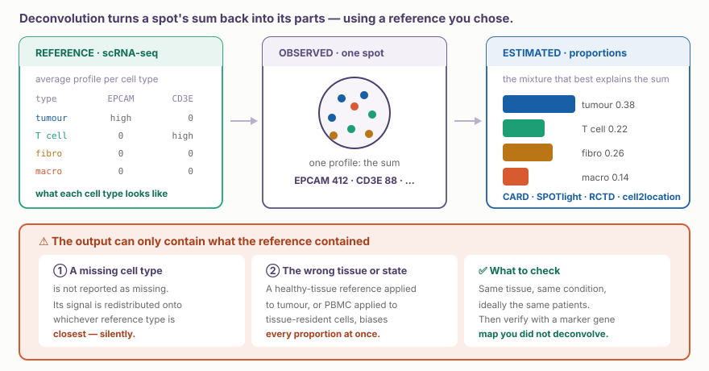
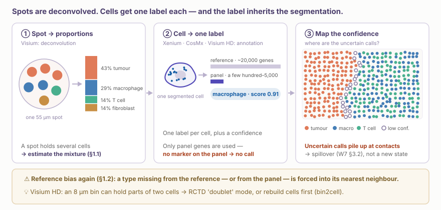
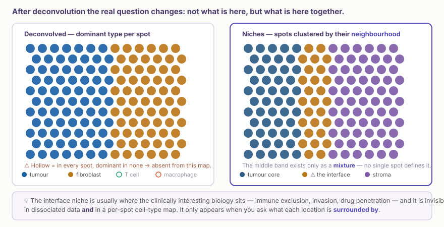
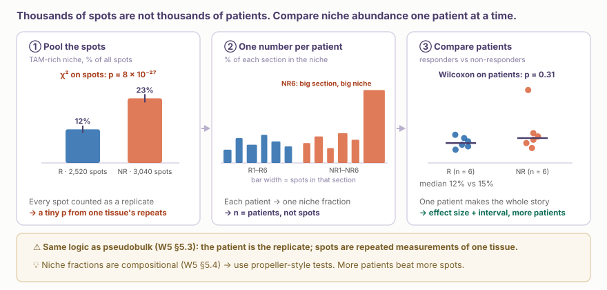
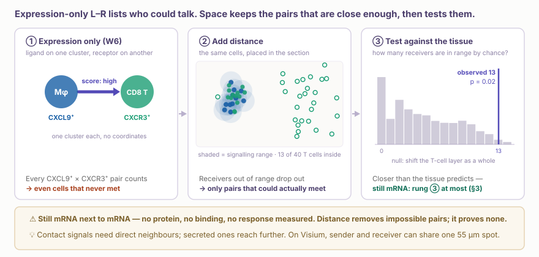
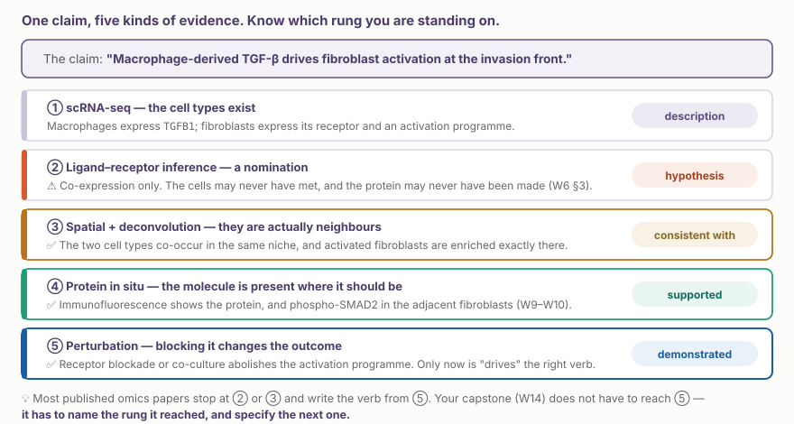

::: {.callout-note collapse="true"}
## 🎯 학습목표

이 장을 마치면 다음을 할 수 있어야 합니다.

-   deconvolution이 무엇을 추정하며 무엇은 추정할 수 없는지 설명할 수 있다
-   ⚠️ 참조 데이터셋이 답을 결정하는 이유와 참조를 신뢰하기 전에 확인할 사항을 말할 수 있다
-   단일세포 해상도 데이터는 deconvolution 대신 annotation하는 이유와, 그 label이 어디서 틀리는지 말할 수 있다
-   세포 유형 지도와 **niche** 지도를 구분하고, 대개 두 번째 지도에 생물학적 의미가 있는 이유를 말할 수 있다
-   ⚠️ 조직 구조를 보존하는 귀무가설을 사용해 공위치(co-localisation)를 검정할 수 있다
-   ⚠️ 이웃한 spot이 유의성을 부풀리는 이유와 그 대처법을 말할 수 있다
-   ⚠️ spot이 아니라 환자를 단위로 환자군 간 niche를 비교할 수 있다
-   ⚠️ ligand–receptor 추론에 거리 제한이 더해 주는 것과 여전히 보여 주지 못하는 것을 말할 수 있다
-   모든 주장을 기술에서 입증까지의 근거 사다리 위에 놓을 수 있다
-   W5–W6에서 생성한 가설을 위한 공간 검증 단계를 설계할 수 있다
:::

> 🤔 **동기 질문**
>
> 4,000개 spot을 deconvolution한 결과 조절 T세포와 탈진 CD8 T세포가 함께 나타났습니다(*p* < 10⁻¹²). 이 p-value는 얼마나 많은 것을 알려 줍니까?

------------------------------------------------------------------------

# 1. Deconvolution 🧩 {#w8-s1}

## 1) 문제 다시 보기 {#w8-s1-1}

🔗 [W7 §3](w7_spatial_basics.qmd#w7-s3)에서 본 대로 Visium spot = **혼합물**. Deconvolution = single-cell data를 "cell type별 생김새 사전"으로 써서, 관측된 profile을 가장 잘 설명하는 cell type 혼합을 추정

{fig-align="center"}

| 방법 | 접근법 | 특징 |
|----------------------|--------------------|------------------------------|
| **RCTD** | 통계 model, platform 효과까지 modelling | 견고, 널리 쓰임 |
| **cell2location** | Bayesian, 절대 abundance 추정 | ✅ 비율뿐 아니라 cell 수까지 |
| **CARD** | spot 간 spatial correlation 이용 | 이웃 spot 정보를 빌려 씀 |
| **SPOTlight** | NMF 기반 | 빠름 |
| **Tangram** | single cell을 공간에 배치 | 짝지어진 data가 있을 때 유용 |

💡 Method보다 reference 선택이 더 중요. Benchmark에서 method 간 차이는 크지 않지만, reference가 틀리면 답 자체가 바뀜

## 2) ⚠️ Reference bias {#w8-s1-2}

::: {.callout-important collapse="true"}
## Error message 없이 일어나는 실패

Deconvolution 결과 = **내가 넣어 준 cell type들 안에서 합이 1**인 비율. "처음 보는 뭔가가 여기 있다"고 알려줄 방법 x

-   ⚠️ **Reference에 없는 cell type** → missing으로 안 나옴. 그 signal은 reference에서 가장 가까운 type으로 재분배됨 = single-cell annotation의 reference bias가 한 층 아래에서 반복되는 것
-   ⚠️ **건강한 조직 reference**를 종양에, **PBMC reference**를 tissue-resident cell에 적용 → 해당 type만이 아니라 모든 비율이 한꺼번에 편향
-   ⚠️ **다른 platform의 reference**(Smart-seq vs 10x, cell vs nucleus) → 체계적 차이가 추정치에 그대로 들어감

✅ 실제로 확인할 것:

-   같은 조직, 같은 condition, 가능하면 spatial 절편과 **같은 환자**
-   Deconvolution에 안 쓴 marker gene으로 검증 — raw *CD3E*를 그려서 T cell 비율이 나온 자리와 겹치는지 보기
-   드물지만 중요한 population이 reference에 아예 들어 있긴 한지
:::

## 3) 비율로 말할 수 있는 것, 없는 것 {#w8-s1-3}

-   ✅ "이 영역이 저 영역보다 macrophage signal이 풍부하다" — 탄탄함
-   ✅ "Macrophage 비율이 invasion front로부터의 거리와 상관있다" — 탄탄하고 흥미로움
-   ⚠️ "이 spot엔 macrophage가 2.3개 있다" — 절대 수를 시도하는 건 cell2location 계열뿐, 불확실성도 큼
-   ❌ "바로 이 macrophage들이 gene X를 발현한다" — 훨씬 강한 가정 없이는 혼합물에서 cell type별 발현을 뽑아낼 수 없음

## 4) Single-cell 해상도: deconvolution 말고 annotation {#w8-s1-4}

{fig-align="center"}

Xenium, CosMx, Visium HD에선 단위 = segmentation된 cell(🔗 [W7 §3.2](w7_spatial_basics.qmd#w7-s3-2)), 혼합물이 아님. 할 일 = **annotation**: 같은 single-cell reference로 cell마다 label 하나

-   **Label transfer**(Seurat anchor, §2.3과 같은 방식) 또는 **RCTD `doublet` mode**(cell 또는 8 µm bin 하나 = type 한두 개) — §1.1의 논리를 더 작은 단위에 적용
-   ⚠️ **Panel에 있는 gene만 쓰임.** Reference는 gene ~20,000개, panel은 수백~5,000개. Panel에 marker가 없는 cell type은 부를 수 없음 → 가장 가까운 type으로 억지 배정 (§1.2 다시)
-   ⚠️ **Label은 segmentation을 물려받음.** 이웃의 transcript를 담은 cell → 섞이거나, 확신 낮거나, 틀린 label
-   ✅ **Confidence를 지도에 그려보기.** 확신 낮은 call이 cell–cell 접촉면에 몰려 있다 = segmentation spillover. 새로운 "hybrid" state 아님
-   ✅ 그다음부턴 아래 내용(niche, co-localisation, 환자 간 비교)이 spot 대신 cell로 똑같이 적용됨

💡 Panel 설계 = 실험 전에 내리는 분석 결정. 가설에 나오는 cell type마다 panel에 marker가 있는지 확인

------------------------------------------------------------------------

# 2. Cell type에서 niche로 🏘️ {#w8-s2}

## 1) Spatial data가 진짜 답하려는 질문 {#w8-s2-1}

Spot별 cell type 지도도 유용하지만 여전히 한 번에 한 위치만 봄. Geometry를 실제로 쓰는 단계 = 각 위치가 **무엇에 둘러싸여 있나** 묻기

{fig-align="center"}

**작동 방식:** spot마다 이웃(*k*개 spot 또는 고정 반경)의 cell type 조성 vector를 만들고 → 그 vector들을 clustering. 이렇게 나온 cluster = **niche** (반복해서 나타나는 조직 미세환경)

-   🔗 [W7 §4.4](w7_spatial_basics.qmd#w7-s4-4)의 spatially aware domain과 차이: domain = 이웃의 *발현*으로 smoothing, niche = 이웃의 *조성*을 clustering

💡 왼쪽 패널이 뭘 숨기는지 보기. T cell과 macrophage는 거의 어디에나 있지만 **거의 어디서도 우세하지 않음** → "우세 cell type" 지도에선 완전히 사라짐. 정체성(identity)이 아니라 조성(composition)을 봐야 면역 biology가 보임

## 2) ⚠️ Co-localisation 정직하게 검정하기 {#w8-s2-2}

::: {.callout-warning collapse="true"}
## 어떤 null과 비교하나?

"Cell type A와 B가 기대보다 자주 같이 나온다" → *기대*의 정의가 필요

-   ❌ **Complete spatial randomness** = 잘못된 null. 조직은 무작위가 아님 — 층, 혈관, 피막, 샘. 거의 아무 두 cell type이나 이 null은 이김
-   ✅ 전체 architecture와 cell type별 총 abundance는 유지한 채 **조직 안에서 label permutation**
-   ✅ 또는 **matched control 조직**과 비교 — 같은 해부학, 다른 질병 상태

⚠️ 동기 질문으로 돌아가면: spot 4,000개에서 나온 *p* \< 10⁻¹² = 대부분 "spot이 4,000개였다"는 얘기. 이웃 spot은 설계상 양의 상관(🔗 [W7 §4.3](w7_spatial_basics.qmd#w7-s4-3)) → effective sample size ≪ 명목 sample size

→ ✅ 중요한 숫자 = 여러 **환자**에서 재현된 **effect size**
:::

## 3) Single cell을 공간에 mapping하기 {#w8-s2-3}

반대 방향: scRNA-seq에서 찾은 cluster가 조직 어디에 있는지 묻기

-   **Tangram**, **Seurat anchor transfer** — single-cell label을 spatial data에 투영
-   ✅ 구체적 가설 검정에 진짜 유용: *"우리가 찾은 exhausted CD8 state, 종양 안에 있나 경계에 있나?"*
-   ⚠️ 순환논리 위험: cluster를 정의한 gene으로 mapping했다면, 그 cluster를 다시 찾은 건 독립적 근거 x

## 4) ⚠️ 환자 간 niche 비교 {#w8-s2-4}

{fig-align="center"}

"비반응자에서 TAM-rich niche가 더 흔하다" = **환자**에 대한 주장 → 단위도 환자. Pseudobulk와 같은 논리(🔗 [W5 §5.3](../part3/w5_scrna_qc.qmd#w5-s5-3))

-   ① Niche는 **모든 절편을 합쳐서** 정의 → 같은 niche label이 모든 환자에서 같은 뜻
-   ② 환자마다 **절편 중 각 niche가 차지하는 비율** → 환자당 한 줄
-   ③ 그 줄들로 군 비교, n = 환자. 비율은 compositional(🔗 [W5 §5.4](../part3/w5_scrna_qc.qmd#w5-s5-4)) → `propeller` 같은 test, 또는 환자를 단위로 한 model
-   ⚠️ **Spot을 합쳐서 검정**(spot 5,000개로 χ²) = W5의 per-cell test가 옷만 바꿔 입은 것. 큰 절편 하나가 결과 전체를 끌고 갈 수 있음
-   ⚠️ 환자당 절편 여러 장 → 평균 내거나 환자를 random effect로. 절대 환자 수로 세지 않기
-   ✅ **Effect size + 구간**으로 보고, 환자당 점 하나씩 보여주기

## 5) ⚠️ Ligand–receptor, 이번엔 거리까지 {#w8-s2-5}

{fig-align="center"}

W6의 cell–cell communication(🔗 [W6 §3.2](../part3/w6_scrna_dynamics.qmd#w6-s3-2)) = 모든 sender cluster x 모든 receiver cluster 점수화 → 같은 장소에 있어본 적 없는 cell끼리도 포함. Spatial data가 빠진 제약을 채워줌

-   **거리 제한** — 신호가 닿는 범위 안의 sender–receiver 쌍만 점수화. Contact 신호: 바로 옆 cell. 분비 신호: 더 멀리, 수백 µm까지
-   `COMMOT` — 거리 제한을 건 optimal transport. Ligand와 receptor가 서로를 두고 경쟁
-   `CellChat` v2 — spatial mode, contact 신호와 분비 신호의 범위를 따로 설정
-   `LIANA+` — local score: 절편 어디에서 ligand와 receptor가 같이 높은가?
-   ✅ **Structure-preserving null과 비교**(§2.2) — 예: receiver 층 전체를 통째로 이동. 가깝다는 건 조직 구조로 예상되는 것보다 더 가까울 때만 의미 있음
-   ⚠️ 여전히 mRNA 옆의 mRNA: protein x, 결합 x, 반응 x. W6 가설이 올라가 봤자 ③단계 (🔗 [§3](#w8-s3))
-   ⚠️ Visium에선 sender와 receiver가 spot 하나를 공유할 수 있음 → "가깝다"의 기준이 biology가 아니라 55 µm. Single-cell platform이 더 깔끔한 버전 — 단, §1.4의 segmentation 주의점 그대로

------------------------------------------------------------------------

# 3. ⚠️ 근거 사다리 위의 위치 🪜 {#w8-s3}

{fig-align="center"}

::: {.callout-tip collapse="true"}
## Spatial 검증으로 얻는 것과 못 얻는 것

Spatial data는 주장을 **② 가설(hypothesis)** → **③ 일치(consistent with)**로 올려줌. 진짜 의미 있는 승급이지만 증명은 아님

-   ✅ Ligand–receptor 추론의 가장 흔한 실패를 배제: 같은 장소에 한 번도 없었던 cell끼리 짝지은 경우
-   ✅ 임상의도 병리의사도 읽을 수 있는 그림
-   ❌ Protein이 실제로 만들어졌다는 건 못 보여줌(④), 인과도 못 보여줌(⑤)

💡 전공의 연구에선 ③이 정직하면서 도달 가능한 천장인 경우가 많음 — ③이라고 쓰면 출판 가능. 논문을 무너뜨리는 건 ③의 근거 위에 ⑤의 동사를 쓰는 것
:::

------------------------------------------------------------------------

# 4. Spatial 연구 설계 📋 {#w8-s4}

이제 설계할 재료는 다 있음. 순서가 중요

**① Platform이 아니라 가설에서 시작.** "종양 몇 개 spatial 해보자" ≠ 설계. "비반응자에서 TAM-rich niche가 CD8 T cell을 배제하는지 검정" = 설계

**② 가설에 필요한 해상도 정하기** (🔗 [W7 §2.3](w7_spatial_basics.qmd#w7-s2-3)). 질문이 "두 cell type이 맞닿아 있나?"라면 → spot 기반 data로는 어떻게 분석해도 답 안 나옴

**③ 절편 말고 환자를 세기**

| 설계 | Effective n | 판정 |
|--------------------------|----------------|-----------------------------|
| 절편 3장, 환자 1명 | 1 | ❌ spot 4,000개짜리 증례보고 |
| 환자 6명, 각 1장 | 6 | ⚠️ pilot — pilot이라고 보고 |
| Outcome 기준으로 고른 환자 20명, 각 1장 | 20 | ✅ 연구 |

**④ 가능하면 outcome 기준으로 증례 선택.** Archive에서 반응자 vs 비반응자 > 동의한 환자를 순서대로 모으기. FFPE라서 가능 (🔗 [W7 §2.2](w7_spatial_basics.qmd#w7-s2-2))

**⑤ 확정 전에 matched single-cell reference 확보** — 같은 조직, 같은 condition. 없으면 생성 비용을 예산에

**⑥ 병리의사부터 섭외.** Block 선택 = 과학적 결정이고, 기회는 한 번뿐

------------------------------------------------------------------------

# 5. 실습 💻 {#w8-s5}

## 1) Deconvolution 후 reference 점검 {#w8-s5-1}

```{r}
library(Seurat); library(spacexr); library(tidyverse)   # spacexr = RCTD

sp  <- readRDS(here::here("analysis", "7_visium.rds"))
ref <- readRDS(here::here("analysis", "5_pbmc_annotated.rds"))   # ⚠️ is this the right reference?

reference <- Reference(GetAssayData(ref, "counts"), factor(ref$cell_type))
puck      <- SpatialRNA(GetTissueCoordinates(sp), GetAssayData(sp, "counts"))

rctd <- create.RCTD(puck, reference, max_cores = 4) |> run.RCTD(doublet_mode = "full")
props <- normalize_weights(rctd@results$weights)
```

⚠️ **믿기 전에**: PBMC reference를 조직 절편에 쓴다는 게 무슨 뜻인지 생각해보기. Tissue-resident macrophage, fibroblast, endothelium은 reference에 없음 → 이들의 signal은 어디로 갔나?

## 2) ✅ 반사적으로 해야 할 검증 {#w8-s5-2}

```{r}
# Plot a raw marker gene next to the estimated proportion of its cell type
p1 <- SpatialFeaturePlot(sp, features = "CD3E") + ggtitle("raw CD3E")
sp$Tcell_prop <- props[, "CD8 T"]
p2 <- SpatialFeaturePlot(sp, features = "Tcell_prop") + ggtitle("estimated CD8 T")
p1 | p2
```

💡 두 지도가 안 맞으면 → deconvolution이 조직이 아니라 reference에 대해 말하고 있는 것

## 3) Niche {#w8-s5-3}

```{r}
library(FNN)

coords <- GetTissueCoordinates(sp)
nn     <- get.knn(as.matrix(coords), k = 6)$nn.index

# neighbourhood composition per spot
nbr_comp <- t(apply(nn, 1, \(idx) colMeans(props[idx, , drop = FALSE])))

set.seed(1)
sp$niche <- factor(kmeans(nbr_comp, centers = 5)$cluster)
SpatialDimPlot(sp, group.by = "niche")
```

## 4) ✅ 한 가지 바꾸기 {#w8-s5-4}

```{r}
# Does your co-localisation survive a structure-preserving null?
observed <- cor(props[, "CD8 T"], props[, "Macrophage"])

null <- replicate(1000, {
  perm <- sample(nrow(props))          # ⚠️ a naive permutation — discuss why this is still too easy
  cor(props[perm, "CD8 T"], props[, "Macrophage"])
})

cat("observed:", round(observed, 3),
    " null 95%:", round(quantile(null, c(.025, .975)), 3), "\n")
```

⚠️ 그다음 토론: 이 permutation은 조직 구조를 **전부** 파괴 → §2.2의 너무 쉬운 null. 더 나은 null은? (힌트: 해부학적 영역 안에서만 permutation, 또는 label 지도 전체를 통째로 평행 이동)

## 5) 다음 주 전까지 {#w8-s5-5}

**[W9 — 단백체학](../part5/w9_proteomics_tech.qmd).** 지금까지는 전부 RNA를 측정. 다음 주엔 protein이 실제로 만들어졌는지 묻고 → 답이 "아니오"인 경우가 얼마나 많은지 확인

설치할 것 없음. W9은 개념 위주

------------------------------------------------------------------------

# 📝 요약

-   Deconvolution = single-cell **reference**로 spot별 cell type 혼합을 추정
-   ⚠️ **Reference가 답을 결정.** Reference에 없는 cell type은 가장 가까운 type으로 조용히 재분배됨
-   ✅ Reference의 조직, condition, platform, 환자 확인 → deconvolution에 안 쓴 marker gene으로 검증
-   Single-cell platform에선 spot을 deconvolution하는 대신 cell을 **annotation**. Panel gene만 쓰이고, label은 segmentation을 물려받음 → ✅ confidence를 지도에
-   우세 cell type 지도 = 어디에나 있지만 어디서도 우세하지 않은 것을 숨김 → 보통 면역 구획
-   ✅ **Niche** (이웃 조성으로 spot을 clustering) = spatial biology가 있는 곳
-   ⚠️ Complete spatial randomness = 잘못된 null. 조직 구조 안에서 permutation하거나 matched control 조직과 비교
-   ⚠️ Spot 수천 개 → p-value 부풀려짐. 주장 = **환자 간 재현된 effect size**
-   ✅ Niche 비교 = **환자당 숫자 하나**(niche 비율) + compositional test. Spot을 합친 검정 = W5의 per-cell test 재탕
-   ⚠️ Spatial ligand–receptor: 거리 제한으로 만난 적 없는 짝을 지우고, structure-preserving null로 나머지를 검정. 그래도 mRNA, 그래도 ③단계
-   Spatial 검증 = 주장을 *가설* → *일치*로 올림. *입증*까지는 아님
-   ✅ 가설에서 설계 시작, 절편 말고 환자 세기, outcome 기준 선택, 병리의사부터 섭외

------------------------------------------------------------------------

# 🔑 핵심 용어

| 용어 | 한 줄 정의 |
|-------------------------|-----------------------------------------|
| Deconvolution | 혼합된 공간 측정 위치 안의 세포 유형 비율을 추정하는 방법 |
| Reference | 각 세포 유형의 분자적 특징을 정의하는 단일세포 데이터셋 |
| Reference bias | 참조 자료에 없는 세포 유형이나 상태는 결과에 나타날 수 없는 현상 |
| RCTD / cell2location / CARD | 대표적인 혼합 신호 분해 방법 |
| Absolute abundance | 비율이 아니라 추정된 세포 수 |
| Cell-level annotation | 단일세포 참조를 이용해 분할된 세포마다 label 하나를 붙이는 방법. 단일세포 해상도 플랫폼에서 deconvolution을 대신함 |
| Panel | Imaging 플랫폼이 측정하도록 미리 고른 유전자 목록. marker가 없는 세포 유형은 부를 수 없음 |
| Niche / neighbourhood | 한 위치 주변에서 반복되는 국소 세포 조성 |
| Niche fraction (per patient) | 환자 절편 중 각 niche가 차지하는 비율. 환자군 비교의 단위 |
| Co-localisation | 두 세포 유형이 우연히 기대되는 빈도보다 자주 함께 나타나는 현상 |
| Structure-preserving null | 조직의 공간 구조를 유지한 채 비교 기준을 만드는 순열 방법 |
| Label transfer | 단일세포 주석을 공간 데이터에 투영하는 방법 |
| Spatially constrained CCC | 신호 도달 범위 안의 세포 쌍으로 제한한 ligand–receptor 분석 |
| Effective sample size | 실제로 서로 독립적인 관측치의 수 |
| Evidence ladder | 기술 → 가설 → 일치함 → 지지됨 → 입증됨 |

------------------------------------------------------------------------

# ➕ 참고문헌

### Deconvolution

Cable DM, et al. [*Robust decomposition of cell type mixtures in spatial transcriptomics.*](https://doi.org/10.1038/s41587-021-00830-w) Nat Biotechnol. 2022. (RCTD)\
Kleshchevnikov V, et al. [*Cell2location maps fine-grained cell types in spatial transcriptomics.*](https://doi.org/10.1038/s41587-021-01139-4) Nat Biotechnol. 2022.\
Ma Y, Zhou X. [*Spatially informed cell-type deconvolution for spatial transcriptomics.*](https://doi.org/10.1038/s41587-022-01273-7) Nat Biotechnol. 2022. (CARD)\
Li B, et al. [*Benchmarking spatial and single-cell transcriptomics integration methods for transcript distribution prediction and cell type deconvolution.*](https://doi.org/10.1038/s41592-022-01480-9) Nat Methods. 2022. **← method 간 차이는 작고 reference 영향은 크다는 걸 보여 준 연구**

### Niche와 공간 통계

Palla G, et al. [*Squidpy: a scalable framework for spatial omics analysis.*](https://doi.org/10.1038/s41592-021-01358-2) Nat Methods. 2022.\
Schürch CM, et al. [*Coordinated cellular neighborhoods orchestrate antitumoral immunity at the colorectal cancer invasive front.*](https://doi.org/10.1016/j.cell.2020.07.005) Cell. 2020. **← ‘neighbourhood’를 분석 단위로 만든 논문**\
Chen Z, Soifer I, Hilton H, Keren L, Jojic V. [*Modeling multiplexed images with spatial-LDA reveals novel tissue microenvironments.*](https://doi.org/10.1089/cmb.2019.0340) J Comput Biol. 2020.

### Spatial cell–cell communication

Cang Z, et al. [*Screening cell–cell communication in spatial transcriptomics via collective optimal transport.*](https://doi.org/10.1038/s41592-022-01728-4) Nat Methods. 2023. (COMMOT)\
Jin S, Plikus MV, Nie Q. [*CellChat for systematic analysis of cell–cell communication from single-cell transcriptomics.*](https://doi.org/10.1038/s41596-024-01045-4) Nat Protoc. 2025. (CellChat v2)\
Dimitrov D, et al. [*LIANA+ provides an all-in-one framework for cell–cell communication inference.*](https://doi.org/10.1038/s41556-024-01469-w) Nat Cell Biol. 2024.

### 통합과 연구 설계

Longo SK, et al. [*Integrating single-cell and spatial transcriptomics to elucidate intercellular tissue dynamics.*](https://doi.org/10.1038/s41576-021-00370-8) Nat Rev Genet. 2021.\
Biancalani T, et al. [*Deep learning and alignment of spatially resolved single-cell transcriptomes with Tangram.*](https://doi.org/10.1038/s41592-021-01264-7) Nat Methods. 2021.\
Marco Salas S, et al. [*Optimizing Xenium In Situ data utility by quality assessment and best-practice analysis workflows.*](https://doi.org/10.1038/s41592-025-02617-2) Nat Methods. 2025. **← single-cell platform 분석 전 과정 정리**
