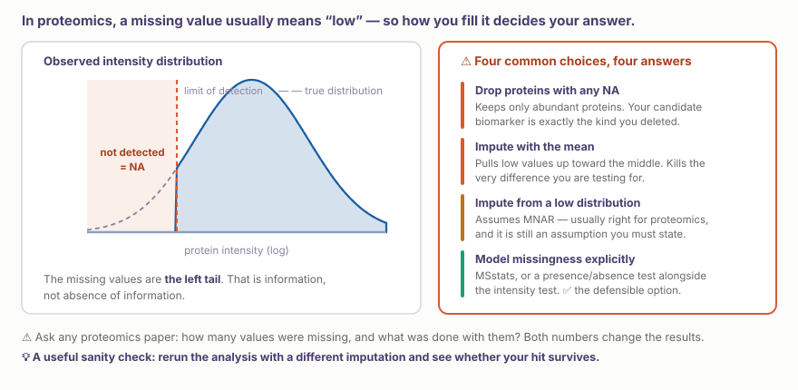
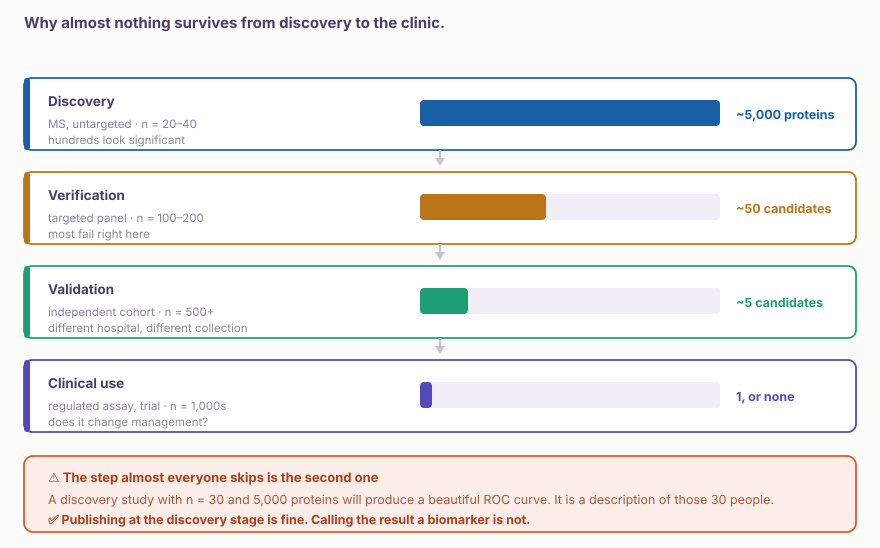
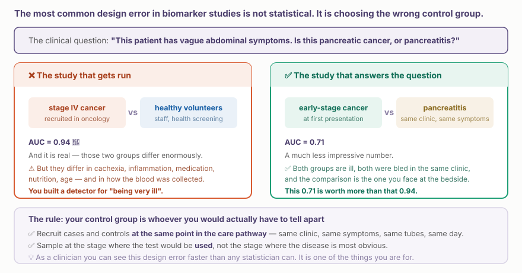

::: {.callout-note collapse="true"}
## 🎯 학습목표

이 장을 마치면 다음을 할 수 있어야 합니다.

-   ⚠️ 단백체학의 결측값이 무작위 결측이 아닌 이유와 imputation 선택이 결론을 어떻게 바꾸는지 설명할 수 있다
-   `limma`로 차등 abundance 분석을 수행하고, 이것이 단순한 t-test가 아닌 이유를 말할 수 있다
-   ⚠️ 바이오마커 주장을 discovery → verification → validation → 임상의 단계에 놓을 수 있다
-   ⚠️ 잘못된 대조군 오류를 알아보고 이를 피하도록 연구를 설계할 수 있다
-   발견 연구에서 AUC 0.94라는 결과가 얼마나 가치 있는지 말할 수 있다
-   diagnostic, prognostic, predictive biomarker를 구분하고 연구가 실제로 어느 것을 검정했는지 말할 수 있다
-   소속 진료과에서 수행할 수 있는 바이오마커 연구 설계를 작성할 수 있다
:::

> 🤔 **동기 질문**
>
> 한 논문에서 혈장 단백질 하나가 췌장암 환자와 건강한 대조군을 AUC = 0.94로 구분한다고 보고했습니다. 막연한 복통을 호소하는 눈앞의 환자에게 이 검사를 처방하시겠습니까?

------------------------------------------------------------------------

# 1. ⚠️ Missing value부터 🕳️ {#w10-s1}

통계 전에, transcriptomics엔 없던 결정을 먼저 내려야 함

{fig-align="center"}

## 1) 무작위가 아닌 이유 {#w10-s1-1}

Run에서 protein이 빠지는 주된 이유 = **검출한계 아래**, 즉 양이 적어서. 통계 용어로 **MNAR**(missing not at random) — 대부분의 기본 방법이 가정하는 것과 정반대

-   ⚠️ **DDA는 여기에 기술적 missing을 한 층 더 얹음** (🔗 [W9 §2.2](w9_proteomics_tech.qmd#w9-s2-2)) — 양이 적어서가 아니라 선택되지 않아서 빠질 수도 있음
-   ✅ **DIA data는 이 점에서 훨씬 깨끗함** → 지금 DIA가 기본값이 된 가장 큰 이유

## 2) 네 가지 선택, 각각이 결과에 하는 일 {#w10-s1-2}

::: {.callout-important collapse="true"}
## 전부 정리 단계가 아니라 가정

-   ❌ **Missing이 하나라도 있는 protein 제외** → 많고 어디서나 검출되는 protein만 남음 = 새 biomarker가 나올 법한 집합과 정반대
-   ❌ **행 평균으로 imputation** → 낮은 값이 가운데로 끌려 올라감 = 검정하려던 차이를 바로 줄여버림
-   ⚠️ **낮은 분포에서 뽑아 imputation** (예: Perseus처럼 평균을 낮추고 폭을 좁힌 정규분포). 대개 MNAR 기전에 그럭저럭 맞음 — 그래도 Methods에 적어야 할 가정
-   ✅ **Missing을 명시적으로 modelling** — `MSstats`, 또는 intensity 검정과 함께 presence/absence 검정도 보고. NA도 data라는 걸 숨기지 않으니 가장 방어 가능

💡 **반사적으로 할 확인:** 다른 imputation으로 다시 돌려서 hit가 살아남는지 보기. 안 살아남으면 → reviewer보다 먼저 중요한 걸 알게 된 것
:::

------------------------------------------------------------------------

# 2. 차이 검정 📊 {#w10-s2}

## 1) t-test 말고 `limma`인 이유 {#w10-s2-1}

Proteomics dataset = 넓고 짧음: protein 수천 개, sample 수십 개. Protein별 t-test → 분산 추정이 아주 적은 관측치에 기대서 불안정

`limma` = **empirical Bayes**로 protein별 분산을 전체 추세 쪽으로 축소 → 우연히 아주 일정해 보이는 protein이 자동으로 유의 판정을 받지 않음

::: {.panel-tabset group="lang"}

### R

```{r}
library(limma); library(tidyverse)

# toy input (illustration only): the simulated plasma panel from the hands-on below
mat  <- readRDS(here::here("rawdata", "plasma_proteomics.rds"))
meta <- readRDS(here::here("rawdata", "plasma_meta.rds"))
mat  <- mat[rowMeans(is.na(mat)) < 0.30, ]    # proteins measured in ≥ 70% of samples

# mat: log2 intensities, proteins × samples. meta: one row per sample.
design <- model.matrix(~ condition + sex + age + batch, data = meta)   # ⚠️ batch belongs here

fit <- lmFit(mat, design) |> eBayes(trend = TRUE, robust = TRUE)
res <- topTable(fit, coef = "conditioncase", number = Inf) |>
  as_tibble(rownames = "protein")
res
```

### Python

```{python}
import numpy as np, pandas as pd, pyreadr
import statsmodels.formula.api as smf
from statsmodels.stats.multitest import multipletests

# toy input (illustration only): the simulated plasma panel from the hands-on below
mat  = pyreadr.read_r("rawdata/plasma_proteomics.rds")[None]    # proteins × samples, log2
meta = pyreadr.read_r("rawdata/plasma_meta.rds")[None]
meta["condition"] = meta.condition.cat.reorder_categories(["control", "case"])   # control = reference, as in R
mat  = mat[mat.isna().mean(axis=1) < 0.30]     # proteins measured in ≥ 70% of samples

# limma's moderated t has no maintained Python port — an ordinary linear model per protein
def fit_per_protein(mat, meta, rhs, term="condition[T.case]"):
    rows = []
    for protein, y in mat.iterrows():
        f = smf.ols(f"y ~ {rhs}", data=meta.assign(y=y.to_numpy()), missing="drop").fit()
        rows.append((protein, f.params[term], f.tvalues[term], f.pvalues[term]))
    res = pd.DataFrame(rows, columns=["protein", "logFC", "t", "P"]).set_index("protein")
    res["adj_P"] = multipletests(res.P, method="fdr_bh")[1]
    return res.sort_values("P")

res = fit_per_protein(mat, meta, "condition + sex + age + batch")   # ⚠️ batch belongs here
res.head(10)
```

:::

-   ✅ `trend = TRUE` → MS data에 전형적인 intensity–variance 관계를 반영
-   ⚠️ Design에 **batch, sex, age** 넣기. Model에서 뺀다고 사라지지 않음
-   ✅ Technical replicate나 fractionation이 있는 MS 설계 → **`MSstats`**가 계층 구조를 제대로 modelling

## 2) 보고할 것 {#w10-s2-2}

-   Effect size(log2 fold change) **+** adjusted p-value — 지난 학기 DESeq2와 같은 원칙
-   검정한 protein 수, missing 때문에 뺀 protein 수. ⚠️ Multiple testing 기준 = 살아남은 protein이 아니라 검정한 protein 전체 (🔗 [W2 §2.4](../part1/w2_scripts_ai.qmd#w2-s2-4))
-   다른 imputation에서도 결과가 유지되는지

------------------------------------------------------------------------

# 3. ⚠️ 차이에서 biomarker로 🪜 {#w10-s3}

군 간 유의한 차이 = 아주 긴 과정의 시작일 뿐 (단계마다 측정법이 어떻게 바뀌는지: 🔗 [W9 §4.2](w9_proteomics_tech.qmd#w9-s4-2))

{fig-align="center"}

## 1) 자주 헷갈리는 biomarker 세 종류 {#w10-s3-1}

| 종류 | 묻는 것 | 필요한 것 |
|--------------------|--------------------------|--------------------------|
| **Diagnostic biomarker** | 이 환자가 *지금* 병이 있나? | 내원 시점의 환자군 + 제대로 된 감별진단군 |
| **Prognostic biomarker** | 이 환자에게 앞으로 무슨 일이? | 추적관찰, outcome, 생존 model |
| **Predictive biomarker** | 이 환자가 *이* 약에 반응할까? | ⚠️ 치료군 + 비치료군 — 없으면 예측과 예후를 못 가름 |

⚠️ **Predictive biomarker가 가장 어려운데 가장 자주 주장됨.** "반응자가 비반응자보다 수치가 높았다" = 치료와 무관하게 그냥 예후 좋은 병을 표시하는 marker여도 똑같이 나옴

## 2) ⚠️ AUC 0.94가 아무 가치 없을 수 있는 이유 {#w10-s3-2}

{fig-align="center"}

::: {.callout-warning collapse="true"}
## 동기 질문으로 돌아가기

**처방 x** — 적어도 그 연구만으로는

논문의 비교 = 진행성 암 vs 건강한 자원자. 눈앞의 환자는 둘 다 아님. 진료에서 쓸모 있으려면 → **내원 시점의 조기 암 vs 그걸 흉내 내는 질환**을 갈라야 함

밑에 숨은 두 번째 문제: 환자군은 종양 병동에서, 대조군은 건강검진센터에서 채혈 → 채혈 tube, 처리까지 시간, 공복 여부가 군 간에 전부 체계적으로 다름 (🔗 [W9 §6](w9_proteomics_tech.qmd#w9-s6)). AUC 일부 = **어디서 채혈했나**를 잰 것

→ ✅ 물어볼 것: 환자군과 대조군을 진료 경로의 같은 시점, 같은 장소, 같은 tube로 채취했나?
:::

## 3) 진료 현장에선 유병률이 전부를 바꿈 {#w10-s3-3}

AUC는 유병률과 무관, **PPV(양성예측도)는 아님**

```
민감도 90%, 특이도 90%:

  유병률 50%(임상시험 코호트)    →  PPV ≈ 90%
  유병률  1%(선별검사 진료소)    →  PPV ≈  8%
```

⚠️ 같은 검사. 양성 100건 중 92건이 거짓양성 → 전원 CT

💡 이 계산은 내가 할 수 있고 bioinformatician은 못 함 — **우리** 진료 현장의 유병률이 필요하니까

------------------------------------------------------------------------

# 4. 실제로 돌릴 수 있는 연구 설계 📋 {#w10-s4}

**① 임상 결정을 명시.** "X의 biomarker 찾기" x → *"지금 추측에 기대는 바로 그 시점에 A와 B를 구분"*

**② Comparator group 명시** — 실제로 구별해야 하는 집단으로

**③ 첫 sample 전에 채취 protocol 확정.** 같은 tube, 같은 원심분리까지 시간, 같은 aliquot 부피, 동결–해동 기록. 한 페이지로 적어두기

**④ Batch에 randomise.** 🔗 [W1 §3.3](../part1/w1_intro.qmd#w1-s3-3) — 여기서 가장 크게 물림

**⑤ 아무것도 보기 전에 validation set 떼어두기.** 환자 단위로, 가능하면 모집 기관이나 기간으로 나누기

**⑥ 성공 기준을 미리 정하기** — AUC 기준이 아니라 어떤 결정이 바뀌는지로

::: {.callout-tip collapse="true"}
## 전공의가 실제로 할 수 있는 버전

새 전향적 cohort가 없어도 시작 가능

-   ✅ 많은 병원이 잔여 serum/plasma를 보관 중. 뭐가 어떤 동의로 보관돼 있는지 확인
-   ✅ **Outcome 기준으로 고른** 후향적 sample 세트(반응자 vs 비반응자, 재발 vs 비재발) > 연속 모집. 추적관찰 결과도 이미 붙어 있음
-   ⚠️ 함정: 보관 sample은 당시 조건대로 채취됨 → pre-analytical variation이 실제 위험. 채취가 protocol화돼 있었는지 확인
-   ✅ 보관 sample 300개를 affinity panel로 > 새 sample 30개를 MS로. 대개 더 싸고 훨씬 많은 걸 알려줌
:::

------------------------------------------------------------------------

# 5. 실습 💻 {#w10-s5}

## 1) Missing을 의도적으로 다루기 {#w10-s5-1}

⚠️ 이 dataset은 simulation (환자 검체는 공유 불가). 그리고 **batch와 condition이 일부 교락**: B1 = 대조군 28 + 환자군 12, B2는 그 반대. 의도한 것 — 환자군과 대조군을 다른 시기에 모은 실제 보관 cohort가 딱 이렇게 생김

::: {.panel-tabset group="lang"}

### R

```{r}
library(tidyverse); library(limma)

prot <- readRDS(here::here("rawdata", "plasma_proteomics.rds"))  # proteins × samples, log2
meta <- readRDS(here::here("rawdata", "plasma_meta.rds"))

table(meta$batch, meta$condition)    # ⚠️ look at this before anything else

# ⚠️ Look before deciding
miss <- rowMeans(is.na(prot))
hist(miss, breaks = 40, main = "Fraction missing per protein")

# Is missingness related to abundance? (if yes → MNAR)
plot(rowMeans(prot, na.rm = TRUE), miss,
     xlab = "mean intensity", ylab = "fraction missing", pch = 16, col = "#185FA5")
```

### Python

```{python}
import matplotlib.pyplot as plt

prot = pyreadr.read_r("rawdata/plasma_proteomics.rds")[None]    # proteins × samples, log2
meta = pyreadr.read_r("rawdata/plasma_meta.rds")[None]
meta["condition"] = meta.condition.cat.reorder_categories(["control", "case"])

print(pd.crosstab(meta.batch, meta.condition))    # ⚠️ look at this before anything else

# ⚠️ Look before deciding
miss = prot.isna().mean(axis=1)
plt.hist(miss, bins=40); plt.title("Fraction missing per protein")
plt.show()

# Is missingness related to abundance? (if yes → MNAR)
plt.scatter(prot.mean(axis=1), miss, s=16, c="#185FA5")
plt.xlabel("mean intensity"); plt.ylabel("fraction missing")
plt.show()
```

:::

💡 두 번째 plot에서 뚜렷한 음의 추세 = 그게 바로 MNAR의 증거. Supplement에 넣기

## 2) 중요한 covariate를 넣고 검정 {#w10-s5-2}

::: {.panel-tabset group="lang"}

### R

```{r}
keep <- miss < 0.30                       # state this threshold in the methods
mat  <- prot[keep, ]

design <- model.matrix(~ condition + age + sex + batch, data = meta)
fit    <- lmFit(mat, design) |> eBayes(trend = TRUE, robust = TRUE)
res    <- topTable(fit, coef = "conditioncase", number = Inf) |>
  as_tibble(rownames = "protein")

sum(res$adj.P.Val < 0.05)
```

### Python

```{python}
keep = miss < 0.30                        # state this threshold in the methods
mat  = prot[keep]

res = fit_per_protein(mat, meta, "condition + age + sex + batch")

int((res.adj_P < 0.05).sum())
```

:::

## 3) ✅ 한 가지를 세 번 바꾸기 {#w10-s5-3}

::: {.panel-tabset group="lang"}

### R

```{r}
# ① Drop batch from the design. How many hits change?
#    (you should go from ~40 proteins to ~209 — that gap is 169 false positives)
# ② Impute from a low distribution instead of filtering. Do the top 10 survive?
# ③ Split by patient into train/test, fit on train, evaluate AUC on test.
#    Compare that AUC with the one from the full dataset.
```

### Python

```{python}
# ① Drop batch from the design. How many hits change?
#    (you should go from ~40 proteins to ~209 — that gap is 169 false positives)
# ② Impute from a low distribution instead of filtering. Do the top 10 survive?
# ③ Split by patient into train/test, fit on train, evaluate AUC on test.
#    Compare that AUC with the one from the full dataset.
```

:::

⚠️ ③이 핵심. In-sample AUC와 held-out AUC의 차이 = overfitting의 크기. 보통 예상보다 큼

## 4) 설계 과제 이어서 {#w10-s5-4}

🔗 [W9 §7.3](w9_proteomics_tech.qmd#w9-s7-3)에서 설계한 연구에 추가:

-   실제로 필요한 **comparator group**
-   결과가 바꿀 **결정**
-   검사를 쓸 진료 현장의 **유병률**

W14에 가져오기 — 충분히 말이 되는 capstone project

------------------------------------------------------------------------

# 📝 요약

-   ⚠️ **Proteomics missing value 대부분 = "너무 낮아서 검출 안 됨"** — MCAR가 아니라 MNAR
-   ❌ NA 있는 protein 제외 → 많은 protein만 남음. ❌ 평균 imputation → 검정하려는 효과가 줄어듦
-   ✅ 낮은 분포에서 imputation하거나 missing을 명시적으로 modelling(`MSstats`) — **어느 쪽인지 적기**
-   ✅ 다른 imputation으로 재분석. Hit가 안 살아남으면 reviewer보다 먼저 아는 게 나음
-   Empirical Bayes를 쓰는 `limma` = protein별 t-test보다 안정적. ⚠️ Design에 batch, age, sex
-   ⚠️ Discovery → verification → validation → clinical. **단계마다 ~90% 탈락**, 가장 자주 건너뛰는 건 두 번째 단계
-   ⚠️ **Diagnostic, prognostic, predictive = 서로 다른 주장.** Predictive엔 비치료군 필요
-   ⚠️ **건강한 자원자 대비 AUC 0.94 = "많이 아픈 상태" 탐지기일 수도** — 일부는 채혈 장소 탐지기
-   ✅ 대조군 = 실제로 구분해야 할 사람들, 진료 경로의 같은 시점에 채취
-   ⚠️ **유병률이 낮으면 PPV 붕괴.** 민감도·특이도 90% 검사를 유병률 1%에 쓰면 PPV ≈ 8%
-   ✅ Outcome으로 고른 보관 sample + affinity panel = 전공의에게 현실적인 출발점

------------------------------------------------------------------------

# 🔑 핵심 용어

| 용어 | 한 줄 정의 |
|-------------------------|-----------------------------------------|
| MNAR / MCAR | 무작위가 아닌 결측 / 완전 무작위 결측 |
| Left-censoring | 검출한계보다 낮은 값을 결측으로 기록하는 것 |
| Imputation | 결측값을 채우는 과정으로, 선택한 방법마다 가정이 따름 |
| `MSstats` | 결측과 연구 설계를 함께 모형화하는 단백체학 패키지 |
| Empirical Bayes | 단백질별 분산을 전체 분산 추세 쪽으로 축소하는 방법(`limma`) |
| Discovery / verification / validation | 바이오마커가 임상에 도달하기 전에 거치는 발견·확인·검증의 세 단계 |
| Diagnostic biomarker | 환자가 현재 질병을 가지고 있는지 판별하는 지표 |
| Prognostic biomarker | 치료와 무관하게 앞으로 일어날 결과를 예측하는 지표 |
| Predictive biomarker | 특정 환자가 특정 치료로 이득을 볼지 예측하는 지표 |
| Comparator group | 검사가 환자군과 실제로 구분해야 하는 비교 집단 |
| PPV | 검사 양성인 사람 중 실제 환자의 비율로, 유병률에 따라 달라짐 |
| Overfitting | 별도로 보관한 코호트에서는 유지되지 않는 과도하게 낙관적인 성능 |

------------------------------------------------------------------------

# ➕ 참고문헌

### 결측값과 통계

Lazar C, et al. [*Accounting for the multiple natures of missing values in label-free quantitative proteomics data sets.*](https://doi.org/10.1021/acs.jproteome.5b00981) J Proteome Res. 2016. **← 단백체학의 MNAR와 MCAR를 다룬 핵심 문헌**\
Choi M, et al. [*MSstats: an R package for statistical analysis of quantitative mass spectrometry-based proteomic experiments.*](https://doi.org/10.1093/bioinformatics/btu305) Bioinformatics. 2014.\
Ritchie ME, et al. [*limma powers differential expression analyses for RNA-sequencing and microarray studies.*](https://doi.org/10.1093/nar/gkv007) Nucleic Acids Res. 2015.

### 바이오마커 개발과 실패

Pepe MS, et al. [*Phases of biomarker development for early detection of cancer.*](https://doi.org/10.1093/jnci/93.14.1054) J Natl Cancer Inst. 2001. **← 문제를 가장 명확히 설명하는 5단계 framework**\
Ioannidis JPA, Bossuyt PMM. [*Waste, leaks, and failures in the biomarker pipeline.*](https://doi.org/10.1373/clinchem.2016.254649) Clin Chem. 2017.\
Geyer PE, et al. [*Revisiting biomarker discovery by plasma proteomics.*](https://doi.org/10.15252/msb.20156297) Mol Syst Biol. 2017.\
Collins GS, et al. [*Transparent reporting of a multivariable prediction model for individual prognosis or diagnosis (TRIPOD).*](https://doi.org/10.7326/M14-0697) Ann Intern Med. 2015. **← 논문 작성에 사용할 보고 지침**

### 연구 설계

Bossuyt PM, et al. [*STARD 2015: an updated list of essential items for reporting diagnostic accuracy studies.*](https://doi.org/10.1136/bmj.h5527) BMJ. 2015.\
Rifai N, Gillette MA, Carr SA. [*Protein biomarker discovery and validation: the long and uncertain path to clinical utility.*](https://doi.org/10.1038/nbt1235) Nat Biotechnol. 2006.
