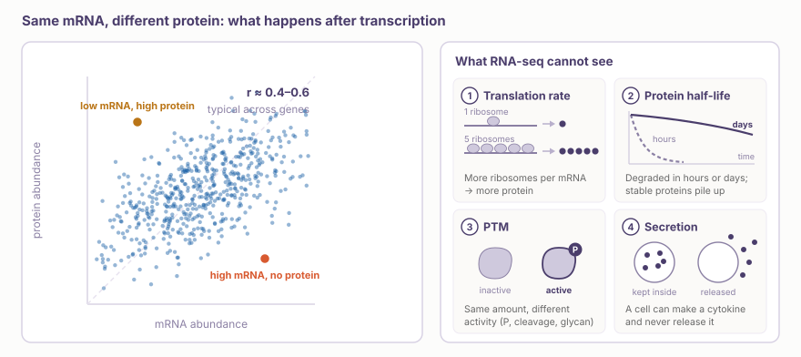
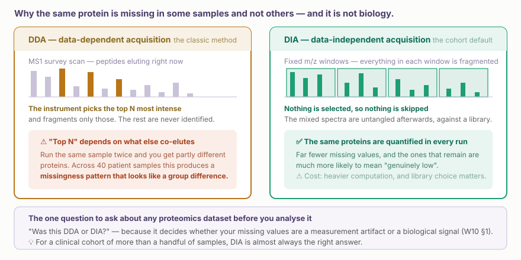
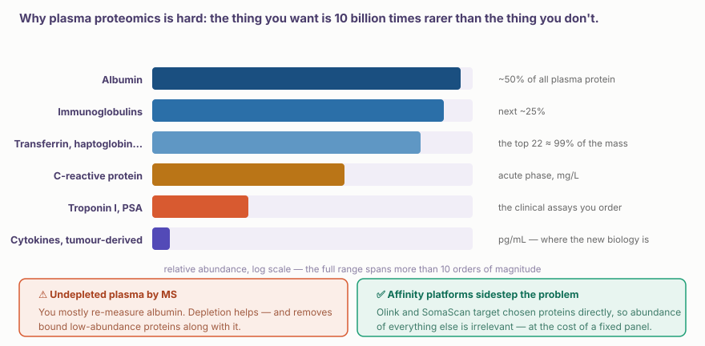
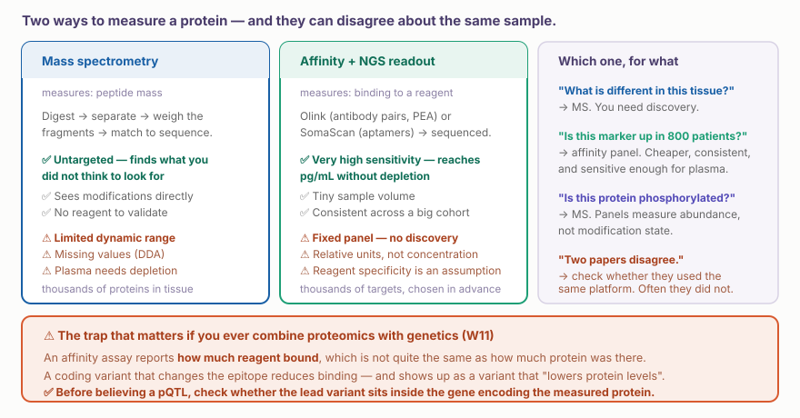

::: {.callout-note collapse="true"}
## 🎯 학습목표

이 장을 마치면 다음을 할 수 있어야 합니다.

-   ⚠️ mRNA가 단백질의 제한적인 대리 지표인 이유를 말하고 그 한계의 크기를 수치로 설명할 수 있다
-   질량분석기가 무엇을 측정하는지 모호한 표현 없이 한 문단으로 설명할 수 있다
-   ⚠️ DDA가 생물학적 신호처럼 보이는 결측값을 만드는 이유를 설명할 수 있다
-   혈장이 단백체학에서 가장 어렵지만 임상적으로 가장 유용한 검체인 이유를 말할 수 있다
-   연구 질문에 따라 질량분석과 affinity panel 중 하나를 선택할 수 있다
-   ⚠️ 거짓 pQTL을 만드는 epitope artifact를 알아볼 수 있다
-   단백체 코어 시설에 연구의 성패를 결정하는 세 가지 질문을 할 수 있다
:::

> 🤔 **동기 질문**
>
> RNA-seq에서 반응자의 유전자 발현이 3배 높았습니다. 공동연구자가 단백질을 측정했지만 차이가 없었습니다. 어느 결과가 틀렸습니까?

------------------------------------------------------------------------

# 1. ⚠️ 지금까지 모든 분석이 기대온 가정 🧬 {#w9-s1}

## 1) mRNA는 protein을 얼마나 잘 예측하나? {#w9-s1-1}

{fig-align="center"}

한 sample 안에서 gene별 mRNA vs protein abundance 상관 = 보통 **r = 0.4–0.6** 정도. Gene 하나를 여러 sample에 걸쳐 본 상관은 gene마다 천차만별 — 강한 gene도 있고, 사실상 0인 gene도 있음

::: {.callout-important collapse="true"}
## 동기 질문의 두 결과, 둘 다 틀리지 않음

서로 다른 걸 측정한 것

-   RNA-seq = **전사 + transcript 안정성**
-   Protein assay = **번역, folding, 분비, 분해의 균형**

mRNA 3배 ↑인데 protein 변화 x = 실제로 해석 가능한 결과: 하류의 뭔가가 완충하고 있다는 뜻. 둘이 일치했을 때보다 오히려 더 흥미로울 때가 많음

⚠️ 문제는 불일치가 아님. RNA-seq 결과를 protein에 대한 진술처럼 써버린 게 문제
:::

## 2) 기술 문제만이 아니라 임상적으로 중요한 이유 {#w9-s1-2}

-   **약은 protein에 작용.** Transcript data만으로 고른 target = 한 단계를 건너뛴 것
-   **처방하는 biomarker 전부**(troponin, PSA, CRP, HbA1c) = protein이거나 protein 변형
-   **PTM은 RNA-seq에 안 보임.** 인산화, 절단, 당화 → 양은 그대로인데 protein이 *하는 일*이 바뀜
-   **분비도 안 보임.** Cell이 cytokine을 전사하고도 내보내지 않을 수 있음 (🔗 [W6 §3.2](../part3/w6_scrna_dynamics.qmd#w6-s3-2))

------------------------------------------------------------------------

# 2. 질량분석기가 하는 일 🔬 {#w9-s2}

## 1) 측정 과정, 정확하게 {#w9-s2-1}

질량분석기는 protein 서열을 읽지 않음. 전하 띤 조각의 질량을 아주 정밀하게 재고 → software가 그 질량으로 서열을 추론

```
단백질 혼합물
   → trypsin으로 분해          (단백질은 너무 크지만 peptide는 그렇지 않음)
   → 액체 크로마토그래피       (시간에 따라 peptide를 분리)
   → MS1: peptide 질량 측정    (현재 용출되는 물질을 조사)
   → MS2: 분해 후 질량 측정    (조각의 패턴으로 서열을 식별)
   → 데이터베이스와 대조       → 단백질의 정체와 양
```

⚠️ 이 설계에서 나오는, 하류 분석에 중요한 세 가지:

-   **Peptide를 재고 protein을 추론.** Family끼리 공유하는 peptide → 모호성
-   **식별은 database에 의존.** Database에 없는 protein 형태는 못 찾음
-   **정량은 상대적** — 표지된 표준물질(spike-in)을 넣지 않는 한

## 2) ⚠️ DDA vs DIA — 통계를 결정하는 차이 {#w9-s2-2}

{fig-align="center"}

::: {.callout-warning collapse="true"}
## DDA의 missing이 위험한 이유

DDA = 매 cycle마다 장비가 intensity 가장 높은 precursor를 고름. 뭐가 "가장 높은지"는 그 순간 같이 용출되는 다른 모든 것에 따라 달라짐

-   ⚠️ 같은 sample을 두 번 돌려도 **protein 목록이 일부 달라짐**
-   ⚠️ Cohort 전체로 보면, 어떤 protein이 측정됐는지가 총 protein 양, chromatography drift, run 순서와 상관됨
-   ⚠️ 환자군과 대조군을 다른 batch에서 돌렸다면(🔗 [W1 §3.3](../part1/w1_intro.qmd#w1-s3-3)) → missing 자체가 군 간 차이가 됨

→ ✅ **DIA = 고정된 window 안의 모든 것을 fragment** → 모든 run에서 같은 protein이 정량됨. 임상 cohort라면 이게 기본값 — 남의 dataset을 볼 때도 제일 먼저 물어볼 것
:::

------------------------------------------------------------------------

# 3. ⚠️ Plasma: 가장 쓰고 싶은데 가장 어려운 검체 🩸 {#w9-s3}

{fig-align="center"}

Plasma protein 농도 범위 = **10자릿수 이상**. Albumin 하나가 총 protein 질량의 약 절반, 상위 ~22개 protein이 약 99%. 정작 관심 있는 것(cytokine, 종양 유래 protein)은 반대쪽 끝에 있음

::: {.callout-tip collapse="true"}
## 실제로 할 만한 연구에서 이게 뜻하는 것

-   ⚠️ **Depletion 안 한 plasma를 MS로** → 대부분 albumin을 또 재는 것. Protein 수백 개가 나오는데, 대부분 일반 화학검사 panel에 이미 있는 것들
-   ⚠️ **Depletion column** → 많은 protein을 걷어내면서 거기 붙어 있던 적은 protein까지 같이 제거("albuminome"). 알려진, 피할 수 없는 손실
-   ✅ **Affinity panel은 이 문제를 아예 우회**: 고른 protein만 표적 → tube 안에 뭐가 더 있든 상관 x. 요즘 대규모 plasma biomarker 연구 대부분이 affinity panel을 쓰는 이유
-   ✅ **조직은 plasma보다 훨씬 쉬움.** 생검으로 물을 수 있는 질문이면 → 이런 문제 없이 MS로 protein 수천 개

💡 누가 "plasma proteomics"를 하자면서 platform을 말 안 한다면 → 그것부터 물어보기
:::

------------------------------------------------------------------------

# 4. 두 기술, 서로 다른 두 측정값 ⚖️ {#w9-s4}

{fig-align="center"}

## 1) ⚠️ Affinity assay는 결합을 잼 {#w9-s4-1}

::: {.callout-important collapse="true"}
## Epitope artifact — 그리고 W11에서 중요한 이유

항체나 aptamer가 보고하는 값 = **시약이 얼마나 결합했나**. 대개는 protein abundance를 따라가지만, 아닐 때도 있음

결합 epitope를 바꾸는 coding variant → protein 양은 그대로인데 signal ↓. 유전 분석에선 protein 수치를 "낮추는" variant로 보임 = **가짜 pQTL**. 그리고 *cis* variant에 특히 몰림 (gene 안에 있는 variant라서)

✅ 확인법: *cis*-pQTL마다 lead variant가 같은 gene의 protein-altering variant인지 보기. 그렇다면 → 직교 검증 필요. Peptide를 직접 재는 MS가 가장 좋음

⚠️ pQTL이 drug-target Mendelian randomization에 점점 많이 쓰여서 중요(🔗 [W3 §3.2](../part2/w3_gwas.qmd#w3-s3-2)). 여기서 생긴 artifact → target 선정까지 그대로 전파
:::

## 2) Platform 간 불일치는 정상 {#w9-s4-2}

Affinity platform끼리, 또는 affinity vs MS를 비교한 연구 → 상당수 target에서 상관이 낮게 나오는 게 보통

-   ⚠️ 같은 protein에 다른 결과를 낸 두 논문이, 각자 잰 것에 대해선 둘 다 맞을 수 있음
-   ✅ 중요한 결과면 두 번째 platform으로 확인. Methods에 넣으면 reviewer를 막아주는 문장

------------------------------------------------------------------------

# 5. Proteomics core와 상의하기 💬 {#w9-s5}

직접 돌릴 일은 없음. 연구 성패를 가르는 질문 세 가지:

**① "제 질문엔 MS와 affinity panel 중 뭘 권하시나요? 이유는요?"**

좋은 core는 가진 장비가 아니라 내 검체 종류와 cohort 크기를 근거로 답함

**② "한 batch에 sample 몇 개까지 돌리고, 제 sample은 어떻게 randomise하나요?"**

⚠️ 뒷부분 답을 들어보면 confounding을 생각해봤는지 알 수 있음. 편의상 환자군과 대조군을 batch별로 나누려 한다면 → 지금 고치기 (🔗 [W1 §3.3](../part1/w1_intro.qmd#w1-s3-3))

**③ "검체량은 얼마나 필요하고, 분석 전 조건은요?"**

::: {.callout-warning collapse="true"}
## Pre-analytical variation이 어떤 분석 선택보다 더 많은 biomarker 연구를 무너뜨림

-   **Serum vs plasma?** Serum은 응고를 거침 → 혈소판 내용물이 방출돼 섞임
-   **어떤 항응고제?** EDTA, citrate, heparin → 결과가 다름. Heparin은 일부 assay를 방해
-   **처리까지 걸린 시간.** 불안정한 protein은 실온 몇 분도 영향
-   **동결–해동 횟수.** 세고, 기록하기
-   **용혈.** 분홍빛 sample = 적혈구 내용물이 다른 모든 걸 압도하는 농도로 들어 있음

⚠️ 환자군은 외래, 대조군은 건강검진센터에서 채취 → 위 조건이 전부 체계적으로 다름. **실험복 입은 batch effect** = biomarker가 재현 안 되는 가장 흔한 이유
:::

------------------------------------------------------------------------

# 6. 실습 💻 {#w9-s6}

이번 주 설치할 것 없음. 브라우저 실습 2개 + 설계 과제 1개

## 1) 처방하는 protein 찾아보기 {#w9-s6-1}

[**Human Protein Atlas**](https://www.proteinatlas.org) → 진료에서 쓰는 biomarker 하나 검색 (troponin I, PSA, CA-125, NT-proBNP…)

-   ① 어떤 조직, 어떤 cell type에서 발현? 임상에서 말하는 만큼 특이적인가?
-   ② 같은 페이지에서 **RNA**와 **protein** 조직 profile 비교. 어디서 안 맞나?
-   ③ Pathology 항목 보기 — 어떤 암에서든 발현이 생존과 연관되나?

## 2) Proteomics dataset 믿기 전에 확인하기 {#w9-s6-2}

내 분야의 plasma proteomics 논문 하나 골라서 답해보기:

-   ④ **Platform?** MS인가 affinity인가 — MS라면 **DDA인가 DIA인가**?
-   ⑤ **Depletion?** Protein 몇 개를 정량했고, 그 숫자가 검체 종류에 비춰 말이 되나?
-   ⑥ **Missing value** — 얼마나 많고, 어떻게 처리했나? (🔗 [W10 §1](w10_clinical_proteomics.qmd#w10-s1))
-   ⑦ **Pre-analytical** — 환자군과 대조군을 같은 방식, 같은 장소에서 채취했나?
-   ⑧ **Batch** — 군을 batch에 randomise했나, 언급이라도 했나?

💡 ⑦, ⑧은 보통 supplement에 있거나 아예 없음. 없다는 것 자체가 답

## 3) 설계 과제 {#w9-s6-3}

우리 과에서 현실적으로 할 수 있는 proteomics 연구를 다섯 문장으로 써보기: 검체 종류, platform, n, 비교, 가장 걱정되는 pre-analytical 변수 하나

→ [W10](w10_clinical_proteomics.qmd)에서 이걸로 작업

------------------------------------------------------------------------

# 📝 요약

-   ⚠️ mRNA vs protein 상관 ≈ **r = 0.4–0.6** — 그 차이 = RNA-seq이 못 보는 조절
-   Transcript와 protein의 불일치 = 오류가 아니라 **결과**
-   MS = peptide 질량을 재고 protein을 추론. 식별은 database 의존, 정량은 대개 상대적
-   ⚠️ **DDA는 intensity 가장 높은 precursor를 고름** → run마다 missing이 달라지고 군 간 차이처럼 보일 수 있음
-   ✅ **임상 cohort의 기본값 = DIA** — 매번 같은 protein을 정량
-   ⚠️ Plasma dynamic range \>10자릿수. Albumin이 질량의 절반, depletion은 붙어 있던 protein까지 제거
-   ✅ Affinity panel(Olink, SomaScan) = depletion 없이 pg/mL까지. 대신 panel이 고정
-   ⚠️ **Affinity assay는 결합을 잼.** Epitope를 바꾸는 variant → 가짜 *cis*-pQTL
-   ⚠️ **Pre-analytical variation**(serum vs plasma, tube 종류, 원심분리까지 시간, 동결–해동, 용혈)이 어떤 통계 선택보다 더 많은 biomarker 연구를 무너뜨림

------------------------------------------------------------------------

# 🔑 핵심 용어

| 용어 | 한 줄 정의 |
|-------------------------|-----------------------------------------|
| Tryptic digest | 측정할 수 있도록 단백질을 펩타이드로 절단하는 과정 |
| MS1 / MS2 | 온전한 펩타이드의 탐색 스캔 / 펩타이드 조각의 질량 스펙트럼 |
| DDA | 장비가 신호가 강한 상위 N개 전구체를 선택해 측정하는 방식 |
| DIA | 고정된 질량 범위 안의 모든 물질을 빠짐없이 측정하는 방식 |
| Spectral library | DIA 스펙트럼을 해석하는 데 사용하는 참조 자료 |
| Protein inference | 여러 단백질에 공통된 펩타이드를 원래 단백질에 배정하는 과정 |
| Dynamic range | 검체에서 가장 많은 단백질과 가장 적은 단백질 사이의 범위 |
| Depletion | 분석 전에 양이 많은 혈장 단백질을 제거하는 과정 |
| PEA (Olink) | 항체 쌍과 NGS 판독을 이용하는 근접 연장 분석법 |
| Aptamer (SomaScan) | 항체 대신 표적 단백질에 결합하도록 만든 핵산 분자 |
| pQTL | 단백질 수치와 연관된 유전 변이 |
| Epitope artifact | 변이가 시약 결합을 바꾸어 단백질 양이 변한 것처럼 보이는 현상 |
| Pre-analytical variation | 환자에게서 검체를 채취한 뒤 냉동고에 보관할 때까지 생기는 모든 변이 |
| PTM | 단백질 번역 후 일어나는 변형으로 RNA-seq에서는 관측되지 않음 |

------------------------------------------------------------------------

# ➕ 참고문헌

### mRNA와 단백질

Liu Y, Beyer A, Aebersold R. [*On the dependency of cellular protein levels on mRNA abundance.*](https://doi.org/10.1016/j.cell.2016.03.014) Cell. 2016. **← 상관성이 그 정도인 이유를 가장 명확히 설명한 논문**\
Buccitelli C, Selbach M. [*mRNAs, proteins and the emerging principles of gene expression control.*](https://doi.org/10.1038/s41576-020-0258-4) Nat Rev Genet. 2020.

### 질량분석

Aebersold R, Mann M. [*Mass-spectrometric exploration of proteome structure and function.*](https://doi.org/10.1038/nature19949) Nature. 2016.\
Ludwig C, et al. [*Data-independent acquisition-based SWATH-MS for quantitative proteomics: a tutorial.*](https://doi.org/10.15252/msb.20178126) Mol Syst Biol. 2018.\
Sinitcyn P, Rudolph JD, Cox J. [*Computational methods for understanding mass spectrometry-based shotgun proteomics data.*](https://doi.org/10.1146/annurev-biodatasci-080917-013516) Annu Rev Biomed Data Sci. 2018.

### 혈장과 임상 단백체학

Geyer PE, et al. [*Revisiting biomarker discovery by plasma proteomics.*](https://doi.org/10.15252/msb.20156297) Mol Syst Biol. 2017. **← 혈장 연구를 설계하기 전에 읽어야 할 논문**\
Anderson NL, Anderson NG. [*The human plasma proteome: history, character, and diagnostic prospects.*](https://doi.org/10.1074/mcp.r200007-mcp200) Mol Cell Proteomics. 2002. (dynamic range 논의를 시작한 논문)

### Affinity 플랫폼과 pQTL

Sun BB, et al. [*Genomic atlas of the human plasma proteome.*](https://doi.org/10.1038/s41586-018-0175-2) Nature. 2018.\
Ferkingstad E, et al. [*Large-scale integration of the plasma proteome with genetics and disease.*](https://doi.org/10.1038/s41588-021-00978-w) Nat Genet. 2021.\
Pietzner M, et al. [*Synergistic insights into human health from aptamer- and antibody-based proteomic profiling.*](https://doi.org/10.1038/s41467-021-27164-0) Nat Commun. 2021. **← 두 플랫폼이 얼마나 일치하지 않는지 측정한 연구**

### 자료

[Human Protein Atlas](https://www.proteinatlas.org) · [PRIDE 저장소](https://www.ebi.ac.uk/pride/) · [PeptideAtlas](https://peptideatlas.org)
