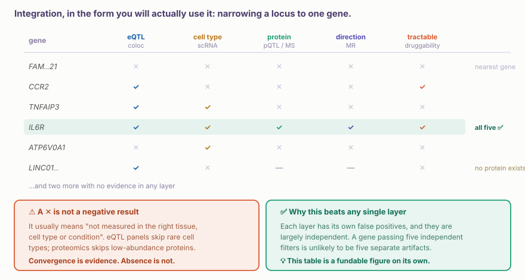
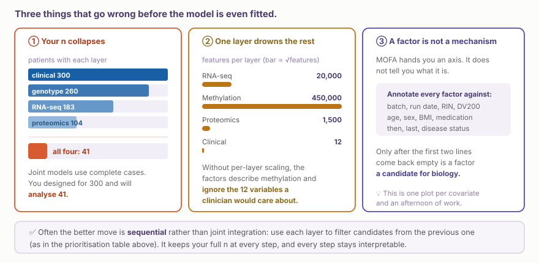

::: {.callout-note collapse="true"}
## 🎯 학습목표

이 장을 마치면 다음을 할 수 있어야 합니다.

-   **순차 통합**과 **공동 통합**을 구분하고 연구 질문에 어느 방식이 필요한지 말할 수 있다
-   여러 층에서 수렴하는 근거를 이용해 하나의 locus를 단일 후보 유전자로 좁힐 수 있다
-   ⚠️ 한 층에서 신호가 없다는 것이 음성 결과가 아닌 이유를 말할 수 있다
-   MOFA 분산 설명 그림을 읽고 ⚠️ 기술 요인을 알아볼 수 있다
-   ⚠️ 모형을 적합하기 전에 발생하는 세 가지 실패, 즉 n의 붕괴, scale 불균형, 해석할 수 없는 factor를 예상할 수 있다
-   통합이 실제로 제공하는 것과 만들어 낼 수 없는 것을 말할 수 있다
:::

> 🤔 **동기 질문**
>
> 같은 코호트에서 유전형, RNA-seq, 단백체, 임상 데이터를 가지고 있습니다. 이 모든 것을 하나의 모형에 넣어야 할까요?

------------------------------------------------------------------------

# 1. 통합하는 두 가지 방법 🧭 {#w11-s1}

## 1) Sequential — 층마다 앞 결과를 걸러냄 {#w11-s1-1}

이미 해봤음, 통합이라고 안 불렀을 뿐: W3에서 locus를 좁히고, W5에서 cell type을 특정하고, W9에서 protein이 실제로 있는지 물음. 층마다 후보가 줄어듦

-   ✅ 분석마다 그 층이 있는 sample만 씀 → 단계마다 **전체 n** 유지
-   ✅ 단계마다 따로 해석 가능, Methods에서 방어 가능
-   ✅ 층이 **서로 다른 cohort**에서 와도 됨 — 공개 eQTL data, 출판된 atlas, 내 sample
-   ⚠️ 층을 *가로질러서만* 보이는 pattern은 못 찾음

## 2) Joint — 층을 한꺼번에 modelling {#w11-s1-2}

**MOFA+**, **mixOmics/DIABLO**, **iCluster** 같은 방법 = 여러 층의 변이를 동시에 설명하는 latent factor를 찾음

-   ✅ 어느 한 층만으론 안 보이는, 층끼리 맞물린 program을 찾을 수 있음
-   ✅ Unsupervised → 묻지 않았던 구조(환자 subtype)까지 찾을 수 있음
-   ⚠️ 모든 층을 잰 **같은 sample**이 필요
-   ⚠️ 결과 = factor이지 기전이 아님

💡 **동기 질문의 답:** 대개 **처음부터는 x**. Sequential 우선순위화로 대부분의 임상 질문에 답할 수 있고, n도 지키고, reviewer가 따라올 수 있는 그림이 나옴. Joint model은 층 간 program을 구체적으로 의심하거나 unsupervised 환자 subtype이 필요할 때 꺼내기

------------------------------------------------------------------------

# 2. Sequential integration 실전 🎯 {#w11-s2}

{fig-align="center"}

## 1) 수렴이 강한 근거인 이유 {#w11-s2-1}

층마다 거짓양성이 따로 있고, 이들은 대체로 **독립적**: eQTL colocalisation artifact ≠ proteomics artifact. 독립적인 filter 5개를 다 통과한 gene = 우연이 다섯 번 겹쳤을 가능성 낮음

## 2) ⚠️ 없다 ≠ 근거 {#w11-s2-2}

::: {.callout-important collapse="true"}
## 끊임없이 잘못 읽히는 비대칭

한 열의 ✕ = 거의 항상 **"맞는 맥락에서 측정 못 함"**이지 "측정했는데 없음"이 아님

-   ⚠️ eQTL panel은 bulk 조직 기반 → 드문 cell type에만 있는 효과는 안 보임
-   ⚠️ Plasma proteomics는 양 적은 protein을 아예 놓침 (🔗 [W9 §3](../part5/w9_proteomics_tech.qmd#w9-s3))
-   ⚠️ 잴 protein 산물이 없는 gene도 있음
-   ⚠️ MR엔 강한 instrument가 필요. Instrument 없는 gene = 검정 불가 ≠ 검정해서 실패

→ ✅ 수렴은 양성 근거로 보고. 빈칸은 결과에 한 문장으로 **coverage limitation**이라고 보고

⚠️ 그리고 여기서 생기는 실패: 우선순위화 pipeline은 체계적으로 **잘 측정되고 잘 연구된 gene**을 선호. 같은 편향이 [W12](w12_network_drug.qmd)에서 network hub로 다시 등장
:::

------------------------------------------------------------------------

# 3. Joint model — 결과 읽기 📐 {#w11-s3}

{fig-align="center"}

## 1) Factor란? {#w11-s3-1}

Sample들이 달라지는 잠재 축 + 어느 층의 어느 feature가 그 축을 만드는지 알려주는 **loading**. Variance-explained plot = factor마다 각 층의 변이를 얼마나 설명하나

## 2) ⚠️ 해석 전에 factor부터 annotate {#w11-s3-2}

::: {.callout-warning collapse="true"}
## Factor 1은 거의 항상 기술적

실제 cohort에서 가장 강한 공통 변이 원인 = 질병인 경우 드묾. Batch, RNA integrity, sex, age일 때가 많음

✅ 순서대로 annotate:

1.  **기술** — batch, run date, RIN/DV200, operator, storage time
2.  **인구학** — age, sex, BMI, ancestry
3.  **임상 교란** — medication, comorbidity, disease duration
4.  **그다음에야** — disease status나 outcome

⚠️ Factor가 batch와 r = 0.8, disease와 r = 0.3 → disease와 살짝 교락된 batch factor. 이걸 "disease signature"로 보고하는 건 실제로 흔한 오류

💡 **여러** 층에 loading이 걸린 factor가 한 층에만 걸린 것보다 biology일 가능성이 높음 — 단, 1–3단계에서 아무것도 안 나온 뒤에
:::

------------------------------------------------------------------------

# 4. ⚠️ Model 전에 일어나는 세 가지 실패 🕳️ {#w11-s4}

{fig-align="center"}

**① n이 무너짐.** Joint model은 complete case만 씀. 4개 층을 가진 300명 cohort라도 4개 층을 다 잰 환자가 41명이면 → 그게 진짜 sample size

-   ✅ 분석 계획 **전에** 교집합 확인
-   ✅ Missing view를 처리하는 방법도 있음. 쓴다면 명시해야 할 결정이지 기본값이 아님

**② Scale 불균형.** Methylation feature 450,000개 vs 임상 변수 12개. 층별 scaling 없으면 → factor = methylation 설명

**③ Factor ≠ 기전.** §3.2 참고

::: {.callout-tip collapse="true"}
## 통합으로 할 수 없는 것

-   ❌ 검정력을 만들어내지 못함. 41명의 noisy한 층 4개 < 300명의 좋은 층 1개
-   ❌ 교락을 해결하지 못함. Batch가 disease를 따라가면 모든 층이 물려받고, joint model은 그걸 factor 하나에 모아줌
-   ❌ 검정력 부족한 연구를 출판 가능하게 만들지 못함. Reviewer들은 n 대신 통합을 들이민 연구를 잘 알아봄

→ ✅ 통합이 진짜로 주는 것: 다른 방법으론 못 보는 **층 간 맞물림**, 찾을 생각도 못 했던 **unsupervised subtype**
:::

------------------------------------------------------------------------

# 5. 실습 💻 {#w11-s5}

## 1) 우선순위화 표 만들기 {#w11-s5-1}

진료하는 질환의 locus 하나 골라서, §2의 표를 브라우저로 직접 채우기:

-   **eQTL / locus-to-gene** — [Open Targets Platform](https://platform.opentargets.org) (구 Open Targets Genetics) 또는 [GTEx](https://gtexportal.org)
-   **Cell type** — [CELLxGENE](https://cellxgene.cziscience.com)
-   **Protein** — [Human Protein Atlas](https://www.proteinatlas.org)
-   **방향** — MR 결과는 [IEU OpenGWAS](https://opengwas.io)
-   **Tractability** — [Open Targets](https://platform.opentargets.org)의 target profile

✅ 후보 gene 하나 = 한 행, 층 하나 = 한 열. 오후 한나절이면 되고, 진짜 논문 figure가 됨

## 2) 교집합부터 확인 {#w11-s5-2}

::: {.panel-tabset group="lang"}

### R

```{r}
library(tidyverse); library(UpSetR)

# toy cohort (illustration only): 200 patients, each layer measured in some of them
set.seed(1)
meta <- tibble(patient = sprintf("P%03d", 1:200),
               geno_id = ifelse(runif(200) < 0.90, patient, NA),
               rna_id  = ifelse(runif(200) < 0.60, patient, NA),
               prot_id = ifelse(runif(200) < 0.45, patient, NA))

have <- meta |> transmute(
  clinical   = 1L,
  genotype   = as.integer(!is.na(geno_id)),
  rna        = as.integer(!is.na(rna_id)),
  proteomics = as.integer(!is.na(prot_id)))

upset(as.data.frame(have), order.by = "freq")
cat("complete cases:", sum(rowSums(have) == ncol(have)), "\n")   # ⚠️ this is your n
```

### Python

```{python}
import numpy as np, pandas as pd, matplotlib.pyplot as plt
from upsetplot import UpSet, from_indicators

# toy cohort (illustration only): 200 patients, each layer measured in some of them
rng = np.random.default_rng(1)
patient = [f"P{i:03d}" for i in range(1, 201)]
meta = pd.DataFrame({"patient": patient,
                     "geno_id": np.where(rng.random(200) < 0.90, patient, None),
                     "rna_id":  np.where(rng.random(200) < 0.60, patient, None),
                     "prot_id": np.where(rng.random(200) < 0.45, patient, None)})

have = pd.DataFrame({"clinical":   True,
                     "genotype":   meta.geno_id.notna(),
                     "rna":        meta.rna_id.notna(),
                     "proteomics": meta.prot_id.notna()})

_ = UpSet(from_indicators(have), subset_size="count", sort_by="cardinality").plot()
plt.show()
print("complete cases:", have.all(axis=1).sum())   # ⚠️ this is your n
```

:::

## 3) MOFA, 그리고 factor annotation {#w11-s5-3}

::: {.panel-tabset group="lang"}

### R

```{r}
library(MOFA2)

# toy layers (illustration only): 60 samples × 3 omics, features × samples;
# a batch effect runs through RNA and protein, a weaker case effect through all three
set.seed(2)
n <- 60
meta <- tibble(sample = sprintf("S%02d", 1:n), batch = rep(c("B1", "B2"), each = n / 2),
               RIN = round(runif(n, 5, 9), 1), age = round(rnorm(n, 60, 10)),
               sex = sample(c("F", "M"), n, replace = TRUE), bmi = round(rnorm(n, 25, 4), 1),
               condition = sample(c("control", "case"), n, replace = TRUE))
layer <- function(p, prefix, batch_shift, case_shift) {
  m <- matrix(rnorm(p * n), p, n, dimnames = list(paste0(prefix, 1:p), meta$sample))
  b <- 1:(p / 5); k <- p / 5 + 1:(p / 10)
  m[b, ] <- m[b, ] + rep(batch_shift * (meta$batch == "B2"), each = length(b))
  m[k, ] <- m[k, ] + rep(case_shift * (meta$condition == "case"), each = length(k))
  m
}
rna_mat <- layer(500, "gene_", 2, 1); prot_mat <- layer(200, "prot_", 1.5, 1); meth_mat <- layer(300, "cpg_", 0, 0.8)

mofa <- create_mofa(list(RNA = rna_mat, Protein = prot_mat, Methyl = meth_mat)) |>
  prepare_mofa() |> run_mofa()

plot_variance_explained(mofa)          # the figure above

# ⚠️ the step that must come next
Z <- get_factors(mofa)[[1]]
covars <- meta |> select(batch, RIN, age, sex, bmi, condition)

cors <- sapply(covars, \(v) apply(Z, 2, \(f) {
  if (is.numeric(v)) abs(cor(f, v, use = "pairwise")) else summary(aov(f ~ factor(v)))[[1]][1, "F value"]
}))
round(cors, 2)     # look here before you look at biology
```

### Python

```{python}
from scipy.stats import f_oneway
from mofapy2.run.entry_point import entry_point

# toy layers (illustration only): 60 samples × 3 omics, samples × features;
# a batch effect runs through RNA and protein, a weaker case effect through all three
rng = np.random.default_rng(2)
n = 60
meta = pd.DataFrame({"sample": [f"S{i:02d}" for i in range(1, n + 1)], "batch": np.repeat(["B1", "B2"], n // 2),
                     "RIN": rng.uniform(5, 9, n).round(1), "age": rng.normal(60, 10, n).round(),
                     "sex": rng.choice(["F", "M"], n), "bmi": rng.normal(25, 4, n).round(1),
                     "condition": rng.choice(["control", "case"], n)})
def layer(p, batch_shift, case_shift):
    m = rng.normal(size=(n, p))
    m[:, : p // 5] += batch_shift * (meta.batch == "B2").to_numpy()[:, None]
    m[:, p // 5 : p // 5 + p // 10] += case_shift * (meta.condition == "case").to_numpy()[:, None]
    return m
views = {"RNA": layer(500, 2, 1), "Protein": layer(200, 1.5, 1), "Methyl": layer(300, 0, 0.8)}

ent = entry_point()
ent.set_data_matrix([[v] for v in views.values()], views_names=list(views))
ent.set_model_options(factors=15)                  # MOFA2's default in R
ent.set_train_options(seed=1, quiet=True)
ent.build(); ent.run()

r2 = pd.DataFrame(ent.model.calculate_variance_explained()[0] * 100, index=list(views))
r2.columns = [f"Factor{k + 1}" for k in r2.columns]
fig, ax = plt.subplots(figsize=(8, 2.5))
im = ax.imshow(r2, cmap="Purples", aspect="auto")
ax.set_xticks(range(r2.shape[1]), r2.columns, rotation=90); ax.set_yticks(range(len(views)), r2.index)
_ = fig.colorbar(im, label="variance explained (%)")
plt.show()

# ⚠️ the step that must come next
Z = pd.DataFrame(ent.model.nodes["Z"].getExpectation(), columns=r2.columns)
covars = meta[["batch", "RIN", "age", "sex", "bmi", "condition"]]

cors = pd.DataFrame({name: [abs(np.corrcoef(Z[f], v)[0, 1]) if pd.api.types.is_numeric_dtype(v)
                            else f_oneway(*(Z[f][v == g] for g in v.unique())).statistic
                            for f in Z] for name, v in covars.items()}, index=Z.columns)
cors.round(2)     # look here before you look at biology
```

:::

## 4) ✅ 한 가지 바꾸기 {#w11-s5-4}

::: {.panel-tabset group="lang"}

### R

```{r}
# Re-run MOFA with the batch effect removed from each layer first.
# Does Factor 1 disappear? Does anything else change rank?
```

### Python

```{python}
# Re-run MOFA with the batch effect removed from each layer first.
# Does Factor 1 disappear? Does anything else change rank?
```

:::

💡 Batch를 빼고 돌렸을 때 factor 순위가 뒤섞인다면 → 원래 결과 중 batch가 얼마였는지 알려주는 것. Review에서 지적받기 전에 알아둘 만한 숫자

## 5) 다음 주 전까지 {#w11-s5-5}

**[W12 — network와 약물 표적](w12_network_drug.qmd).** §5.1의 우선순위화 표 가져오기. 살아남은 gene이 약물 표적이 될 수 있는지 봄

------------------------------------------------------------------------

# 📝 요약

-   **Sequential** = 층마다 후보를 걸러냄. **Joint** = 층을 함께 modelling
-   ✅ Sequential은 전체 n 유지, cohort가 달라도 OK, 대부분의 임상 질문에 답함
-   ✅ 층마다 거짓양성이 **독립적** → 여러 층의 수렴 = 강한 근거
-   ⚠️ **신호 없음 = coverage gap이지 음성 결과 아님** — 그리고 우선순위화를 잘 연구된 gene 쪽으로 기울게 함
-   ⚠️ **Factor 1은 거의 항상 기술적.** Disease보다 먼저 batch, RIN, age, sex로 annotate
-   ⚠️ Joint model은 complete case만 씀 → **n = 교집합**, cohort 전체가 아님
-   ⚠️ 층별 scaling 없으면 feature가 제일 많은 층이 모든 factor를 지배
-   ❌ 통합으로 검정력을 만들거나, 교락을 고치거나, 검정력 부족한 연구를 살릴 수 없음

------------------------------------------------------------------------

# 🔑 핵심 용어

| 용어 | 한 줄 정의 |
|-------------------------|-----------------------------------------|
| Sequential integration | 각 층이 이전 층에서 나온 후보를 차례로 걸러 내는 방식 |
| Joint integration | 여러 오믹스 층을 동시에 모형화하는 방식 |
| Latent factor | 여러 오믹스 층에서 공유되는 변이의 축 |
| Loadings | 각 층에서 하나의 요인을 형성하는 변수별 기여도 |
| Variance explained | 하나의 요인이 각 오믹스 층의 변이를 설명하는 정도 |
| MOFA+ | 비지도 방식으로 여러 오믹스 층의 공통 요인을 찾는 분석법 |
| DIABLO / mixOmics | 지도 방식으로 여러 오믹스 층을 결합해 집단을 판별하는 분석법 |
| Complete case | 모든 층을 측정한 검체 |
| Per-layer scaling | 변수가 가장 많은 층이 결과를 지배하지 않도록 층별 척도를 맞추는 처리 |
| Convergent evidence | 서로 독립적인 여러 오믹스 층이 같은 유전자를 지목하는 것 |
| Coverage gap | 해당 오믹스 층의 측정 범위상 신호를 검출할 수 없었던 상태 |

------------------------------------------------------------------------

# ➕ 참고문헌

### 방법

Argelaguet R, et al. [*MOFA+: a statistical framework for comprehensive integration of multi-modal single-cell data.*](https://doi.org/10.1186/s13059-020-02015-1) Genome Biol. 2020.\
Argelaguet R, et al. [*Multi-Omics Factor Analysis — a framework for unsupervised integration of multi-omics data sets.*](https://doi.org/10.15252/msb.20178124) Mol Syst Biol. 2018.\
Singh A, et al. [*DIABLO: an integrative approach for identifying key molecular drivers from multi-omics assays.*](https://doi.org/10.1093/bioinformatics/bty1054) Bioinformatics. 2019.

### 관점과 함정

Argelaguet R, Cuomo ASE, Stegle O, Marioni JC. [*Computational principles and challenges in single-cell data integration.*](https://doi.org/10.1038/s41587-021-00895-7) Nat Biotechnol. 2021.\
Vasaikar SV, et al. [*LinkedOmics: analyzing multi-omics data within and across 32 cancer types.*](https://doi.org/10.1093/nar/gkx1090) Nucleic Acids Res. 2018.\
Subramanian I, et al. [*Multi-omics data integration, interpretation, and its application.*](https://doi.org/10.1177/1177932219899051) Bioinform Biol Insights. 2020.

### 유전자 우선순위화

Mountjoy E, et al. [*An open approach to systematically prioritize causal variants and genes at all published human GWAS trait-associated loci.*](https://doi.org/10.1038/s41588-021-00945-5) Nat Genet. 2021. (Open Targets Genetics locus-to-gene)\
Ochoa D, et al. [*The next-generation Open Targets Platform.*](https://doi.org/10.1093/nar/gkac1046) Nucleic Acids Res. 2023.
