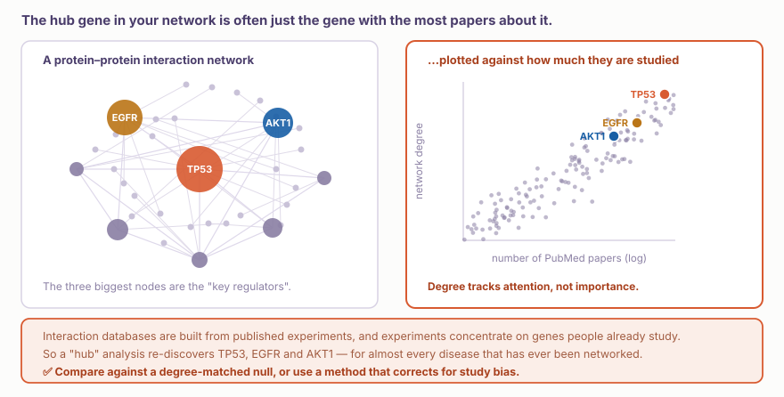
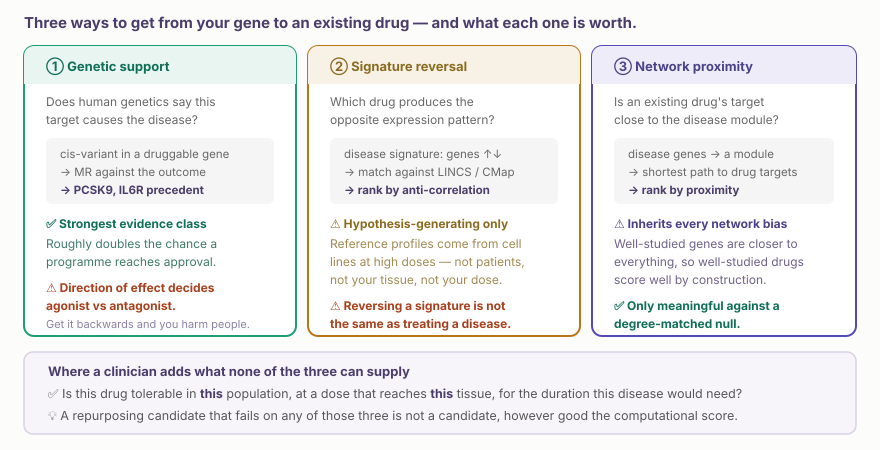
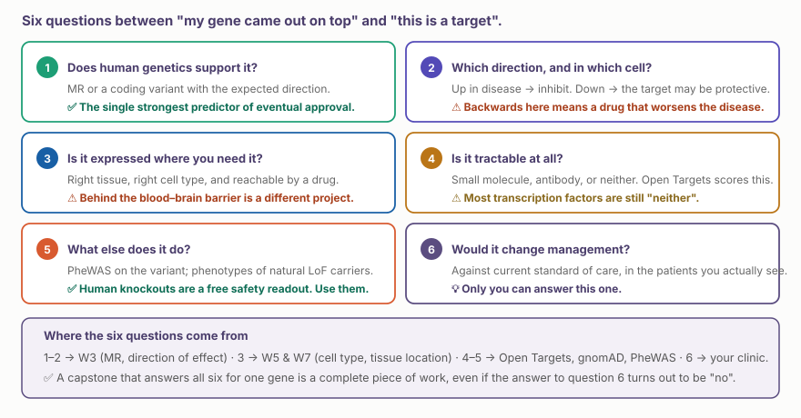

::: {.callout-note collapse="true"}
## 🎯 학습목표

이 장을 마치면 다음을 할 수 있어야 합니다.

-   생물학적 network가 무엇으로 만들어지며 ⚠️ 그 구성 방식이 모든 결과를 편향시키는 이유를 말할 수 있다
-   ⚠️ 대부분의 “hub gene” 결과 뒤에 숨어 있는 study bias artifact를 알아볼 수 있다
-   약물 재창출의 세 가지 경로를 비교하고 각각이 어떤 수준의 근거인지 말할 수 있다
-   ⚠️ 효과 방향이 agonist와 antagonist 중 어느 것을 선택할지 결정하는 이유를 설명할 수 있다
-   순위가 높은 유전자와 실제 약물 표적을 구분하는 여섯 가지 질문을 검토할 수 있다
-   PheWAS와 loss-of-function 보인자를 무료 안전성 readout으로 활용할 수 있다
:::

> 🤔 **동기 질문**
>
> 자신의 질병을 분석한 network 연구에서 TP53, EGFR, AKT1이 핵심 조절자라고 보고했습니다. 얼마나 놀라운 결과일까요?

------------------------------------------------------------------------

# 1. ⚠️ Network는 무엇으로 만들어지나 🕸️ {#w12-s1}

## 1) 만드는 방식, 그리고 거기서 생기는 편향 {#w12-s1-1}

Protein–protein interaction network = **출판된 실험**의 누적. STRING, BioGRID, IntAct = 정리된 문헌 + 그 문헌으로 학습한 예측

실험은 이미 많이 연구되는 gene에 몰림 → node degree = 사실상 **논문 수**를 따라감

{fig-align="center"}

::: {.callout-important collapse="true"}
## 동기 질문의 답: 하나도 안 놀라움

TP53, EGFR, AKT1은 network 분석을 해본 거의 모든 질병에서 hub로 나옴. 각각 논문이 수만 편 → 모든 것과 연결돼 있음

⚠️ 구체적으로는:

-   "Hub" 분석 = 내 data와 상관없이 같은 gene을 다시 발견
-   **Network proximity** 점수 = 많이 연구된 약물·표적에 유리
-   논문이 없는 gene = **degree ≈ 0** → 아무리 중요해도 우선순위에 못 오름

✅ 대처:

-   **Degree-matched null**과 비교 — node별 degree를 유지한 채 permutation → "연결이 많다"가 자동 승리가 되지 않게
-   가능하면 문헌을 모은 network 대신 **체계적 실험 하나**로 만든 network (proteomics interactome, CRISPR screen)
-   ✅ Hub 주장엔 항상 degree도 같이 보고 → 독자가 직접 보게
:::

## 2) 그래도 network가 쓸모 있는 곳 {#w12-s1-2}

-   ✅ **Module** — 기대보다 더 많이 상호작용하는 gene 집합 → gene 하나가 아니라 과정 수준의 결과
-   ✅ **흩어진 hit 연결** — GWAS locus 40개가 pathway 하나로 모이나?
-   ✅ 기능 모르는 gene의 이웃을 보고 **기전 제안**
-   ⚠️ 언제나 가설로만. Edge는 내 실험이 아니라 남의 실험

------------------------------------------------------------------------

# 2. Gene에서 약물로 💊 {#w12-s2}

{fig-align="center"}

## 1) 유전적 근거가 가장 강한 경로 {#w12-s2-1}

사람의 유전적 근거가 있는 표적 → 임상 개발 성공 확률 약 **2배**. 원리는 단순: 표적을 바꾸는 variant = 사람에게서 평생 진행된 자연 무작위 실험 — 🔗 [W3 §3.2](../part2/w3_gwas.qmd#w3-s3-2)의 논리

-   **PCSK9** — loss-of-function 보인자는 LDL ↓, 심혈관 위험 ↓ → inhibitor가 효과적
-   **IL6R** — IL-6 차단을 흉내 내는 variant가 관상동맥질환 위험 ↓와 연관 → tocilizumab의 심혈관 signal

## 2) ⚠️ 효과 방향 {#w12-s2-2}

::: {.callout-warning collapse="true"}
## 이 수업에서 결과가 가장 나쁜 실수

위험 allele이 표적 활성을 **올리면** → inhibitor. **낮추면** → 표적이 보호 역할일 수 있음 → 억제하면 환자가 더 나빠짐

두 가지 복병:

-   ⚠️ **비일관성.** 위험 allele이 gene 발현을 낮추는데, 환자 조직에선 그 gene이 높게 나올 수 있음. 대개 손상된 보호 반응 → 치료 방향은 발현 data가 시사하는 것과 반대
-   ⚠️ **조직 특이성.** 방향이 조직마다 다를 수 있음. 봐야 할 조직 = 질병 과정이 실제로 일어나는 조직 (🔗 [W5](../part3/w5_scrna_qc.qmd), 🔗 [W7](../part4/w7_spatial_basics.qmd))

→ ✅ 방향은 환자 조직의 fold change가 아니라 **유전학 + MR**로 정하기
:::

## 3) Signature reversal과 network proximity {#w12-s2-3}

-   **Signature reversal** (CMap, LINCS) — 질병 signature와 반대(음의 상관)인 발현 signature를 가진 약물 찾기. ⚠️ 참조 profile = 고농도로 처리한 cell line. 후보 만들기엔 유용, 근거는 아님
-   **Network proximity** — 약물 표적이 질병 module과 가까운가? ⚠️ §1의 study bias를 전부 물려받음 → degree-matched null과 비교해야만 의미 있음

------------------------------------------------------------------------

# 3. 표적이라 부르기 전 여섯 가지 질문 ✅ {#w12-s3}

{fig-align="center"}

::: {.callout-tip collapse="true"}
## 5번 질문 자세히: 안전성 연구는 사람이 이미 해둠

표적에 자연적인 loss-of-function variant를 가진 사람 = 그 표적을 평생 억제하면 무슨 일이 생기는지 미리 보여주는 셈

-   ✅ **gnomAD** — LoF 보인자가 몇 명? 그 gene에 LoF가 유독 적나? (**LOEUF**가 0에 가까움 = LoF를 못 견딤 → 좋은 표적이 아닐 가능성 높음)
-   ✅ 그 variant의 **PheWAS** — 그 밖에 뭐가 달라지나? 그게 예측 가능한 부작용
-   ✅ 동형접합 보인자가 있다면 → 임상시험 전 단계에서 얻을 수 있는 가장 강한 signal

⚠️ LoF를 아주 못 견디는 gene = 뭔가 말해주고 있는 것. 억제하면 질병 말고 다른 데도 영향이 갈 가능성 높음
:::

------------------------------------------------------------------------

# 4. 실습 💻 {#w12-s4}

🔗 [W11 §5.1](w11_multiomics.qmd#w11-s5-1)에서 만든 우선순위화 표 가져오기

## 1) 코드 없이: 살아남은 gene 검토 {#w12-s4-1}

[**Open Targets**](https://platform.opentargets.org) → 내 gene → target profile

-   ① **Tractability** — small molecule? 항체? 적응증 상관없이 어느 임상 단계까지 갔나?
-   ② **안전성** — 특정 장기 독성 경고가 있나?
-   ③ **알려진 약물** — 어떤 질환이든 이미 승인된 약이 있나?
-   ④ [**gnomAD**](https://gnomad.broadinstitute.org) → **LOEUF**. LoF를 견디는 gene인가?
-   ⑤ [**Open Targets**](https://platform.opentargets.org) → lead variant 페이지 → 그 variant가 연관된 다른 형질(= PheWAS). 또 뭐에 영향을 주나?

✅ 답을 다섯 문장으로 쓰기. 그러면 §3 checklist 완료

## 2) 작은 network 만들고 스스로 점검 {#w12-s4-2}

::: {.panel-tabset group="lang"}

### R

```{r}
library(STRINGdb); library(igraph); library(tidyverse)

# toy gene list (illustration only): the default list in scripts/download_public_data.R
my_genes <- c("TP53", "EGFR", "AKT1", "TNF", "IL6", "MYC", "VEGFA", "STAT3", "MTOR", "CTNNB1",
              "IL6R", "PCSK9", "TCF7L2", "PPARG", "SCN5A", "IL23R", "RANKL", "HMGCR", "ESR1", "DRD2",
              "TMEM175", "FAM210B", "CCDC91", "ZNF385D", "RNF130", "TTC39B", "ANKRD55", "SPPL3",
              "CCDC92", "MAP3K11", "TMEM258", "RASIP1")

sdb <- STRINGdb$new(version = "12", species = 9606, score_threshold = 700)
mapped <- sdb$map(data.frame(gene = my_genes), "gene", removeUnmappedRows = TRUE)
g <- sdb$get_subnetwork(mapped$STRING_id) |> igraph::simplify()
V(g)$name <- mapped$gene[match(V(g)$name, mapped$STRING_id)]   # STRING ids → gene symbols

deg <- sort(degree(g), decreasing = TRUE)
head(deg, 10)
```

### Python

```{python}
import io, requests, numpy as np, pandas as pd, igraph as ig

# toy gene list (illustration only): the default list in scripts/download_public_data.R
my_genes = ["TP53", "EGFR", "AKT1", "TNF", "IL6", "MYC", "VEGFA", "STAT3", "MTOR", "CTNNB1",
            "IL6R", "PCSK9", "TCF7L2", "PPARG", "SCN5A", "IL23R", "RANKL", "HMGCR", "ESR1", "DRD2",
            "TMEM175", "FAM210B", "CCDC91", "ZNF385D", "RNF130", "TTC39B", "ANKRD55", "SPPL3",
            "CCDC92", "MAP3K11", "TMEM258", "RASIP1"]

# STRING v12, high-confidence edges (score ≥ 700), from the STRING API
r = requests.post("https://string-db.org/api/tsv/network",
                  data={"identifiers": "\r".join(my_genes), "species": 9606, "required_score": 700})
edges = pd.read_csv(io.StringIO(r.text), sep="\t")
g = ig.Graph.TupleList(edges[["preferredName_A", "preferredName_B"]].itertuples(index=False)).simplify()

deg = pd.Series(g.degree(), index=g.vs["name"]).sort_values(ascending=False)
deg.head(10)
```

:::

⚠️ **이제 보통 빠지는 단계:**

::: {.panel-tabset group="lang"}

### R

```{r}
# Is your "hub" just a well-studied gene?
# Fetch PubMed counts for the same genes and correlate with degree.
# real PubMed counts — scripts/download_public_data.R fetches these
pubs <- readRDS(here::here("rawdata", "pubmed_counts.rds"))   # gene → n papers
cor(log10(pubs[names(deg)] + 1), deg, use = "complete", method = "spearman")
```

### Python

```{python}
import time
from scipy.stats import spearmanr

# Is your "hub" just a well-studied gene?
# Fetch PubMed counts for the same genes and correlate with degree.
# real PubMed counts — NCBI E-utilities, as scripts/download_public_data.R does
def pubmed_count(gene):
    r = requests.get("https://eutils.ncbi.nlm.nih.gov/entrez/eutils/esearch.fcgi",
                     params={"db": "pubmed", "term": f"{gene}[Title/Abstract]", "retmode": "json"})
    time.sleep(0.35)                                   # 3 requests/s without an API key
    return int(r.json()["esearchresult"]["count"])

pubs = pd.Series({gene: pubmed_count(gene) for gene in deg.index})   # gene → n papers
round(float(spearmanr(np.log10(pubs + 1), deg).statistic), 3)
```

:::

💡 문헌 기반 network 대부분에서 이 상관이 강하게 나옴. 같이 보고하면 → hub 주장이 "당연한 결과"가 아니라 믿을 만한 주장이 됨

## 3) Degree-matched null {#w12-s4-3}

::: {.panel-tabset group="lang"}

### R

```{r}
# toy gene sets (illustration only); the rewiring null needs one connected network
g <- largest_component(g)
disease_genes <- c("TCF7L2", "PPARG", "PCSK9", "HMGCR")
drug_targets  <- c("MTOR", "EGFR", "ESR1")

observed <- mean(distances(g, v = disease_genes, to = drug_targets))

null <- replicate(1000, {
  rw <- sample_degseq(degree(g), method = "vl")   # same degrees, rewired edges
  V(rw)$name <- V(g)$name
  mean(distances(rw, v = disease_genes, to = drug_targets))
})

cat("observed:", round(observed, 2), " null mean:", round(mean(null), 2), "\n")
```

### Python

```{python}
# toy gene sets (illustration only); the rewiring null needs one connected network
g = g.connected_components().giant()
disease_genes = ["TCF7L2", "PPARG", "PCSK9", "HMGCR"]
drug_targets  = ["MTOR", "EGFR", "ESR1"]

observed = np.mean(g.distances(source=disease_genes, target=drug_targets))

null = []
for _ in range(1000):
    rw = ig.Graph.Degree_Sequence(g.degree(), method="vl")   # same degrees, rewired edges
    rw.vs["name"] = g.vs["name"]
    null.append(np.mean(rw.distances(source=disease_genes, target=drug_targets)))

print("observed:", round(observed, 2), " null mean:", round(np.mean(null), 2))
```

:::

✅ 관측된 proximity가 degree-matched null보다 확실히 낫지 않다면 → 잰 건 중요도가 아니라 인기도

**직접 해 보기** — [네트워크 null model: 차수 보존 재배선 ↗](https://kkonoo.github.io/edu_sims/sims/network-null/?lang=ko){target="_blank"}

::: {.column-page}
```{=html}
<iframe src="https://kkonoo.github.io/edu_sims/sims/network-null/?embed=1&lang=ko" title="네트워크 null model: 차수 보존 재배선" loading="lazy"
        style="width: 100%; height: 1300px; border: 0;"></iframe>
```
:::

## 4) 다음 주 전까지 {#w12-s4-4}

**[W13 — 해석과 시각화](../part7/w13_visualization.qmd).** 내 연구나 읽고 있는 논문에서 **그림 하나** 가져오기. 같이 뜯어봄

------------------------------------------------------------------------

# 📝 요약

-   생물학적 network = 출판된 실험의 집합 → ⚠️ **node degree는 논문 수를 따라감**
-   ⚠️ Hub 분석은 거의 모든 질병에서 TP53, EGFR, AKT1을 다시 찾아냄. ✅ Degree-matched null 쓰기
-   ⚠️ 문헌 없는 gene = degree ≈ 0 → 아무리 중요해도 우선순위에 못 오름
-   ✅ Network는 **module** 찾기, 흩어진 hit 연결, 기전 제안에 유용 — 단, 가설로서
-   ✅ **유전적 근거 = 표적이 승인까지 갈 확률을 약 2배로** — 쓸 수 있는 가장 강한 근거
-   ⚠️ **효과 방향이 agonist vs antagonist를 결정.** 거꾸로 판단하면 환자에게 해
-   ⚠️ Signature reversal = 고농도 cell line 기반. 근거가 아니라 후보
-   ✅ 여섯 질문: 유전학 · 방향 · 발현 · tractability · 안전성 · **진료를 바꾸나**
-   ✅ LoF 보인자와 PheWAS = 공짜로 얻는, 사람의 평생 안전성 readout. 표적 제안 전에 꼭 확인

------------------------------------------------------------------------

# 🔑 핵심 용어

| 용어 | 한 줄 정의 |
|-------------------------|-----------------------------------------|
| PPI network | 주로 문헌에서 수집한 단백질–단백질 상호작용 그래프 |
| Degree | 하나의 노드에 연결된 간선의 수 |
| Hub | 연결된 간선이 많은 노드로, 흔히 많이 연구된 유전자 |
| Study bias | 연결 정도가 생물학보다 연구자의 관심을 반영하는 편향 |
| Degree-matched null | 네트워크 주장을 검정하기 위해 각 노드의 연결 수를 보존하며 간선을 다시 연결한 귀무모형 |
| Module | 서로 조밀하게 연결된 유전자 집합 |
| Network proximity | 약물 표적과 질병 유전자 사이의 그래프 거리 |
| Signature reversal | 질병 발현 신호와 반대 방향으로 작용하는 약물을 찾는 방법 |
| CMap / LINCS | 약물 처리로 유도된 유전자 발현 양상을 모은 데이터베이스 |
| Tractability | 특정 표적을 실제 약물로 조절할 수 있는 정도 |
| LOEUF | 기능상실 변이에 대한 불내성을 나타내는 gnomAD 지표 |
| Human knockout | 자연적으로 기능상실 변이를 동형접합으로 가진 사람으로, 평생의 안전성을 미리 보여 주는 사례 |

------------------------------------------------------------------------

# ➕ 참고문헌

### Network와 편향

Schaefer MH, Serrano L, Andrade-Navarro MA. [*Correcting for the study bias associated with protein–protein interaction measurements reveals differences between protein degree distributions from different cancer types.*](https://doi.org/10.3389/fgene.2015.00260) Front Genet. 2015. **← 연구 편향 문제를 측정한 논문**\
Gillis J, Ballouz S, Pavlidis P. [*Bias tradeoffs in the creation and analysis of protein–protein interaction networks.*](https://doi.org/10.1016/j.jprot.2014.01.020) J Proteomics. 2014.\
Barabási AL, Gulbahce N, Loscalzo J. [*Network medicine: a network-based approach to human disease.*](https://doi.org/10.1038/nrg2918) Nat Rev Genet. 2011.

### 약물 표적과 유전적 근거

Nelson MR, et al. [*The support of human genetic evidence for approved drug indications.*](https://doi.org/10.1038/ng.3314) Nat Genet. 2015. **← ‘약 두 배’의 근거가 된 논문**\
King EA, Davis JW, Degner JF. [*Are drug targets with genetic support twice as likely to be approved?*](https://doi.org/10.1371/journal.pgen.1008489) PLoS Genet. 2019.\
Reay WR, Cairns MJ. [*Advancing the use of genome-wide association studies for drug repurposing.*](https://doi.org/10.1038/s41576-021-00387-z) Nat Rev Genet. 2021.\
Minikel EV, et al. [*Evaluating drug targets through human loss-of-function genetic variation.*](https://doi.org/10.1038/s41586-020-2267-z) Nature. 2020. **← 사람 knockout을 안전성 readout으로 사용**

### 약물 재창출 방법

Subramanian A, et al. [*A next generation connectivity map: L1000 platform and the first 1,000,000 profiles.*](https://doi.org/10.1016/j.cell.2017.10.049) Cell. 2017.\
Guney E, Menche J, Vidal M, Barabási AL. [*Network-based in silico drug efficacy screening.*](https://doi.org/10.1038/ncomms10331) Nat Commun. 2016.

### 자료

[Open Targets](https://platform.opentargets.org) · [STRING](https://string-db.org) · [gnomAD](https://gnomad.broadinstitute.org) · [CLUE / LINCS](https://clue.io) · [DGIdb](https://dgidb.org)
