::: {.callout-note collapse="true"}
## 🎯 학습목표

이 장을 마치면 다음을 할 수 있어야 합니다.

-   Node, edge, degree를 설명하고 graph의 종류(방향, 가중, 부호, 이분)를 구분할 수 있다
-   생물학 network가 측정한 것인지 규칙으로 만든 것인지 구분하고, ⚠️ 그 구성 방식이 결과를 어떻게 편향시키는지 말할 수 있다
-   Degree, 경로, 중심성, module이 각각 무엇을 재는지 설명할 수 있다
-   ⚠️ 대부분의 “hub gene” 결과 뒤에 숨어 있는 study bias artifact를 알아볼 수 있다
-   약물 재창출의 세 가지 경로를 비교하고 각각이 어떤 수준의 근거인지 말할 수 있다
-   ⚠️ MR 결과에서 효과 방향을 읽고, 그 방향이 inhibitor와 activator 중 무엇을 고를지 결정하는 이유를 설명할 수 있다
-   순위가 높은 유전자와 실제 약물 표적을 구분하는 여섯 가지 질문을 검토할 수 있다
-   PheWAS와 loss-of-function 보인자를 무료 안전성 readout으로 활용할 수 있다
:::

> 🤔 **동기 질문**
>
> 자신의 질병을 분석한 network 연구에서 TP53, EGFR, AKT1이 핵심 조절자라고 보고했습니다. 얼마나 놀라운 결과일까요?

------------------------------------------------------------------------

# 1. Network 기초 🕸️ {#w12-s1}

## 1) Network와 graph: node와 edge {#w12-s1-1}

-   **Network**: 실제로 있는 관계. 서로 결합하는 단백질, 기질을 인산화하는 효소, 맞닿아 있는 세포
-   **Graph**: 그 관계를 수학으로 적은 것. **node**(점)와 **edge**(선) 두 가지로만 이루어짐
    -   Node: 대상. Gene, 단백질, 세포, 환자, 약물
    -   Edge: 두 대상 사이의 관계. 결합, 조절, 상관, 유사도
    -   **Degree**: 한 node에 붙은 edge 수

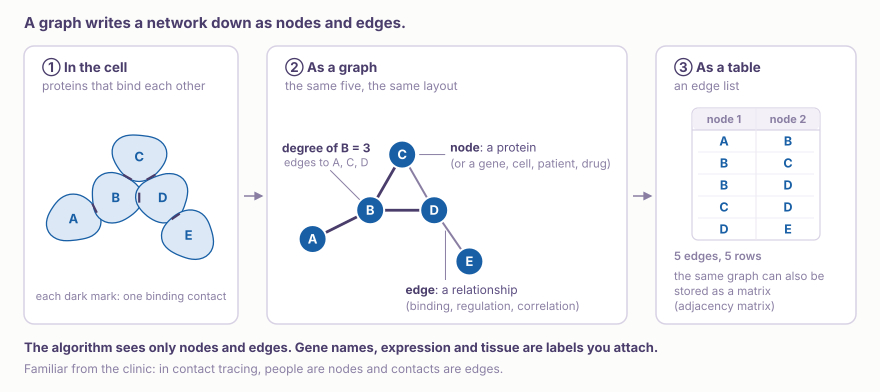{fig-align="center"}

💡 Graph는 node가 무엇인지 모름. Gene 이름, 발현값, 조직은 graph 위에 붙인 정보일 뿐

-   ✅ 그래서 친구 관계 network에 쓰던 알고리즘을 단백질 network에 그대로 쓸 수 있음
-   ⚠️ 같은 이유로, 잡음으로 만든 network에서도 알고리즘은 hub와 module을 문제없이 찾아 줌

## 2) Graph의 종류 {#w12-s1-2}

Edge에 어떤 정보가 붙느냐에 따라 graph 종류가 나뉨

| 종류 | Edge에 붙는 정보 | 생물학 예 |
|------------------|---------------------------|---------------------------|
| 무방향 (undirected) | 연결 여부만. A–B와 B–A가 같음 | PPI: 두 단백질이 결합 |
| 방향 (directed) | 방향. A → B와 B → A는 다름 | 전사인자 → 표적 gene, kinase → 기질 |
| 가중 (weighted) | 숫자 (세기, 신뢰도) | STRING 점수, 상관계수 |
| 부호 (signed) | + 또는 − | 신호전달의 활성화와 억제 |
| 이분 (bipartite) | 두 종류의 node 사이 연결 | 약물–표적, gene–pathway, 환자–진단 |

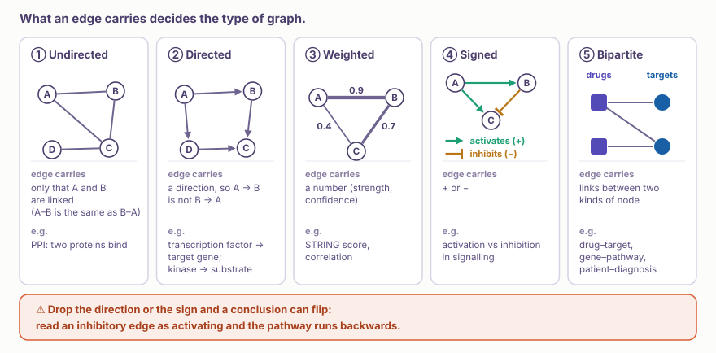{fig-align="center"}

-   ⚠️ 방향과 부호를 버리면 결론이 뒤집힐 수 있음. 억제 edge를 활성화 edge로 읽으면 신호전달 경로를 거꾸로 해석하게 됨
-   💡 §2의 약물 재창출은 이분 graph(약물–표적)를 PPI graph에 이어 붙여서 씀

## 3) 생물학적 graph {#w12-s1-3}

생물학 network는 edge를 어떻게 얻었느냐에 따라 나뉨

-   **측정한 edge**: 실험에서 관계를 직접 봄
    -   단백질 상호작용(PPI): yeast two-hybrid, affinity purification–mass spectrometry. 무방향
    -   신호전달·대사 경로: 방향과 부호가 있음 (Reactome, KEGG, OmniPath)
    -   ⚠️ STRING 점수에는 실험 외에 문헌 text-mining과 예측도 섞여 있음. "High confidence"가 "실험에서 관찰됨"이라는 뜻은 아님
-   **규칙으로 만든 edge**: data에 내가 정한 규칙을 적용해서 계산함
    -   공발현 network: 두 gene의 상관계수가 기준값을 넘으면 edge (WGCNA)
    -   Single-cell kNN graph: 각 세포를 가장 가까운 k개 세포와 연결 (🔗 [W5 §4.1](../part3/w5_scrna_qc.qmd#w5-s4-1))
    -   공간 이웃 graph: 조직에서 가까이 있는 spot이나 세포끼리 연결 (🔗 [W7 §4.4](../part4/w7_spatial_basics.qmd#w7-s4-4))
-   **지식 graph (knowledge graph)**: gene, 약물, 질병, 표현형을 node로, "치료한다", "유발한다", "결합한다"를 edge로 둠. 문헌과 database에서 모으므로 §1.6의 연구 편향을 그대로 물려받음

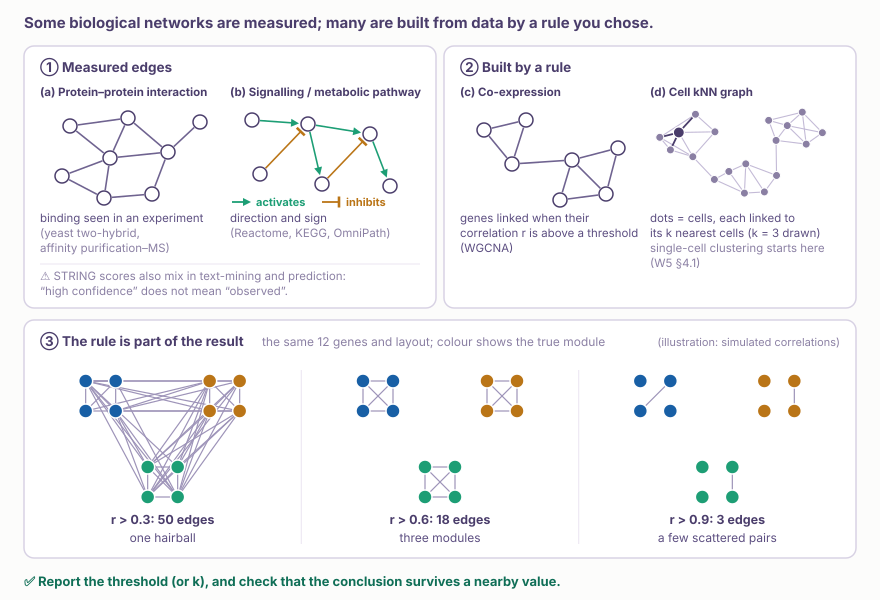{fig-align="center"}

⚠️ 규칙으로 만든 network는 기준값(상관 기준, k)에 따라 모양이 완전히 달라짐. 그런데 그다음 분석은 측정한 network와 똑같은 도구로 진행되고, 어느 단계도 "이 edge는 내가 고른 숫자에서 나왔다"고 알려 주지 않음

✅ 기준값을 보고하고, 값을 조금 바꿔도 결론이 같은지 확인

## 4) Network 정량화: degree, 연결성, 중심성 {#w12-s1-4}

-   **Degree**: 한 node에 붙은 edge 수. 가장 단순하고 가장 많이 쓰는 지표
    -   생물학 network에서는 degree가 아주 고르지 않음. 대부분의 node는 edge가 몇 개뿐이고, 소수의 node가 아주 많은 edge를 가짐
    -   ⚠️ 그래서 평균 degree 하나만 보고하면 이 차이가 가려짐
-   **연결성 (connectivity)**
    -   **경로 (path)**: edge를 따라 한 node에서 다른 node로 가는 길. **거리**는 가장 짧은 경로에 들어 있는 edge 수
    -   **연결 요소 (connected component)**: 서로 오갈 수 있는 node들의 묶음. 거리와 중심성은 대개 가장 큰 덩어리(giant component) 안에서만 계산함
-   **중심성 (centrality)**: "중요한 node"를 숫자로 정한 것. 정의가 여러 가지
    -   **Degree centrality**: 이웃이 많은가. 높으면 **hub**
    -   **Betweenness**: 다른 node 쌍 사이의 최단 경로가 이 node를 얼마나 자주 지나는가. 높으면 **bottleneck**. 두 덩어리를 잇는 유일한 통로가 여기에 해당
    -   **Closeness**: 다른 모든 node까지의 평균 거리가 짧은가

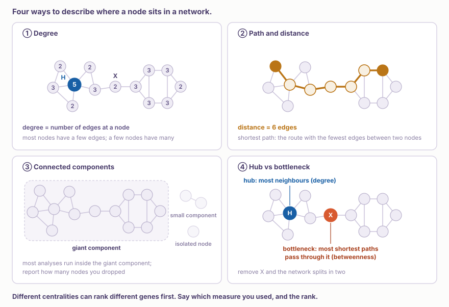{fig-align="center"}

-   ⚠️ 중심성마다 1위 gene이 다를 수 있음. Hub와 bottleneck이 서로 다른 gene인 경우가 흔함
-   ✅ 논문에 "hub gene"이라고만 쓰지 말고, 어느 중심성으로 몇 위인지 적기

## 5) Community, module, hub {#w12-s1-5}

-   **Community (module)**: 안쪽끼리는 촘촘히 연결되고 바깥과는 드물게 연결된 node 묶음
    -   생물학에서는 단백질 복합체, 하나의 pathway, 함께 움직이는 gene 묶음에 해당
    -   찾는 알고리즘은 Louvain, Leiden. 🔗 [W5 §4.2](../part3/w5_scrna_qc.qmd#w5-s4-2)에서 세포 clustering에 쓴 그 방법이고, 거기서는 node가 세포였음
-   **Module hub**: module 안에서 연결이 가장 많은 node. WGCNA의 "hub gene"이 이것
-   **Connector**: 여러 module에 걸쳐 연결된 node. 4)의 bottleneck과 비슷한 자리

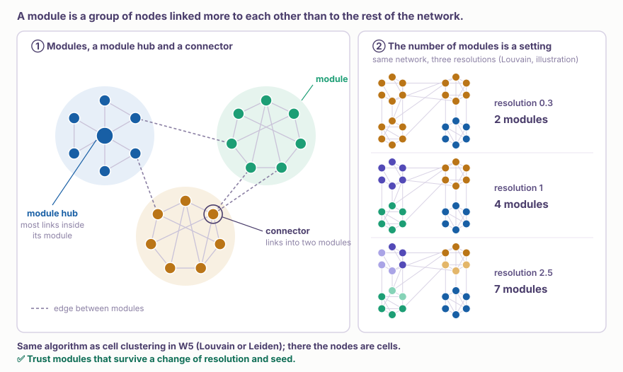{fig-align="center"}

-   ⚠️ Module 개수는 **resolution** 값이 정하고, 통계적으로 옳은 값은 없음. 그래서 resolution과 seed를 바꿔도 살아남는 module만 믿기
-   💡 Gene 하나보다 module 하나가 더 안정적인 결과. 측정 잡음이 여러 gene에 나뉘고, "어떤 과정이 바뀌었나"로 해석할 수 있음

## 6) ⚠️ 편향, 그리고 그래도 쓸모 있는 곳 {#w12-s1-6}

PPI network는 **출판된 실험**을 모아 놓은 것. STRING, BioGRID, IntAct는 정리된 문헌과 그 문헌으로 학습한 예측으로 이루어짐

실험은 이미 많이 연구되는 gene에 몰림. 그래서 node degree는 사실상 **논문 수**를 따라감

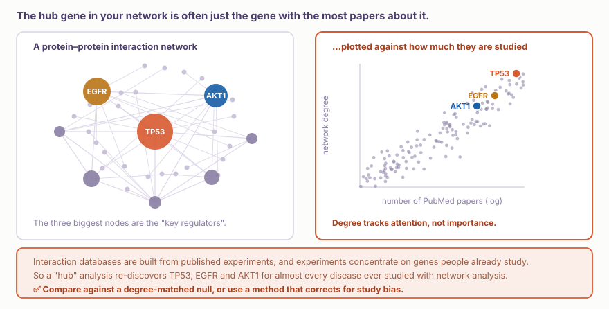{fig-align="center"}

::: {.callout-important collapse="true"}
## 동기 질문의 답: 하나도 안 놀라움

TP53, EGFR, AKT1은 network 분석을 해본 거의 모든 질병에서 hub로 나옴. 각각 논문이 수만 편이라서 모든 것과 연결돼 있음

⚠️ 구체적으로는:

-   "Hub" 분석은 내 data와 상관없이 같은 gene을 다시 찾아냄
-   **Network proximity** 점수는 많이 연구된 약물·표적에 유리함
-   논문이 없는 gene은 **degree ≈ 0**이라서 아무리 중요해도 우선순위에 못 오름

✅ 대처:

-   **Degree-matched null**과 비교: node별 degree를 유지한 채 permutation해서 연결이 많다는 이유만으로 유리해지지 않게 함
-   가능하면 문헌을 모은 network 대신 **체계적 실험 하나**로 만든 network (proteomics interactome, CRISPR screen)
-   ✅ Hub 주장엔 항상 degree도 같이 보고해서 독자가 직접 확인할 수 있게 하기
:::

그래도 network가 쓸모 있는 곳:

-   ✅ **Module**: 기대보다 더 많이 상호작용하는 gene 집합. Gene 하나가 아니라 과정 수준의 결과를 얻음
-   ✅ **흩어진 hit 연결**: GWAS locus 40개가 pathway 하나로 모이나?
-   ✅ 기능 모르는 gene의 이웃을 보고 **기전 제안**
-   ⚠️ 언제나 가설로만. Edge는 내 실험이 아니라 남의 실험 결과

------------------------------------------------------------------------

# 2. Gene에서 약물로 💊 {#w12-s2}

내 gene에서 이미 있는 약물로 가는 경로는 세 가지. 근거 수준이 서로 많이 다름

| 경로 | 묻는 질문 | 근거 수준 |
|------------------|-----------------------------------|------------------|
| 1) 유전적 근거 | 사람 유전학이 이 표적을 질병의 원인으로 지목하나? | ✅ 가장 강함 |
| 2) Signature reversal | 질병의 발현 변화를 반대로 돌리는 약물이 있나? | ⚠️ 후보 목록 |
| 3) Network proximity | 약물 표적이 질병 gene 가까이에 있나? | ⚠️ 후보 목록. 편향 보정이 필수 |

## 1) 유전적 근거 {#w12-s2-1}

사람의 유전적 근거가 있는 표적은 임상 개발에 성공할 확률이 약 **2배**. 원리는 단순함: 표적 gene의 기능을 바꾸는 variant는 수정될 때 무작위로 정해지므로, 사람에게서 평생 진행된 자연 무작위 실험과 같음 (🔗 [W3 §3.2](../part2/w3_gwas.qmd#w3-s3-2)의 Mendelian randomization 논리)

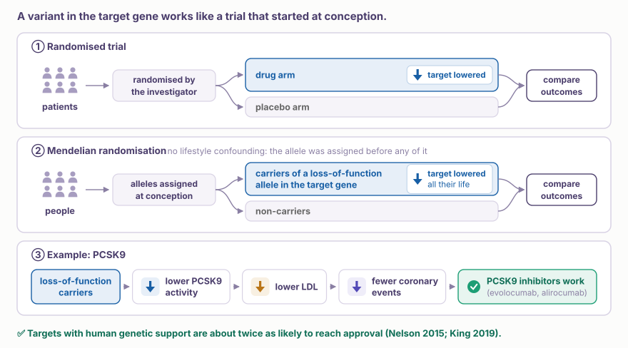{fig-align="center"}

-   **PCSK9**: loss-of-function 보인자는 LDL과 심혈관 위험이 낮음. 그래서 inhibitor(evolocumab, alirocumab)가 효과적
-   **IL6R**: IL-6 차단과 같은 효과를 내는 variant가 관상동맥질환 위험 감소와 연관됨. tocilizumab의 심혈관 signal을 뒷받침하는 근거

::: {.callout-warning collapse="false"}
## 효과 방향: 이 수업에서 결과가 가장 나쁜 실수

위험 allele이 표적 활성을 **올리면** inhibitor를 써야 함. **낮추면** 표적이 보호 역할일 수 있어서, 억제하면 환자가 더 나빠짐. 이때 필요한 것은 활성을 올리는 약(agonist, activator)이나 보충

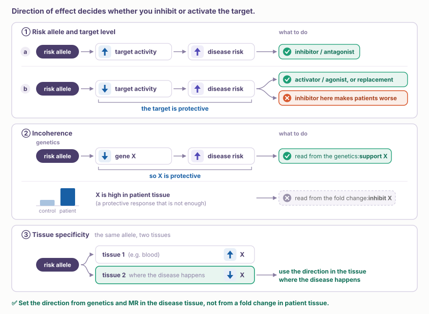{fig-align="center"}

두 가지 복병:

-   ⚠️ **비일관성.** 위험 allele이 gene 발현을 낮추는데, 환자 조직에선 그 gene이 높게 나올 수 있음. 대개 보호 반응이 손상된 경우이고, 이때 치료 방향은 발현 data가 시사하는 것과 반대
-   ⚠️ **조직 특이성.** 방향이 조직마다 다를 수 있음. 봐야 할 조직은 질병 과정이 실제로 일어나는 조직 (🔗 [W5](../part3/w5_scrna_qc.qmd), 🔗 [W7](../part4/w7_spatial_basics.qmd))

✅ 방향은 환자 조직의 fold change가 아니라 **유전학 + MR**로 정하기
:::

::: {.callout-tip collapse="true"}
## MR 결과로 방향 정하기

MR 결과는 보통 "exposure가 1 단위(또는 1 SD) 바뀔 때 질병의 OR"로 보고됨. 방향을 정하려면 세 단계로 읽음

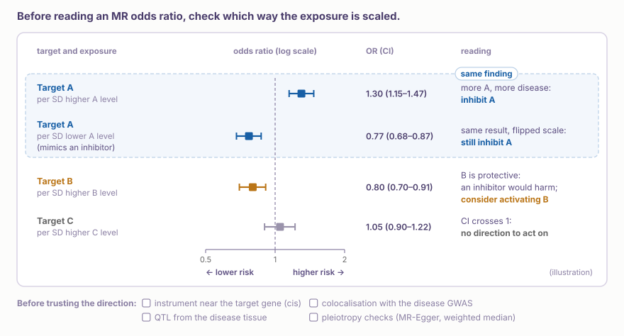{fig-align="center"}

1.  **Exposure가 어느 쪽으로 정의됐는지 먼저 확인**
    -   "유전적으로 예측한 표적 수치의 **증가**"인가, "표적 **억제**를 흉내 내는 variant"(drug-target MR에서 흔함)인가
    -   ⚠️ 둘은 부호가 반대. 같은 결과가 OR 1.30으로도, OR 0.77로도 보고될 수 있음
2.  **OR을 약의 방향으로 옮기기** (exposure가 수치 증가로 정의됐을 때)
    -   OR이 1보다 큼: 표적이 많을수록 위험. Inhibitor 후보
    -   OR이 1보다 작음: 표적이 보호 역할. Inhibitor는 해로울 수 있고, activator가 후보
    -   신뢰구간이 1을 포함: 방향을 정할 근거가 없음
3.  **믿기 전에 확인**
    -   Instrument가 표적 gene 근처(cis)의 variant인가. 멀리 있는(trans) variant는 다른 경로로 질병에 영향을 줄 수 있음
    -   표적의 eQTL·pQTL과 질병 GWAS가 같은 causal variant를 공유하나 (colocalisation, 🔗 [W3 §3.2](../part2/w3_gwas.qmd#w3-s3-2))
    -   QTL을 질병이 일어나는 조직에서 얻었나 (조직 특이성)
    -   Pleiotropy 점검 (MR-Egger, weighted median)
:::

## 2) Signature reversal {#w12-s2-2}

질병 signature와 반대 방향의 발현 변화를 일으키는 약물을 찾는 방법

-   **질병 signature**: 환자와 대조군을 비교해서 올라간 gene과 내려간 gene의 목록
-   **약물 signature**: cell line에 약물을 처리한 뒤 잰 발현 변화. CMap과 LINCS(L1000)에 약물 수천 개의 profile이 있음
-   두 signature를 비교해서 점수(connectivity score)를 매김
    -   음수: 질병에서 올라간 gene을 내리고, 내려간 gene을 올림. 후보
    -   양수: 질병과 같은 방향으로 움직임. 질병을 악화시킬 수 있음

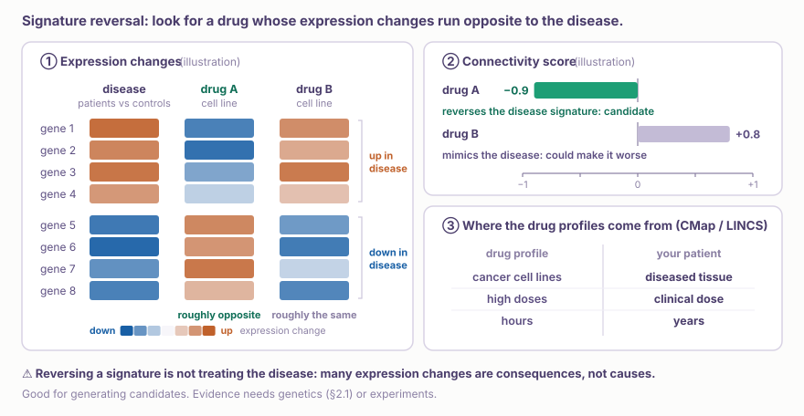{fig-align="center"}

⚠️ 한계:

-   참조 profile은 **cell line**에서, 대개 **고농도로 몇 시간** 처리해서 얻음. 환자의 조직, 실제 용량, 투약 기간과 다름
-   발현을 되돌린다고 질병이 낫는 것은 아님. 발현 변화 중 상당수는 질병의 원인이 아니라 결과 (🔗 [W11 §1](w11_multiomics.qmd#w11-s1))

✅ 후보를 만드는 데는 유용함. 근거가 되려면 1)의 유전적 근거나 실험 검증이 필요

## 3) Network proximity {#w12-s2-3}

약물 표적이 network에서 질병 gene들과 얼마나 가까운지 재는 방법

-   거리는 §1.4의 최단 경로 길이. 흔히 약물 표적마다 가장 가까운 질병 gene까지의 거리를 구해서 평균함 (Guney et al., 2016)
-   표적이 가까울수록 그 약물이 질병 과정에 영향을 줄 가능성이 높다고 봄

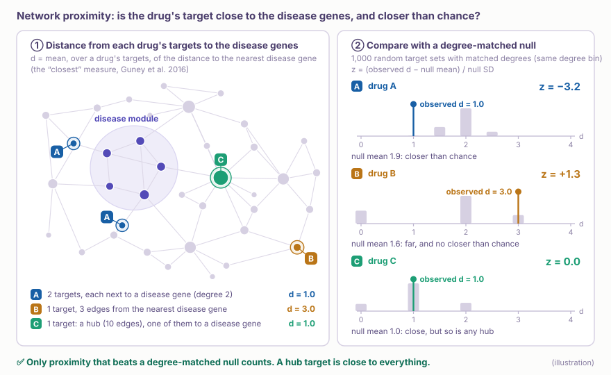{fig-align="center"}

-   ⚠️ §1.6의 연구 편향이 그대로 들어감. Hub를 표적으로 하는 약은 어느 질병과도 가까움
-   ✅ 그래서 관측한 거리를 **degree-matched null**과 비교해야 함. 실제 표적과 degree가 같은 무작위 gene으로 거리를 수천 번 다시 재고, 관측 거리가 그 분포에서 얼마나 벗어나는지(z-score) 봄. §4.3에서는 같은 생각을 degree를 유지한 edge 재배선으로 직접 해 봄

💡 세 경로 모두 답하지 못하는 질문이 있음: 이 환자군에서, 이 조직에 닿는 용량으로, 이 질병에 필요한 기간 동안 견딜 수 있는 약인가? 이 판단은 임상의의 몫

------------------------------------------------------------------------

# 3. 표적이라 부르기 전 여섯 가지 질문 ✅ {#w12-s3}

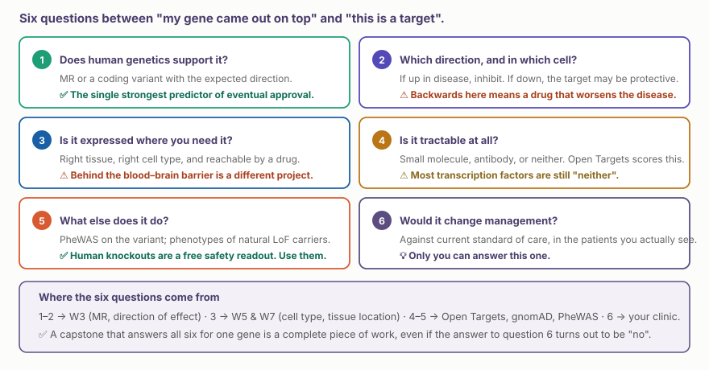{fig-align="center"}

::: {.callout-tip collapse="true"}
## 5번 질문 자세히: 안전성 연구는 사람이 이미 해둠

표적에 자연적인 loss-of-function variant를 가진 사람은 그 표적을 평생 억제하면 무슨 일이 생기는지 미리 보여 주는 사례

-   ✅ **gnomAD**: LoF 보인자가 몇 명? 그 gene에 LoF가 유독 적나? (**LOEUF**가 0에 가까우면 LoF를 못 견딘다는 뜻이고, 좋은 표적이 아닐 가능성이 높음)
-   ✅ 그 variant의 **PheWAS**: 그 밖에 뭐가 달라지나? 그게 예측 가능한 부작용
-   ✅ Human knockout(동형접합 보인자)이 있다면 임상시험 전 단계에서 얻을 수 있는 가장 강한 signal

⚠️ LoF를 아주 못 견디는 gene은 그 자체가 경고 신호. 억제하면 질병 말고 다른 데도 영향이 갈 가능성 높음
:::

------------------------------------------------------------------------

# 4. 실습 💻 {#w12-s4}

🔗 [W11 §6.1](w11_multiomics.qmd#w11-s6-1)에서 만든 우선순위화 표 가져오기

## 1) 코드 없이: 살아남은 gene 검토 {#w12-s4-1}

[**Open Targets**](https://platform.opentargets.org) → 내 gene → target profile

-   ① **Tractability**: small molecule? 항체? 적응증 상관없이 어느 임상 단계까지 갔나?
-   ② **안전성**: 특정 장기 독성 경고가 있나?
-   ③ **알려진 약물**: 어떤 질환이든 이미 승인된 약이 있나?
-   ④ [**gnomAD**](https://gnomad.broadinstitute.org) → **LOEUF**. LoF를 견디는 gene인가?
-   ⑤ [**Open Targets**](https://platform.opentargets.org) → lead variant 페이지 → 그 variant가 연관된 다른 형질(= PheWAS). 또 뭐에 영향을 주나?

✅ 답을 다섯 문장으로 쓰기. 그러면 §3 checklist 완료

## 2) 작은 network 만들고 스스로 점검 {#w12-s4-2}

::: {.panel-tabset group="lang"}

### R

```{r}
library(STRINGdb); library(igraph); library(tidyverse)

# toy gene list (illustration only): the default list in scripts/download_public_data.R
my_genes <- c("TP53", "EGFR", "AKT1", "TNF", "IL6", "MYC", "VEGFA", "STAT3", "MTOR", "CTNNB1",
              "IL6R", "PCSK9", "TCF7L2", "PPARG", "SCN5A", "IL23R", "RANKL", "HMGCR", "ESR1", "DRD2",
              "TMEM175", "FAM210B", "CCDC91", "ZNF385D", "RNF130", "TTC39B", "ANKRD55", "SPPL3",
              "CCDC92", "MAP3K11", "TMEM258", "RASIP1")

sdb <- STRINGdb$new(version = "12", species = 9606, score_threshold = 700)
mapped <- sdb$map(data.frame(gene = my_genes), "gene", removeUnmappedRows = TRUE)
g <- sdb$get_subnetwork(mapped$STRING_id) |> igraph::simplify()
V(g)$name <- mapped$gene[match(V(g)$name, mapped$STRING_id)]   # STRING ids → gene symbols

deg <- sort(degree(g), decreasing = TRUE)
head(deg, 10)
```

### Python

```{python}
import io, requests, numpy as np, pandas as pd, igraph as ig

# toy gene list (illustration only): the default list in scripts/download_public_data.R
my_genes = ["TP53", "EGFR", "AKT1", "TNF", "IL6", "MYC", "VEGFA", "STAT3", "MTOR", "CTNNB1",
            "IL6R", "PCSK9", "TCF7L2", "PPARG", "SCN5A", "IL23R", "RANKL", "HMGCR", "ESR1", "DRD2",
            "TMEM175", "FAM210B", "CCDC91", "ZNF385D", "RNF130", "TTC39B", "ANKRD55", "SPPL3",
            "CCDC92", "MAP3K11", "TMEM258", "RASIP1"]

# STRING v12, high-confidence edges (score ≥ 700), from the STRING API
r = requests.post("https://string-db.org/api/tsv/network",
                  data={"identifiers": "\r".join(my_genes), "species": 9606, "required_score": 700})
edges = pd.read_csv(io.StringIO(r.text), sep="\t")
g = ig.Graph.TupleList(edges[["preferredName_A", "preferredName_B"]].itertuples(index=False)).simplify()

deg = pd.Series(g.degree(), index=g.vs["name"]).sort_values(ascending=False)
deg.head(10)
```

:::

⚠️ **이제 보통 빠지는 단계:**

::: {.panel-tabset group="lang"}

### R

```{r}
# Is your "hub" just a well-studied gene?
# Fetch PubMed counts for the same genes and correlate with degree.
# real PubMed counts — scripts/download_public_data.R fetches these
pubs <- readRDS(here::here("rawdata", "pubmed_counts.rds"))   # gene → n papers
cor(log10(pubs[names(deg)] + 1), deg, use = "complete", method = "spearman")
```

### Python

```{python}
import time
from scipy.stats import spearmanr

# Is your "hub" just a well-studied gene?
# Fetch PubMed counts for the same genes and correlate with degree.
# real PubMed counts — NCBI E-utilities, as scripts/download_public_data.R does
def pubmed_count(gene):
    r = requests.get("https://eutils.ncbi.nlm.nih.gov/entrez/eutils/esearch.fcgi",
                     params={"db": "pubmed", "term": f"{gene}[Title/Abstract]", "retmode": "json"})
    time.sleep(0.35)                                   # 3 requests/s without an API key
    return int(r.json()["esearchresult"]["count"])

pubs = pd.Series({gene: pubmed_count(gene) for gene in deg.index})   # gene → n papers
round(float(spearmanr(np.log10(pubs + 1), deg).statistic), 3)
```

:::

💡 문헌 기반 network 대부분에서 이 상관이 강하게 나옴. 같이 보고하면 hub 주장이 "당연한 결과"가 아니라 믿을 만한 주장이 됨

## 3) Degree-matched null {#w12-s4-3}

::: {.panel-tabset group="lang"}

### R

```{r}
# toy gene sets (illustration only); the rewiring null needs one connected network
g <- largest_component(g)
disease_genes <- c("TCF7L2", "PPARG", "PCSK9", "HMGCR")
drug_targets  <- c("MTOR", "EGFR", "ESR1")

observed <- mean(distances(g, v = disease_genes, to = drug_targets))

null <- replicate(1000, {
  rw <- sample_degseq(degree(g), method = "vl")   # same degrees, rewired edges
  V(rw)$name <- V(g)$name
  mean(distances(rw, v = disease_genes, to = drug_targets))
})

cat("observed:", round(observed, 2), " null mean:", round(mean(null), 2), "\n")
```

### Python

```{python}
# toy gene sets (illustration only); the rewiring null needs one connected network
g = g.connected_components().giant()
disease_genes = ["TCF7L2", "PPARG", "PCSK9", "HMGCR"]
drug_targets  = ["MTOR", "EGFR", "ESR1"]

observed = np.mean(g.distances(source=disease_genes, target=drug_targets))

null = []
for _ in range(1000):
    rw = ig.Graph.Degree_Sequence(g.degree(), method="vl")   # same degrees, rewired edges
    rw.vs["name"] = g.vs["name"]
    null.append(np.mean(rw.distances(source=disease_genes, target=drug_targets)))

print("observed:", round(observed, 2), " null mean:", round(np.mean(null), 2))
```

:::

✅ 관측된 proximity가 degree-matched null보다 확실히 낫지 않다면 잰 것은 중요도가 아니라 인기도

**직접 해 보기** — [네트워크 null model: 차수 보존 재배선 ↗](https://kkonoo.github.io/edu_sims/sims/network-null/?lang=ko){target="_blank"}

::: {.column-page}
```{=html}
<iframe src="https://kkonoo.github.io/edu_sims/sims/network-null/?embed=1&lang=ko" title="네트워크 null model: 차수 보존 재배선" loading="lazy"
        style="width: 100%; height: 1300px; border: 0;"></iframe>
```
:::

## 4) 다음 주 전까지 {#w12-s4-4}

**[W13 — 해석과 시각화](../part7/w13_visualization.qmd).** 내 연구나 읽고 있는 논문에서 **그림 하나** 가져오기. 같이 뜯어봄

------------------------------------------------------------------------

# 📝 요약

-   Graph는 node와 edge로만 이루어짐. Edge에 방향, 가중치, 부호가 붙을 수 있고, ⚠️ 방향과 부호를 버리면 결론이 뒤집힐 수 있음
-   생물학 network의 edge는 측정한 것(PPI, 경로)과 규칙으로 만든 것(공발현, kNN)이 있음. ⚠️ 만든 network는 기준값이 모양을 정함
-   Degree, 거리, 중심성은 서로 다른 것을 잼. ⚠️ Hub(degree)와 bottleneck(betweenness)은 다른 gene일 수 있음
-   Module은 Louvain, Leiden으로 찾음. ⚠️ 개수는 resolution이 정하므로 값과 seed를 바꿔 안정성 확인
-   생물학적 network는 출판된 실험을 모은 것이라서 ⚠️ **node degree는 논문 수를 따라감**
-   ⚠️ Hub 분석은 거의 모든 질병에서 TP53, EGFR, AKT1을 다시 찾아냄. ✅ Degree-matched null 쓰기
-   ⚠️ 문헌 없는 gene은 degree ≈ 0이라서 아무리 중요해도 우선순위에 못 오름
-   ✅ Network는 **module** 찾기, 흩어진 hit 연결, 기전 제안에 유용. 단, 가설로서
-   ✅ **유전적 근거가 있으면 표적이 승인까지 갈 확률이 약 2배**. 쓸 수 있는 가장 강한 근거
-   ⚠️ **효과 방향이 agonist vs antagonist를 결정.** 거꾸로 판단하면 환자에게 해. MR로 정하되, exposure가 어느 방향으로 정의됐는지부터 확인
-   ⚠️ Signature reversal은 고농도 cell line 기반. 근거가 아니라 후보 목록
-   ⚠️ Network proximity는 hub 표적에 유리함. Degree-matched null과 비교해야 의미가 있음
-   ✅ 여섯 질문: 유전학 · 방향 · 발현 · tractability · 안전성 · **진료를 바꾸나**
-   ✅ LoF 보인자와 PheWAS는 공짜로 얻는 사람의 평생 안전성 readout. 표적 제안 전에 꼭 확인

------------------------------------------------------------------------

# 🔑 핵심 용어

| 용어 | 한 줄 정의 |
|-------------------------|-----------------------------------------|
| Node | 그래프의 점. 유전자, 단백질, 세포, 환자, 약물 등 |
| Edge | 두 노드 사이의 관계를 나타내는 선 |
| 방향 graph | 간선에 방향이 있는 그래프. A → B와 B → A가 다름 |
| 이분 graph | 두 종류의 노드가 있고 서로 다른 종류끼리만 연결된 그래프 (예: 약물–표적) |
| PPI network | 주로 문헌에서 수집한 단백질–단백질 상호작용 그래프 |
| Degree | 하나의 노드에 연결된 간선의 수 |
| 최단 경로 | 두 노드 사이에서 간선 수가 가장 적은 경로. 그 길이가 두 노드의 거리 |
| 연결 요소 | 서로 오갈 수 있는 노드들의 묶음 |
| Hub | 연결된 간선이 많은 노드로, 흔히 많이 연구된 유전자 |
| Betweenness | 다른 노드 쌍 사이의 최단 경로가 한 노드를 지나는 정도. 높으면 bottleneck |
| Study bias | 연결 정도가 생물학이 아니라 연구자의 관심을 반영하는 편향 |
| Degree-matched null | 네트워크 주장을 검정하기 위해 각 노드의 연결 수를 보존하며 간선을 다시 연결한 귀무모형 |
| Module | 서로 조밀하게 연결된 유전자 집합 |
| Network proximity | 약물 표적과 질병 유전자 사이의 그래프 거리 |
| Signature reversal | 질병 발현 신호와 반대 방향으로 작용하는 약물을 찾는 방법 |
| CMap / LINCS | 약물 처리로 유도된 유전자 발현 양상을 모은 데이터베이스 |
| Connectivity score | 약물 signature와 질병 signature를 비교한 점수. 약물이 질병 signature를 되돌리면 음수 |
| Tractability | 특정 표적을 실제 약물로 조절할 수 있는 정도 |
| LOEUF | 기능상실 변이에 대한 불내성을 나타내는 gnomAD 지표 |
| Human knockout | 자연적으로 기능상실 변이를 동형접합으로 가진 사람으로, 평생의 안전성을 미리 보여 주는 사례 |

------------------------------------------------------------------------

# ➕ 참고문헌

### Network 기초와 편향

Barabási AL, Oltvai ZN. [*Network biology: understanding the cell's functional organization.*](https://doi.org/10.1038/nrg1272) Nat Rev Genet. 2004. **← 생물학 network 입문**\
Yu H, Kim PM, Sprecher E, Trifonov V, Gerstein M. [*The importance of bottlenecks in protein networks: correlation with gene essentiality and expression dynamics.*](https://doi.org/10.1371/journal.pcbi.0030059) PLoS Comput Biol. 2007. **← hub와 bottleneck은 다름**\
Schaefer MH, Serrano L, Andrade-Navarro MA. [*Correcting for the study bias associated with protein–protein interaction measurements reveals differences between protein degree distributions from different cancer types.*](https://doi.org/10.3389/fgene.2015.00260) Front Genet. 2015. **← 연구 편향 문제를 측정한 논문**\
Gillis J, Ballouz S, Pavlidis P. [*Bias tradeoffs in the creation and analysis of protein–protein interaction networks.*](https://doi.org/10.1016/j.jprot.2014.01.020) J Proteomics. 2014.\
Barabási AL, Gulbahce N, Loscalzo J. [*Network medicine: a network-based approach to human disease.*](https://doi.org/10.1038/nrg2918) Nat Rev Genet. 2011.

### 약물 표적과 유전적 근거

Nelson MR, et al. [*The support of human genetic evidence for approved drug indications.*](https://doi.org/10.1038/ng.3314) Nat Genet. 2015. **← ‘약 두 배’의 근거가 된 논문**\
King EA, Davis JW, Degner JF. [*Are drug targets with genetic support twice as likely to be approved?*](https://doi.org/10.1371/journal.pgen.1008489) PLoS Genet. 2019.\
Reay WR, Cairns MJ. [*Advancing the use of genome-wide association studies for drug repurposing.*](https://doi.org/10.1038/s41576-021-00387-z) Nat Rev Genet. 2021.\
Minikel EV, et al. [*Evaluating drug targets through human loss-of-function genetic variation.*](https://doi.org/10.1038/s41586-020-2267-z) Nature. 2020. **← 사람 knockout을 안전성 readout으로 사용**\
Davies NM, Holmes MV, Davey Smith G. [*Reading Mendelian randomisation studies: a guide, glossary, and checklist for clinicians.*](https://doi.org/10.1136/bmj.k601) BMJ. 2018. **← MR 결과 읽는 법**

### 약물 재창출 방법

Subramanian A, et al. [*A next generation connectivity map: L1000 platform and the first 1,000,000 profiles.*](https://doi.org/10.1016/j.cell.2017.10.049) Cell. 2017.\
Guney E, Menche J, Vidal M, Barabási AL. [*Network-based in silico drug efficacy screening.*](https://doi.org/10.1038/ncomms10331) Nat Commun. 2016.

### 자료

[Open Targets](https://platform.opentargets.org) · [STRING](https://string-db.org) · [gnomAD](https://gnomad.broadinstitute.org) · [CLUE / LINCS](https://clue.io) · [DGIdb](https://dgidb.org)
