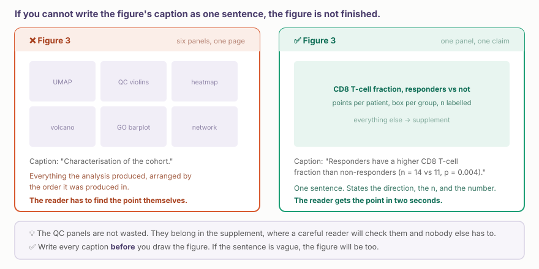
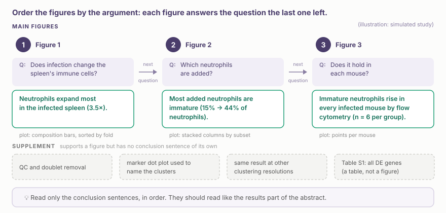
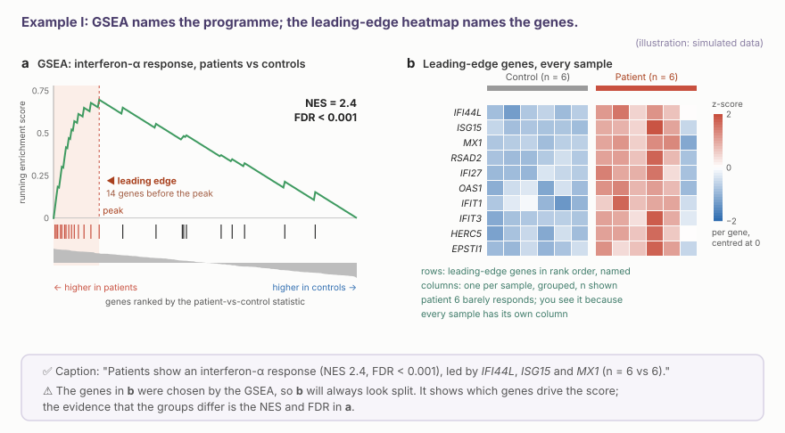
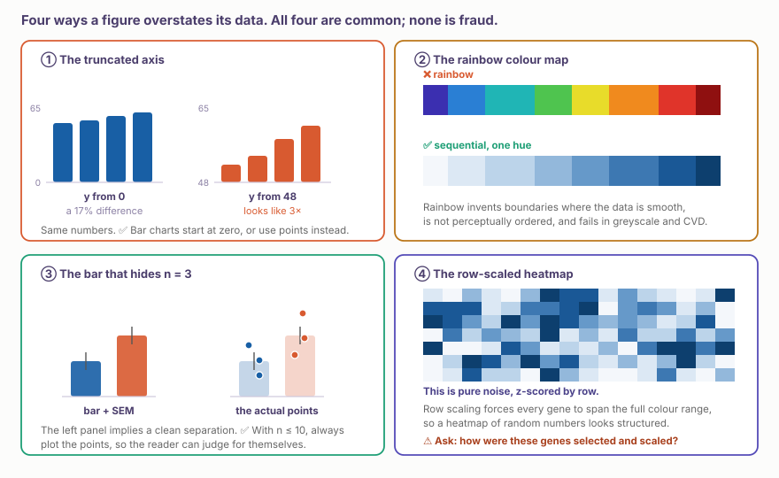
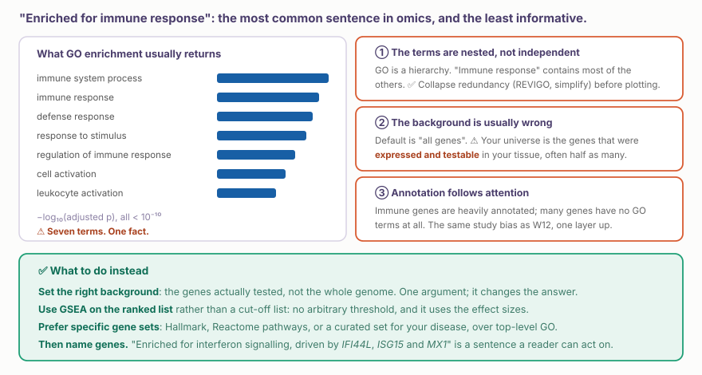
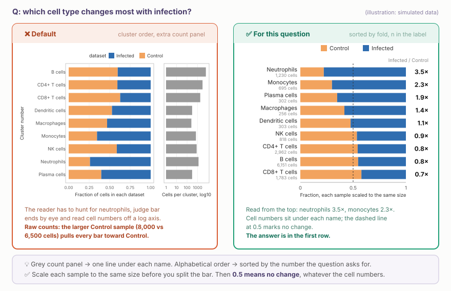
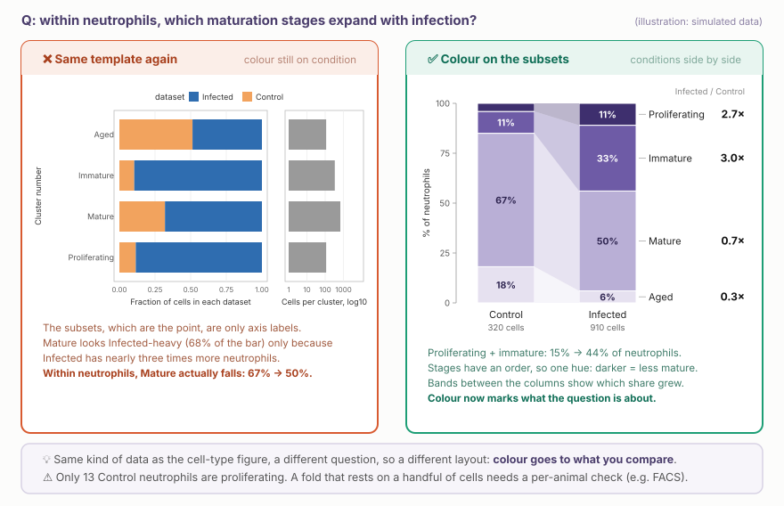

::: {.callout-note collapse="true"}
## 🎯 학습목표

이 장을 마치면 다음을 할 수 있어야 합니다.

-   그림마다 결론 문장을 한 줄로 쓰고, main figure와 supplement를 나눌 수 있다
-   그림 순서를 논증 순서로 정할 수 있다
-   독자가 봐야 할 비교에 맞춰 그래프 종류를 고를 수 있다
-   경향은 그림으로, 찾아볼 값은 표로 나눌 수 있다
-   ⚠️ 그림이 데이터를 과장하는 흔한 방식과, gene 선택·enrichment background처럼 그림을 바꾸는 분석 단계의 함정을 찾아낼 수 있다
-   같은 종류의 data라도 질문에 따라 색·축·정렬을 다르게 정할 수 있다
:::

> 🤔 **동기 질문**
>
> RNA-seq 분석을 마치니 그림이 40개 쌓였습니다. 지도교수는 "main figure는 다섯 개"라고 합니다. 무엇을 남기고, 어떤 순서로, 어떤 모양으로 그려야 합니까?

------------------------------------------------------------------------

# 1. 그림 원칙 📐 {#w13-s1}

원칙은 넷. 뒤의 예시 두 개(§2, §3)에 그대로 적용함

## 1) 그림마다 결론 문장을 하나 쓴다 {#w13-s1-1}

{fig-align="center"}

-   **결론 문장(conclusion sentence)** = 그림 하나가 보여 주는 주장을 한 문장으로 쓴 것. 방법이나 그래프 이름이 아니라 결과를 쓰기
-   ✅ 주어는 연구 대상(세포, gene, 환자군), 동사는 결과. 숫자 자리만 비워 두고 그리기 **전에** 쓰기
-   ✅ Caption엔 **방향**, **n**, **숫자**
-   ⚠️ 관찰 data에 *drives*, *mediates* 같은 인과 동사 x. Data가 보여 주는 만큼만

| ❌ 방법이나 그래프 이름 | ✅ 결론 문장 |
|------------------------------|------------------------------------------------|
| UMAP of PBMCs from 25 patients. | Responders have a higher CD8 T-cell fraction than non-responders (n = 14 vs 11). |
| GSEA of patients vs controls. | Patients show an interferon-α response, led by *IFI44L*, *ISG15* and *MX1*. |
| Cell type composition by condition. | Neutrophils expand most in the infected spleen (3.5×). |

**Main과 supplement 나누기.** 결론 문장이 써지는 그림만 main 후보

-   ✅ **Main**: 주장을 직접 보여 주는 그림
-   ✅ **Supplement**: QC, 분석 parameter 비교, annotation에 쓴 marker 그림, 주장을 바꾸지 않는 재현 확인, 전체 gene 목록(표)
-   ⚠️ 6-panel짜리 "characterisation" 그림은 해석을 독자에게 떠넘기는 것. QC panel은 버리지 말고 supplement로

## 2) 그림 순서는 논증 순서다 {#w13-s1-2}

{fig-align="center"}

-   ✅ 앞 그림이 남긴 질문에 다음 그림이 답하도록 놓기
-   ⚠️ 분석한 순서(QC → clustering → DE → enrichment)나 기법 순서가 아님. 그림마다 **답하는 질문**으로 정하기
-   ✅ 결론 문장만 이어 읽었을 때 Abstract의 결과 부분처럼 읽혀야 함
-   ✅ 한 그림 안의 panel도 같음. 왼쪽에서 오른쪽, 위에서 아래로 읽는 순서가 논증 순서

## 3) 그래프 종류는 보여 줄 비교로 고른다 {#w13-s1-3}

습관대로 고르지 말고 독자가 **무엇과 무엇을 비교해야 하는지** 먼저 정하기. 그래프는 그다음

{fig-align="center"}

-   ✅ n이 작으면(≤ 10) 막대 대신 sample별 point. n은 세포가 아니라 환자·동물의 수
-   ✅ 범주는 알파벳 말고 의미 순서나 값 순서로
-   ✅ 같은 군·같은 cell type은 모든 그림에서 같은 색. 빨강–초록 짝은 피하기
-   ⚠️ **이중 y축은 절대 x.** 척도 두 개를 한 그림에 쓰면 저자가 보이는 관계를 마음대로 고를 수 있음. Panel 두 개로 나누거나, 둘 다 같은 baseline에 맞춘 index로 바꿔 그리기
-   ⚠️ UMAP은 위치 안내용. Cluster 사이 거리를 해석하지 않기

::: {.callout-tip collapse="true"}
## 오믹스 그림 대부분을 고치는 세 가지 습관

-   ✅ **환자를 보여주기.** 다른 걸로 색칠하지 않은 환자별 point가 어떤 요약통계보다 나음
-   ✅ **Direct labelling.** Series가 2–4개면 그림 위에 바로 이름을 쓰는 편이 눈이 왔다 갔다 해야 하는 legend보다 나음
-   ✅ **배경 요소는 뒤로.** Grid와 축은 연한 회색, 진한 건 data뿐. 강조색은 주장에 필요한 것 하나에만
:::

## 4) 경향은 그림으로, 찾아볼 값은 표로 보여 준다 {#w13-s1-4}

-   그림은 차이, 경향, 패턴을 한눈에 보여 줄 때. 표는 정확한 값을 찾아보거나 여러 항목을 나란히 볼 때
-   ⚠️ 같은 data를 그림과 표에 겹쳐 싣지 않기
-   ✅ 표도 본문 없이 읽혀야 함. 제목, 단위, n, 약어 풀이를 표 안에

| 보여 줄 것 | 형식 |
|------------------------------|------------------------------------------------|
| 군 간 차이, 시간에 따른 변화, cluster별 pattern | 그림 |
| 환자 특성(Table 1), sample별 QC 지표, 항체·primer 목록 | 표 |
| DE gene 전체, enrichment 결과 전체 | Supplementary 표 (파일) |
| 핵심 숫자 하나 (예: 반응률 42%) | 본문 문장. 모든 결과에 그림이 필요한 건 아님 |

::: {.callout-important collapse="true"}
## 동기 질문으로 돌아가기

그림 40개를 main figure 다섯 개로 줄이려면:

-   ① 그림마다 **결론 문장**을 써 보기. 써지지 않는 그림(QC, parameter 비교, 전체 목록)은 supplement로
-   ② 남은 결론 문장을 **이어 읽어서** Abstract의 결과처럼 읽히는 순서로 놓기. 질문 하나에 그림 하나
-   ③ 그림마다 독자가 볼 **비교**를 정하고 그래프 고르기
-   ④ 정확한 값이 필요한 건 **표**로
:::

------------------------------------------------------------------------

# 2. 예시 I: GSEA와 핵심 gene heatmap 🧾 {#w13-s2}

RNA-seq 논문의 단골 그림. 환자 vs 대조군 DE → GSEA로 많이 움직인 gene set 찾기(a) → 그중 하나의 running score(b) → 그 gene set을 이끄는 gene(**leading edge**)을 heatmap으로(c)

{fig-align="center"}

-   ✅ a에는 top gene set 몇 개만. 막대는 0(NES)에서 시작하고, b에서 자세히 볼 하나에만 강조색
-   ✅ **Leading edge** = running enrichment score가 최고점에 이르기까지 기여한 gene. Pathway 이름 대신 gene 이름을 쓸 수 있게 해 줌
-   ✅ Heatmap은 sample마다 한 열. 군별로 묶고 n을 보이기. 반응이 약한 환자도 그대로 보임
-   ✅ 결론 문장: *"Patients show an interferon-α response (NES 2.4, FDR < 0.001), led by IFI44L, ISG15 and MX1 (n = 6 vs 6)."*

이 그림 하나를 만들기까지 **그림의 함정**과 **분석의 함정**이 둘 다 있음

## 1) 그림의 함정 {#w13-s2-1}

{fig-align="center"}

이 예시에서 나오는 곳:

-   ⚠️ **Truncated axis.** Top gene set 막대(그림 a의 NES나 −log~10~ FDR)나 핵심 gene 발현 막대를 0이 아닌 곳에서 시작하면 차이가 부풀려짐. 막대는 길이 *자체*가 값이기 때문. 0이 의미 없으면 막대 대신 point나 dot plot
-   ⚠️ **Rainbow color map.** Heatmap 색 척도. 색의 순서가 눈으로 읽히지 않고, 매끄러운 data에 없는 경계를 만들고, 흑백 인쇄나 색각이상에서는 구분이 안 됨. ✅ 크기엔 한 색조 sequential ramp, z-score처럼 부호 있는 값엔 가운데가 중립색인 diverging ramp
-   ⚠️ **n을 숨기는 막대.** 핵심 gene을 qPCR로 확인한 그림(n = 3)을 막대와 SEM으로 그리면 있지도 않은 정밀도가 있는 것처럼 보임. ✅ n ≤ 10이면 개별 point를 그리기
-   ⚠️ **Row-scaled heatmap.** 행마다 z-score로 바꾸면 모든 gene이 색 범위 전체를 쓰게 되어서 noise도 구조처럼 보임. 중심이 치우친 diverging 척도는 한쪽 방향을 과장함. ✅ Legend에 "z-score per gene"이라고 쓰고 척도 중심을 0에

## 2) 분석의 함정 {#w13-s2-2}

그리기 전 단계에서 그림을 바꿔 버리는 것들

### ① Gene을 고른 방법이 block을 만든다

-   ⚠️ 군 간에 다르다는 *이유로* 고른 gene을 heatmap으로 그리면 block은 무조건 나옴. 고르는 과정이 pattern을 만든 것이고, 이를 **circular selection**이라 함. 아주 흔함
-   ⚠️ Leading-edge heatmap도 마찬가지. GSEA가 고른 gene이라 갈라져 보이는 게 당연함. 이 heatmap은 "어떤 gene이 이끄나"를 보여 주는 그림이지 "군이 다르다"의 증거가 아님. 증거는 GSEA의 NES와 FDR
-   ✅ 차이 자체를 heatmap으로 보이려면 data를 둘로 나눠 한쪽에서 gene을 고르고 다른 쪽 data로 그리기. 또는 고르지 않은 gene 세트를 나란히 보여주기

### ② Background가 결과를 좌우한다

{fig-align="center"}

Enrichment는 내 gene 목록에 어떤 category가 **어떤 universe에서 우연히 기대되는 것보다** 많은지 묻는 검정. Universe를 바꾸면 답도 바뀜

-   ❌ 기본값은 "사람의 모든 gene". 하지만 내 조직에서 발현 안 되는 gene은 애초에 목록에 들어올 수가 없었음
-   ✅ Universe는 **실제로 검정한 gene**으로: 기준 이상 발현되고 filter를 통과한 gene
-   ⚠️ 조직 특이적 data에선 universe가 보통 절반으로 줄고, "유의한" category 하나가 통째로 사라지기도 함
-   ✅ GO term은 서로 포함 관계라 같은 결과를 여러 번 보고함. `simplify()`나 REVIGO로 합친 뒤 그리기. 그림 a의 IFN-α와 IFN-γ처럼 leading edge가 거의 겹치는 gene set도 결과는 하나

::: {.panel-tabset group="lang"}

### R

```{r}
# toy input (illustration only): airway smooth-muscle cells ± dexamethasone, through DESeq2
library(DESeq2); library(airway)
data(airway)
airway$dex <- relevel(airway$dex, "untrt")
sym <- AnnotationDbi::mapIds(org.Hs.eg.db::org.Hs.eg.db, rownames(airway), "SYMBOL", "ENSEMBL")
airway <- airway[!is.na(sym) & !duplicated(sym), ]
rownames(airway) <- sym[rownames(airway)]
dds <- DESeqDataSet(airway, design = ~ cell + dex) |> DESeq()
res <- as.data.frame(results(dds)); res$gene <- rownames(res)
sig_genes <- res$gene[which(res$padj < 0.05 & abs(res$log2FoldChange) > 1)]

library(clusterProfiler); library(org.Hs.eg.db)

universe <- rownames(dds)[rowSums(counts(dds)) > 10]   # ✅ what was testable

ego <- enrichGO(gene = sig_genes, universe = universe,     # ⚠️ not the default
                OrgDb = org.Hs.eg.db, keyType = "SYMBOL",
                ont = "BP", pAdjustMethod = "BH")

ego <- simplify(ego, cutoff = 0.7)     # collapse redundant nested terms
head(as.data.frame(ego)[, c("Description", "GeneRatio", "p.adjust")])
```

### Python

```{python}
import numpy as np, pandas as pd, gseapy as gp

# toy input (illustration only): the same airway experiment (± dexamethasone),
# as the authors' published differential-expression table (GEO GSE52778, Cuffdiff)
res = pd.read_csv("https://ftp.ncbi.nlm.nih.gov/geo/series/GSE52nnn/GSE52778/suppl/"
                  "GSE52778_Dex_vs_Untreated_gene_exp.diff.gz", sep="\t")
res = res[res.status == "OK"]                                 # ✅ what was testable
sig_genes = res.gene[(res.q_value < 0.05) & (res["log2(fold_change)"].abs() > 1)].unique().tolist()
universe  = res.gene.unique().tolist()

ego = gp.enrichr(gene_list=sig_genes, background=universe,   # ⚠️ not the default
                 gene_sets="GO_Biological_Process_2023", outdir=None)
# (no GO-similarity simplify() in Python — read past near-duplicate terms yourself)
print(ego.results.sort_values("Adjusted P-value")[["Term", "Odds Ratio", "Adjusted P-value"]].head(6).to_string(index=False))
```

:::

### ③ 잘라낸 목록보다 순위 목록으로 GSEA

✅ Over-representation test보다 나은 경우가 많음. 잘라낸 목록이 아니라 전체 순위를 쓰기 때문에 자의적인 cut-off x, 작지만 함께 움직이는 변화도 잡힘. 위 그림 b의 leading edge도 여기서 나옴

::: {.panel-tabset group="lang"}

### R

```{r}
library(tidyverse)                    # dplyr verbs; loaded after AnnotationDbi so select() is dplyr's

ranks <- res |> filter(!is.na(stat)) |> arrange(desc(stat)) |>
  select(gene, stat) |> deframe()

gseaGO <- gseGO(ranks, OrgDb = org.Hs.eg.db, keyType = "SYMBOL", ont = "BP")
head(as.data.frame(gseaGO)[, c("Description", "NES", "p.adjust")])
```

### Python

```{python}
# Cuffdiff's test_stat is positive when a gene is higher with dexamethasone, like DESeq2's stat
ranks = res.groupby("gene").test_stat.mean().sort_values(ascending=False)

gseaGO = gp.prerank(rnk=ranks, gene_sets="GO_Biological_Process_2023",
                    threads=8, seed=1, outdir=None)
gseaGO.res2d[["Term", "NES", "FDR q-val"]].head(6)
```

:::

### ④ Term 대신 gene 이름을 쓴다

"면역반응 enrichment"는 거의 모든 염증 조직에 해당함. **"*IFI44L*, *ISG15*, *MX1*이 주도하는 interferon signalling"** 은 독자가 써먹고 확인할 수 있는 문장. 그 gene 이름을 주는 게 leading edge

------------------------------------------------------------------------

# 3. 예시 II: Cell type 구성 비교 🧩 {#w13-s3}

§1의 순서 카드에서 Figure 1–2에 해당. scRNA-seq 논문에는 거의 항상 condition별 cell 구성 그림이 들어감. 같은 형태의 data라도 질문이 다르면 그림도 달라야 함. 아래 두 그림은 실제 분석에서 그림을 고친 과정을 가상 data(감염 vs 대조군 mouse 비장)로 다시 만든 것

## 1) 어느 cell type이 가장 많이 변했나 {#w13-s3-1}

{fig-align="center"}

질문은 "condition에 따라 어느 cell type이 가장 많이 변했나". 그러면 그림도 그 답을 먼저 보여줘야 함

-   ✅ **질문이 묻는 숫자로 정렬.** 알파벳이나 cluster 번호 순서는 분석한 순서일 뿐. Fold 순으로 놓으면 맨 위 줄이 답
-   ✅ **회색 cell 수 panel은 빼고 이름 아래 한 줄로.** Cell 수는 참고 정보라 panel 하나를 차지할 이유가 없음
-   ✅ **Fold는 숫자로 직접 쓰기.** 막대 끝을 눈으로 비교하게 하지 않기
-   ⚠️ **두 sample을 같은 크기로 맞춘 뒤 나누기.** Raw count로 나누면 세포가 더 많이 잡힌 sample 쪽으로 모든 막대가 기울어서, 0.5가 "변화 없음"이 아니게 됨

## 2) Neutrophil 안에서는 무엇이 늘었나 {#w13-s3-2}

Neutrophil이 가장 많이 늘었으니 다음 질문은 "어떤 neutrophil이 늘었나". Data 형태는 1)과 같은 condition별 구성 비율이지만, 이번엔 subset이 주인공

{fig-align="center"}

-   ✅ **색은 비교할 대상에.** 이번엔 subset을 비교하니 색을 subset에 주고, condition은 x축에 나란히 두기
-   ✅ **순서 있는 subset엔 한 색조 sequential.** 성숙 단계엔 순서가 있으니 덜 성숙할수록 진하게. 강조하려는 미성숙 subset이 저절로 눈에 띔
-   ✅ **부모 집단 안에서 비율 계산.** 왼쪽에선 mature의 68%가 감염 쪽이라 늘어난 것처럼 보이지만, neutrophil 전체가 거의 3배로 늘어서 생긴 착시. Neutrophil 안의 비율은 67% → 50%로 오히려 줄었음
-   ⚠️ **Fold 뒤의 세포 수 확인.** 대조군의 proliferating은 13개뿐. 세포 몇 개로 정해진 fold는 FACS처럼 개체 단위 실험으로 확인(순서 카드의 Figure 3). 조건당 library가 하나면 fold는 기술일 뿐 검정이 아님

::: {.callout-tip collapse="true"}
## 같은 composition, 다른 그림

| | 1) 전체 cell type | 2) Neutrophil subset |
|--------------|-----------------------------|-----------------------------|
| 질문 | 어느 cell type이 가장 많이 변했나 | Neutrophil 안에서 어느 단계가 늘었나 |
| 색 | Condition | Subset (성숙 순서대로 한 색조) |
| 축 | Cell type, fold 순 | Condition 두 개를 나란히 |
| 숫자 | Cell 수는 이름 아래, fold는 오른쪽 | %는 막대 안, fold는 오른쪽 |

✅ 그림을 정하는 건 data의 형태가 아니라 질문. 독자가 비교해야 할 것을 가장 가까이 두고 가장 눈에 띄는 색을 주기
:::

------------------------------------------------------------------------

# 4. 실습 💻 {#w13-s4}

## 1) 내 Figure 순서 카드 쓰기 {#w13-s4-1}

W14 프로젝트나 지금 하고 있는 분석으로 카드 3–5장

-   ① 카드마다: 답하는 질문 한 줄, 결론 문장 한 줄(영어), 보여 줄 비교와 그래프 종류, main인지 supplement인지
-   ② 결론 문장만 이어 읽어 보기. Abstract의 결과처럼 읽히나?
-   ③ 짝과 카드를 바꿔 읽고, 순서대로 읽을 때 막히는 곳을 말해 주기

## 2) 가져온 그림 뜯어보기 {#w13-s4-2}

둘씩 짝지어서. 옆 사람 그림을 보고:

-   ① 결론 문장을 한 문장으로 쓸 수 있나?
-   ② 독자가 볼 비교에 맞는 그래프인가? §1의 그래프 그림에서 더 맞는 형식이 있나?
-   ③ 축이 0에서 시작하나? 그래야 하나?
-   ④ n이 보이나? 개별 환자가 보이나?
-   ⑤ Heatmap이 있다면: gene은 어떻게 골랐고, row scaling 했나?
-   ⑥ 색 척도가 있다면: sequential, diverging, rainbow 중 어느 것이고, 할 일과 맞나?
-   ⑦ 요점을 약하게 하지 않고 supplement로 보낼 수 있는 panel은?

## 3) 그림 하나 다시 만들기 {#w13-s4-3}

::: {.panel-tabset group="lang"}

### R

```{r}
library(tidyverse)

# toy data (illustration only): CD8 T-cell fraction in 8 controls and 9 responders
set.seed(1)
d <- tibble(group = rep(c("control", "responder"), c(8, 9)),
            value = c(rnorm(8, 0.15, 0.05), rnorm(9, 0.25, 0.07)))

# ❌ before
ggplot(d, aes(group, value, fill = group)) +
  stat_summary(fun = mean, geom = "col") +
  stat_summary(fun.data = mean_se, geom = "errorbar", width = .2)

# ✅ after — the patients are visible, and n is on the axis
d |>
  mutate(group = fct_relevel(group, "control")) |>
  ggplot(aes(group, value)) +
  geom_boxplot(width = .45, outlier.shape = NA, colour = "#8A7FA3") +
  geom_jitter(width = .12, size = 2.6, alpha = .85, colour = "#185FA5") +
  scale_x_discrete(labels = \(x) paste0(x, "\n(n = ", table(d$group)[x], ")")) +
  labs(y = "CD8 T-cell fraction", x = NULL,
       title = "Responders have a higher CD8 T-cell fraction") +
  theme_minimal(base_size = 13) +
  theme(panel.grid.major.x = element_blank())
```

### Python

```{python}
import matplotlib.pyplot as plt, seaborn as sns

# toy data (illustration only): CD8 T-cell fraction in 8 controls and 9 responders
rng = np.random.default_rng(1)
d = pd.DataFrame({"group": ["control"] * 8 + ["responder"] * 9,
                  "value": np.r_[rng.normal(0.15, 0.05, 8), rng.normal(0.25, 0.07, 9)]})

# ❌ before
sns.barplot(d, x="group", y="value", hue="group", errorbar="se", capsize=.2)
plt.show()

# ✅ after — the patients are visible, and n is on the axis
order = ["control", "responder"]
n = d.group.value_counts()
ax = sns.boxplot(d, x="group", y="value", order=order, width=.45, showfliers=False,
                 fill=False, color="#8A7FA3")
sns.stripplot(d, x="group", y="value", order=order, jitter=.12, size=7, alpha=.85,
              color="#185FA5", ax=ax)
ax.set_xticks(range(len(order)), [f"{g}\n(n = {n[g]})" for g in order])
ax.set(xlabel=None, ylabel="CD8 T-cell fraction", title="Responders have a higher CD8 T-cell fraction")
sns.despine()
plt.show()
```

:::

## 4) 맞는 universe로 enrichment 다시 하기 {#w13-s4-4}

::: {.panel-tabset group="lang"}

### R

```{r}
# Run enrichGO twice: default universe, then the expressed-gene universe.
# How many terms survive? Does the top term change?
```

### Python

```{python}
# Run gp.enrichr twice: default background, then the expressed-gene universe.
# How many terms survive? Does the top term change?
```

:::

💡 2분이면 끝나고, 결과가 바뀌는 일이 자주 있어서 매번 할 가치가 있음

## 5) 다음 주 전까지 {#w13-s4-5}

**[W14: 나만의 프로젝트](w14_project_design.qmd).** 한 문장짜리 연구 질문과, 현실적으로 구할 수 있는 data를 적은 메모 가져오기. 실습 1)의 순서 카드가 있으면 함께

------------------------------------------------------------------------

# 📝 요약

-   ✅ **그림마다 결론 문장 하나.** 방향, n, 숫자를 한 문장에. 결론 문장이 안 써지는 그림은 supplement로
-   ✅ **그림 순서는 논증 순서.** 결론 문장만 이어 읽으면 Abstract의 결과가 되도록
-   ✅ **그래프는 보여 줄 비교로 고르기.** 이중 y축은 절대 x
-   ✅ **경향은 그림, 찾아볼 값은 표.** 같은 data를 둘 다에 싣지 않기
-   ⚠️ 그림의 함정 넷: **truncated axis**, **rainbow color map**, **n을 숨기는 막대**, **row scaling한 heatmap**
-   ⚠️ 차이 나는 gene을 골라 heatmap으로 그리면 block을 **만들어냄** (circular selection). Leading-edge heatmap은 gene 이름을 보여 줄 뿐이고, 증거는 GSEA 통계
-   ⚠️ **Enrichment background가 결과를 좌우함.** Genome 전체가 아니라 실제로 검정한 gene으로. 중복 GO term은 합치고, 되도록 순위 목록으로 GSEA
-   ✅ **Term 대신 gene 이름.** "면역반응"보다 "*ISG15*가 주도하는 interferon signalling"이 나음
-   ✅ 같은 composition data라도 질문이 그림을 정함. 색은 비교할 대상에, 정렬은 질문이 묻는 숫자로

------------------------------------------------------------------------

# 🔑 핵심 용어

| 용어 | 한 줄 정의 |
|-------------------------|-----------------------------------------|
| 결론 문장 (conclusion sentence) | 그림 하나가 보여 주는 주장을 쓴 한 문장. 방법이 아니라 결과를 씀 |
| Truncated axis | 0에서 시작하지 않아 차이를 과장하는 막대그래프의 축 |
| Sequential ramp | 하나의 색조가 밝은색에서 어두운색으로 변함. 크기에 사용 |
| Diverging ramp | 가운데가 중립색인 두 색조. 부호 있는 값에 사용 |
| Row scaling (z-score) | 각 행의 척도를 다시 설정해 잡음이 구조처럼 보이게 할 수 있는 처리 |
| Circular selection | 나중에 보여줄 효과를 기준으로 변수를 미리 고르는 것 |
| Over-representation test | 특정 범주가 우연히 기대되는 빈도보다 자주 나타나는지 검정하는 방법 |
| Universe / background | 분석 대상 목록이 추출될 수 있었던 전체 후보 집합 |
| GSEA | 임계값 없이 순위가 매겨진 전체 목록을 사용하는 풍부도 분석 |
| Leading edge | GSEA에서 running score가 최고점에 이르기까지 기여한 gene. 그 gene set을 이끄는 gene |
| Term redundancy | 서로 포함 관계인 GO 용어가 같은 결과를 반복해 보고하는 현상 |
| Direct labelling | 범례 대신 그림 위에 각 계열의 이름을 직접 쓰는 방식 |

------------------------------------------------------------------------

# ➕ 참고문헌

### 그림

Rougier NP, Droettboom M, Bourne PE. [*Ten simple rules for better figures.*](https://doi.org/10.1371/journal.pcbi.1003833) PLoS Comput Biol. 2014.\
Weissgerber TL, et al. [*Beyond bar and line graphs: time for a new data presentation paradigm.*](https://doi.org/10.1371/journal.pbio.1002128) PLoS Biol. 2015. **← 개별 point를 보여야 하는 이유**\
Crameri F, Shephard GE, Heron PJ. [*The misuse of colour in science communication.*](https://doi.org/10.1038/s41467-020-19160-7) Nat Commun. 2020. **← 무지개 색상 지도가 실패하는 이유**\
Wilke CO. [*Fundamentals of Data Visualization.*](https://clauswilke.com/dataviz/) (무료 온라인 자료)\
Holtz Y, Healy C. [*From Data to Viz.*](https://www.data-to-viz.com/) **← data 형태와 보여 줄 것으로 그래프를 고르는 결정 나무**\
Ha E. [*AI 과학 글쓰기 W5. Figure 스토리보드.*](https://kkonoo.github.io/AI_Sci_Writing_KNUmed/ko/chapters/w05_figure_storyboard.html) **← 결론 문장, 그림 순서, 표 형식을 더 자세히**

### Enrichment

Timmons JA, Szkop KJ, Gallagher IJ. [*Multiple sources of bias confound functional enrichment analysis of global -omics data.*](https://doi.org/10.1186/s13059-015-0761-7) Genome Biol. 2015. **← background 문제 포함**\
Wijesooriya K, et al. [*Urgent need for consistent standards in functional enrichment analysis.*](https://doi.org/10.1371/journal.pcbi.1009935) PLoS Comput Biol. 2022.\
Subramanian A, et al. [*Gene set enrichment analysis.*](https://doi.org/10.1073/pnas.0506580102) PNAS. 2005. **← leading edge의 정의**\
Wu T, et al. [*clusterProfiler 4.0: a universal enrichment tool.*](https://doi.org/10.1016/j.xinn.2021.100141) Innovation. 2021.

### 순환논리

Kriegeskorte N, et al. [*Circular analysis in systems neuroscience: the dangers of double dipping.*](https://doi.org/10.1038/nn.2303) Nat Neurosci. 2009. **← 신경과학을 다룬 논문이지만 오믹스 heatmap에도 그대로 적용됨**
