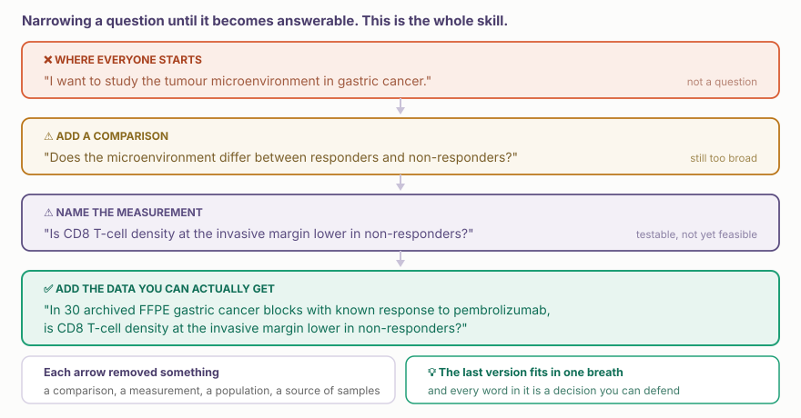
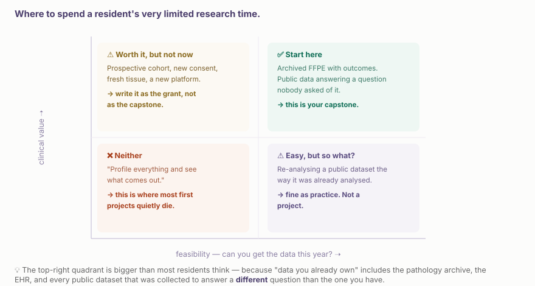
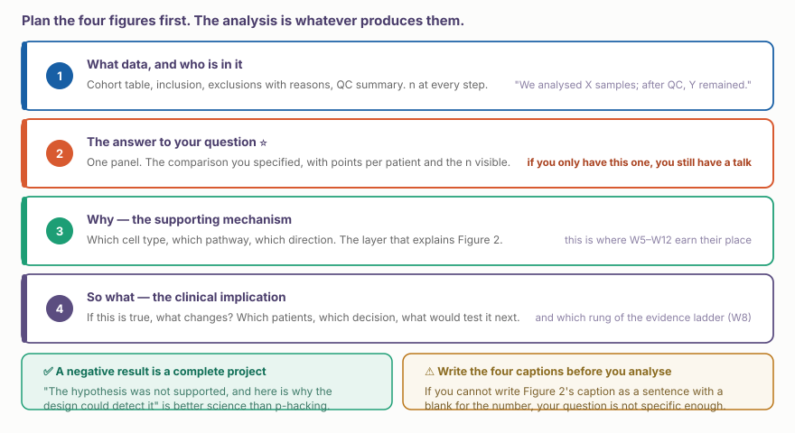

::: {.callout-note collapse="true"}
## 🎯 학습목표

이 장을 마치면 다음을 할 수 있어야 합니다.

-   폭넓은 관심사를 비교, 측정값, 데이터 출처가 있는 질문으로 좁힐 수 있다
-   ⚠️ Feasibility를 정직하게 판단하고 대부분의 첫 프로젝트가 실패하는 사분면을 알아볼 수 있다
-   분석을 시작하기 전에 네 개의 그림을 계획할 수 있다
-   자신의 프로젝트가 evidence ladder의 어느 단계까지 도달할 수 있는지 밝히고 다음 단계를 명시할 수 있다
-   ⚠️ 음성 결과가 완결된 프로젝트인 이유를 말할 수 있다
-   작성된 one-page protocol을 가지고 수업을 마칠 수 있다
:::

> 🤔 **동기 질문**
>
> 6개월 동안 매주 오후 한 번을 쓸 수 있습니다. 그 시간에 무엇을 할 가치가 있을까요?

------------------------------------------------------------------------

# 1. 질문 좁히기 🎯 {#w14-s1}

{fig-align="center"}

쓸 수 있는 질문엔 네 가지가 들어 있음:

-   **대상 집단** — 어떤 환자, 진료 과정의 어느 시점
-   **비교** — 무엇 vs 무엇
-   **측정값** — 실제로 뭘 정량하나
-   **데이터 출처** — 어디서 오나, 이미 있나

⚠️ 넷 중 하나라도 빠지면 → 프로젝트가 아니라 관심사

::: {.callout-tip collapse="true"}
## 문장 틀

> *“\_\_\_\_ [대상 집단]에서, \_\_\_\_ [측정값]은 \_\_\_\_와 \_\_\_\_ [비교] 사이에 차이가 있는가? \_\_\_\_ [데이터 출처]를 사용한다.”*

빈칸을 다 못 채우면 → 빈 칸이 바로 다음 할 일. 그리고 대개 분석이 아님: 병리과에 전화 한 통, 또는 공개 database에서 한 시간
:::

------------------------------------------------------------------------

# 2. ⚠️ Feasibility, 정직하게 🗺️ {#w14-s2}

{fig-align="center"}

## 1) "이미 가진 data"에 실제로 들어가는 것 {#w14-s2-1}

전공의들이 늘 과소평가하는 목록:

-   ✅ **병리 archive** — outcome이 연결된 FFPE block. Spatial도 proteomics도 FFPE에서 됨 (🔗 [W7 §2.2](../part4/w7_spatial_basics.qmd#w7-s2-2))
-   ✅ **잔여 임상 검체** — 기관에 따라 기존 동의로 보관 중인 serum/plasma
-   ✅ **EHR** — 검사, 영상 판독, 약물, outcome이 이미 디지털로 있음
-   ✅ **다른 목적으로 모은 공개 data** — GEO, CELLxGENE, TCGA, UK Biobank return file. 질문 A에 답하려고 만든 dataset에 내 질문 B의 답이 들어 있는 경우가 정말 많음
-   ✅ **우리 과의 예전 연구** — 한 가지 목적으로 한 번 분석하고 끝난 data

💡 좋은 전공의 프로젝트는 대개 **기존 dataset 하나** + **원래 연구에선 아무도 관심 없던 임상 질문 하나**의 조합

## 2) 시간 비용, 정직하게 {#w14-s2-2}

| 단계 | 현실적인 시간 |
|-------------------------|-----------------------------------------|
| 보관 검체 IRB / 윤리 승인 | ⚠️ 1–4개월, 여기서 시계가 돌기 시작 |
| Block 찾고 반출 | 2–6주, 누군가 직접 해야 함 |
| 절편, QC(DV200) | 2–4주 |
| Core 시설 assay | 4–12주 |
| 분석 | ⚠️ 항상 계획보다 오래 걸림 |
| 논문 쓰기 | 그보다 더 오래 |

⚠️ 윤리 신청은 첫 주에 시작. 더 열심히 해도 줄일 수 없는 유일한 단계

------------------------------------------------------------------------

# 3. 그림부터 계획 🖼️ {#w14-s3}

{fig-align="center"}

## 1) 내 단계 정하기 {#w14-s3-1}

🔗 [W8 §3](../part4/w8_spatial_integration.qmd#w8-s3)의 evidence ladder: 기술 → 가설 → 일치 → 지지 → 입증

전공의 프로젝트가 현실적으로 닿는 곳 = **③ 일치**. 그렇다고 명시하고, ④나 ⑤로 올릴 실험을 제시하면 → 출판 가능, 연구비 가능, 그리고 정직함

⚠️ 심사에서 프로젝트를 무너뜨리는 건 ③에서 멈춘 게 아님. ③의 근거 위에 ⑤의 동사를 쓰는 것

## 2) ✅ 음성 결과도 완결된 프로젝트 {#w14-s3-2}

::: {.callout-tip collapse="true"}
## 음성 결과를 완결시키는 것

"아무것도 못 찾았다"가 아니라:

-   ✅ 가설이 틀릴 수 있을 만큼 **구체적**이었음
-   ✅ 설계가 효과를 **검출할 수 있었음** — 어느 크기의 효과까지 검정력이 있었는지 명시
-   ✅ 측정은 제대로 됨 — positive control이 예상대로 나옴
-   ✅ 다음엔 뭘 다르게 할지 말할 수 있음

→ p-value 하나 건진 낚시 연구보다 나은 기여. 그리고 14주 수업에선 훨씬 현실적인 목표
:::

------------------------------------------------------------------------

# 4. One-page protocol 📄 {#w14-s4}

Data 만지기 전에 쓰기. 한 페이지, 제목 열 개

```
1. 질문          네 빈칸을 모두 채운 한 문장
2. 중요성        진료에서 바뀔 의사결정
3. 대상 집단     포함·제외 기준과 존재하는 환자 수
4. 비교          집단 A 대 집단 B, 그리고 matching 방법
5. 측정          플랫폼, assay, 정량할 대상
6. n             반복 단위가 무엇인지 함께 명시  ⚠️
7. 교란요인      batch, 채취 기관, tube 종류, 담당자와 대처 계획
8. 분석          데이터를 보기 전 지금 결정한 일차 검정
9. 그림          빈칸이 있는 문장으로 작성한 caption 네 개
10. 중단 조건    무엇이 나오면 이 프로젝트를 포기할 것인가?
```

::: {.callout-important collapse="true"}
## 다들 건너뛰는 10번, 그런데 몇 달을 아껴주는 항목

어떤 결과가 나오면 멈출지 지금 정하기

-   "DV200이 적절한 block이 25개 미만이면 검정력 부족 → 중단"
-   "positive control이 안 갈리면 assay가 안 되는 것 → 중단"
-   "효과가 X보다 작으면 진료를 못 바꿈 → 중단"

⚠️ 미리 쓰면 protocol, 결과 보고 정하면 합리화
:::

------------------------------------------------------------------------

# 5. Workshop 💻 {#w14-s5}

## 1) 둘씩, 각자 10분 {#w14-s5-1}

-   ① **질문을 한 문장으로.** 상대가 다시 말해보기. 제대로 이해했나?
-   ② §2의 **어느 사분면**? 정직하게
-   ③ 답을 보여줄 **Figure 2를 종이에 그리기.** 축은?
-   ④ **n은?** unit of replication은?
-   ⑤ 예상 결과를 혼자서도 만들어낼 수 있는 **교란요인 하나**
-   ⑥ **10번** — 뭐가 나오면 멈추나?

::: {.callout-warning collapse="true"}
## 오늘 가장 많이 듣게 될 세 가지 실패

-   ❌ **너무 넓음.** "면역 미세환경을 보고 싶어요" → 비교가 나올 때까지 §1 적용
-   ❌ **n이 틀림.** "Cell이 40,000개예요" → 환자는 몇 명? (🔗 [W5 §5](../part3/w5_scrna_qc.qmd#w5-s5))
-   ❌ **Data가 아직 없음.** "새로 검체를 모을게요" → 6개월 안에 몇 개? 정직한 답은 대개 10개 미만
:::

## 2) 마지막 수업 전까지 {#w14-s5-2}

**제출물:**

-   ✅ 제목 열 개를 다 채운 one-page protocol
-   ✅ Figure 1(cohort) 초안, 대충이라도
-   ✅ Figure 2(답) 초안 — 또는 숫자만 비워둔 caption
-   ✅ 손으로 친 숫자 없이 render되는 Quarto 문서 (🔗 [W2 §3](../part1/w2_scripts_ai.qmd#w2-s3))
-   ✅ Git 저장소에 올린 코드 (🔗 [W2 §4](../part1/w2_scripts_ai.qmd#w2-s4)) — ⚠️ `.gitignore`에 `rawdata/` 포함

**발표:** 15분 + 질의응답 5분

```
배경                 2분   임상 문제
질문                 1분   한 문장, 그리고 답할 수 있는 이유
데이터와 방법        3분   가진 데이터, 수행한 분석, 제외한 항목
결과               5–7분   그림 네 개, 그림마다 메시지 하나
해석                 2분   근거 단계와 다음 단계로 올릴 방법
임상적 의미          1분   결과가 참이라면 무엇이 바뀌는가?
```

------------------------------------------------------------------------

# 6. 이제 할 수 있는 것 🎓 {#w14-s6}

이 수업을 시작할 땐 bulk RNA-seq을 돌려서 gene 목록을 만들 수 있었음

이제는:

-   GWAS를 읽고 그게 보여주지 *않는* 걸 말할 수 있음
-   PRS가 내 환자에게 적용되는지 판단할 수 있음
-   Single-cell 논문이 cell과 donor를 헷갈렸는지 알아볼 수 있음
-   조직 *어디서* 일어났는지 물을 수 있음
-   Protein이 애초에 만들어지지 않았을 수도 있다는 걸 앎
-   Network hub가 논문 수의 artifact임을 알아봄
-   통계를 돌리기도 전에 잘못된 대조군을 찾아냄

전부 코딩이 아님. 전부 판단 — 그리고 남에게 맡길 수 없는 부분

::: {.callout-tip collapse="true"}
## 계속 가져갈 세 가지 습관

-   ✅ **Unit of replication이 뭔지 묻기.** 모든 논문, 모든 회의, 모든 설계에서. 이 분야에서 가장 수확이 큰 질문 하나
-   ✅ data를 만들기 전에 **답이 이미 있는지 찾아보기.** 브라우저에서 한 시간씩 습관처럼 — 연구비 하나를 통째로 아낀 경우도 있음
-   ✅ **Caption부터 쓰기.** 그림이든 논문이든 프로젝트든 — 문장이 흐릿하면 작업도 흐릿해짐

💡 하나 더: 결과가 너무 깔끔해 보이면 → 가설이 틀렸을 때 이 설계가 뭘 만들어냈을지 물어보기
:::

------------------------------------------------------------------------

# 📝 요약

-   쓸 수 있는 질문 = **대상 집단, 비교, 측정값, 데이터 출처**
-   ⚠️ 넷 중 하나라도 빠지면 관심사지 프로젝트가 아님
-   ✅ 가치도 높고 feasibility도 높은 사분면에서 시작: **outcome이 연결된 보관 검체**, 또는 **새 질문을 던지는 공개 data**
-   ⚠️ 윤리 신청은 첫 주에 — 줄일 수 없는 단계
-   ✅ **분석 전에 그림 네 개 계획**: cohort · 답 · 기전 · 의미
-   ✅ 닿을 수 있는 **evidence ladder 단계**와, 한 단계 올려줄 실험을 명시
-   ✅ 가설이 구체적이고 설계가 효과를 검출할 수 있었다면 **음성 결과도 완결**
-   ⚠️ **"뭐가 나오면 그만둘지"**를 미리 쓰기. 나중에 정하면 합리화
-   ✅ 세 가지 습관: unit of replication 묻기, 답이 이미 있는지 확인, caption부터 쓰기

------------------------------------------------------------------------

# 🔑 핵심 용어

| 용어 | 한 줄 정의 |
|-------------------------|-----------------------------------------|
| Scoping | 넓은 관심사를 실제로 답할 수 있는 질문으로 좁히는 과정 |
| Unit of replication | 독립적으로 반복할 수 있는 대상 — 대개 환자 |
| Feasibility | 정해진 일정과 자원 안에서 필요한 데이터를 확보할 수 있는 정도 |
| One-page protocol | 데이터를 다루기 전에 열 개 핵심 항목으로 작성하는 연구계획서 |
| Stopping rule | 프로젝트를 중단하거나 방향을 바꾸게 할 결과를 미리 정한 기준 |
| Evidence ladder | 기술 → 가설 → 일치함 → 지지됨 → 입증됨으로 근거 수준을 구분하는 체계 |
| Positive control | 분석법이 제대로 작동했음을 보여 주는, 존재가 이미 확인된 신호 |
| Pre-specification | 데이터를 보기 전에 분석 방법과 판단 기준을 정하는 것 |

------------------------------------------------------------------------

# ➕ 참고문헌

### 연구 설계와 보고

Lazic SE. [*Experimental Design for Laboratory Biologists.*](https://doi.org/10.1017/9781139696647) Cambridge University Press. 2016.\
Collins GS, et al. [*TRIPOD: transparent reporting of a multivariable prediction model.*](https://doi.org/10.7326/M14-0697) Ann Intern Med. 2015.\
Kilkenny C, et al. [*Improving bioscience research reporting: the ARRIVE guidelines.*](https://doi.org/10.1371/journal.pbio.1000412) PLoS Biol. 2010.

### 프로젝트가 실패하는 이유

Ioannidis JPA. [*Why most published research findings are false.*](https://doi.org/10.1371/journal.pmed.0020124) PLoS Med. 2005.\
Ioannidis JPA, Bossuyt PMM. [*Waste, leaks, and failures in the biomarker pipeline.*](https://doi.org/10.1373/clinchem.2016.254649) Clin Chem. 2017.\
Munafò MR, et al. [*A manifesto for reproducible science.*](https://doi.org/10.1038/s41562-016-0021) Nat Hum Behav. 2017.

### 실무 자료

Bryan J. [*Happy Git and GitHub for the useR.*](https://happygitwithr.com)\
[Quarto publishing](https://quarto.org/docs/publishing/github-pages.html) · [Open Targets](https://platform.opentargets.org) · [CELLxGENE](https://cellxgene.cziscience.com) · [GEO](https://www.ncbi.nlm.nih.gov/geo/)
